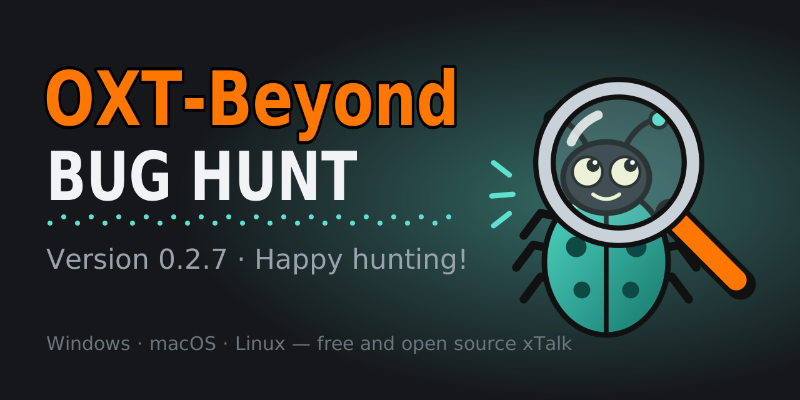

# OXT-Beyond



[](https://github.com/SethMorrowSoftware/OpenXTalk-Beyond/actions/workflows/build-windows.yml)
[](https://github.com/SethMorrowSoftware/OpenXTalk-Beyond/actions/workflows/build-macos.yml)
[](https://github.com/SethMorrowSoftware/OpenXTalk-Beyond/actions/workflows/build-linux.yml)

OXT-Beyond is a free, open source development environment for Windows,
macOS and Linux in which you build programs with an English-like
scripting language in the HyperCard/HyperTalk tradition ("xTalk"). You
lay out stacks of cards with buttons, fields and other controls, and
write scripts that respond to what the user does.

OXT-Beyond continues **OpenXTalk Lite**. OpenXTalk Lite was (to my understanding) initiated by
**Terry Little** (TerryL) in September 2023 as a debranded LiveCode
Community 9.6.3, and was built and maintained by **Tom Perry**
(tperry2x) from version 0.91 (September 2023) to version 1.15 (June
2026), for macOS, Linux and Windows, with contributions from **Paul
McClernan** (OpenXTalkPaul) and other members of the
[OpenXTalk community](https://www.openxtalk.org). In August and
September 2026 Tom said that 1.15 is probably as far as he will take OpenXTalk
Lite on the LiveCode 9 engine, that his new OXTL7 (built on a LiveCode 7
engine) is meant to replace it, and that anyone may carry 1.15 on as
their own fork. OXT-Beyond is one such continuation, on the 9.x engine.
[HISTORY.md](HISTORY.md) tells the story
up to OXT-Beyond 0.0.1, version by version; the notes of each release
since are on the
[Releases page](https://github.com/SethMorrowSoftware/OpenXTalk-Beyond/releases),
and [CHANGELOG.md](CHANGELOG.md) lists every change made since Tom
Perry's last commit, release by release.

Like OpenXTalk Lite, OXT-Beyond is based on **LiveCode Community**, the
GPLv3 edition of LiveCode by LiveCode Ltd and its contributors. The
upstream LiveCode Community repositories have had no changes since July
2021 and are now archived (read-only).

This repository, **OpenXTalk-Beyond**, holds all of it: the engine source (LiveCode Community 9.7 plus
Tom Perry's 9.7.1-OXT engine work), the OpenXTalk Lite 1.15 IDE with
its history, and the scripts that build, package and test OXT-Beyond
for Windows, macOS and Linux. It is maintained by
[SethMorrowSoftware](https://github.com/SethMorrowSoftware). GitHub
forwards the old name's addresses, so existing clones and links keep
working; `git remote set-url origin
https://github.com/SethMorrowSoftware/OpenXTalk-Beyond.git` points a
clone at the new one.

## Status

OXT-Beyond 0.2.6 "Frankenstein" is an early release of a young project,
for Windows, macOS and Linux (see what 0.2.1 adds, what 0.2.2 fixes,
what 0.2.3 adds, what 0.2.4 changes, what 0.2.5 adds and what 0.2.6
adds, under [The IDE](#the-ide)). Please read this before you download
it. 0.2.6 adds the xTalk MCP Bridge, which lets Claude, signed in with
your own Claude plan in the Claude desktop app or Claude Code, build
stacks in the IDE and stays off until you turn it on (see
[0.2.6-rc.1](#026-rc1-the-xtalk-mcp-bridge),
[0.2.6-rc.2](#026-rc2-the-bridge-asks-before-every-run) and
[0.2.6-rc.3](#026-rc3-setting-up-the-claude-desktop-app)), fixes
HyperCard import and the installer's file dates on Windows, brings the
xTalk Assistant and the bridge to other xTalks' IDEs (see
[0.2.6-rc.4](#026-rc4-hypercard-import-a-quick-start-on-windows-and-plugins)),
and makes HTML5 standalones work (see
[0.2.6-rc.5](#026-rc5-web-standalones) and
[0.2.6-rc.6](#026-rc6-the-web-panes-page-settings)). Two of those
changes can be seen by a script: on Linux a period typed while a
handler runs no longer stops it (Control-period does, as on Windows),
and `do ... in widget` and the other widget commands that crashed the
engine for a widget whose extension is not loaded now do nothing.
0.2.7-rc.1 is a test release (a pre-release) of a new font for HTML5
standalones, with a bold face, of their tests in Firefox and WebKit as
well as Chromium, of the Linux clipboard fix withdrawn with the first
0.2.6-rc.4, and of xTalk Suite extensions that load on older Linux and
macOS (see
[0.2.7-rc.1](#027-rc1-a-new-web-font-and-firefox-and-safari)), and
0.2.7-rc.2 adds a File menu item for importing HyperCard stacks and
de-branded macOS app settings (see
[0.2.7-rc.2](#027-rc2-importing-hypercard-stacks)), and 0.2.7-rc.3
adds the Stack Player, a web page that opens any stack, the IDE itself
in a web page, Learn, one window for the lessons, guides and examples,
and a HyperCard import that brings in pictures, palettes, colour and
sound and reads Mac disk images (see
[0.2.7-rc.3](#027-rc3-stacks-and-the-ide-on-the-web-learn-and-more-of-hypercard)),
and 0.2.7-rc.4 connects the web IDE to Claude through the xTalk MCP
Bridge, closes a web menu when the page around it is clicked, brings
over OXT DPE's Extension Manager, lets a stack in the Stack Player find
its files through `specialFolderPath("resources")` and polishes the
stacks new in 0.2.7 (see
[0.2.7-rc.4](#027-rc4-claude-in-the-web-ide-the-extension-manager-and-polish)),
and 0.2.7-rc.5 makes the scripts of
imported HyperCard stacks compile, and adds xTalk Chat, three xTalk
Suite apps in Learn and a new About window, and fixes the
Standalone Settings' Web card on macOS 26 (see
[0.2.7-rc.5](#027-rc5-hypercard-scripts-that-compile-xtalk-chat-and-the-xtalk-suites-apps)),
and 0.2.7-rc.6 "Bug Hunt", the candidate frozen for play testing, adds
the xTalk Academy, a course in programming for beginners, Home and a
Release Notes window on the desktop, a modern Tools palette and the
IDE's questions in Learn's look, and makes File > Import Stack work in
the IDE again and imported HyperCard stacks open on the web (see
[0.2.7-rc.6](#027-rc6-bug-hunt-the-xtalk-academy-and-the-ide-in-learns-look)),
and 0.2.7-rc.6.1 fixes what its play testers reported: Linux at HiDPI
and its audio clips, Safari reloading the web IDE, the Mac menu bar and
external editor, and the modern Tools palette's labels, and moves the
macOS user folder to `~/Documents/OXT-Beyond` (see
[0.2.7-rc.6.1](#027-rc61-the-bug-hunts-fixes)), and 0.2.7-rc.6.2 fixes
the Mac IDE's start-up stall, Linux's browser widget, the modern Tools
palette and many more imported HyperCard scripts, brings the xTalk
Suite and a downloadable zip to the web IDE, and lets the xTalk
Assistant use a local model (see
[0.2.7-rc.6.2](#027-rc62-the-bug-hunt-round-two)), and 0.2.7-rc.6.3
brings in imported HyperCard stacks' MACE sounds, HyperCard's message
order for them and many more of their scripts, keeps two web tabs from
deleting each other's files, fixes the dark appearance's rows and
switching, and gives the xTalk Assistant many more services (see
[0.2.7-rc.6.3](#027-rc63-the-bug-hunt-round-three)), and 0.2.7-rc.6.4
fixes what the Bug Hunt's testers reported on rc.6.3: the Tools
palette's icons, the Inspector and the Message Box in the dark, the Menu
Builder, Linux's menu ticks and players, the Mac's field frames, tabs
and sliders, the Mac menu bar made a window, the Geometry Manager and
vertical sliders on the web, and the time zone library on 32-bit Linux,
and brings back mergJSON and some of HyperXTalk's syntax (see
[0.2.7-rc.6.4](#027-rc64-the-bug-hunt-round-four)), and 0.2.7-rc.6.5
fixes what they reported on rc.6.4: a Mac IDE that seemed to freeze
after a click on its backdrop, the paint tools' names in the Tools
palette and the IDE's messages that called it LiveCode, ends a crash on
a file that is not a stack and one on invisible direction marks in a
field, shows a card's border as soon as a script changes it, keeps the
Windows icons out of the Linux and Mac packages, draws the palette's
controls and tools, gives the toolbar a modern look, and brings the dark
appearance to Home, Learn, the xTalk Academy, About, xTalk Chat, the
xTalk Assistant and the Dictionary (see
[0.2.7-rc.6.5](#027-rc65-the-bug-hunt-round-five)), and 0.2.7-rc.6.6
fixes what they reported on rc.6.5: crashes printing PDFs with links,
typing after Close and Remove From Memory and showing 0 cards, pieces of
lines left along a scrolled field, the Inspector's image ID, Gravity and
Scrollbar width, the Tools palette's settings, the Dictionary's filters,
the Message Box's Pending Messages and the IDE's own file dialog, brings
the dark appearance to Release Notes, the Extension Manager, the script
error window and the remastered examples, gives imported HyperCard
stacks HyperCard's text properties, text styles, round, characters and
card ids, and their controls their own Inspector and right-click menu,
imports HyperCard stacks from disk images again, and lets scripts write
literal arrays, as in LiveCode 10 (see
[0.2.7-rc.6.6](#027-rc66-the-bug-hunt-round-six)), and 0.2.7-rc.6.7
lays out right-to-left and mixed text in the order ICU gives, ends a
crash on the next background of a card with none, keeps the web IDE in
the browser between visits, draws the modern Tools palette's buttons as
buttons, and runs many more of imported HyperCard stacks' scripts (see
[0.2.7-rc.6.7](#027-rc67-the-bug-hunt-round-seven)), and 0.2.7-rc.6.8
lets the Script Editor follow the dark appearance, makes the Project
Browser's script counts and the Tools palette's icons easier to read,
runs the xTalk Suite's libraries in web standalones and the Stack
Player, and stops more imported HyperCard stacks from hanging (see
[0.2.7-rc.6.8](#027-rc68-the-bug-hunt-round-eight)), and 0.2.7-rc.6.9
shows the docs of externals you add in the Dictionary, lets a web
standalone follow the browser's dark mode, and keeps web standalones
that use none of the xTalk Suite's libraries as small as before (see
[0.2.7-rc.6.9](#027-rc69-the-bug-hunt-round-nine)), and 0.2.7-rc.6.10
follows every switch between light and dark on the Mac, lets the web
IDE follow the browser's dark mode, and fixes a hilite on Linux, the
Dictionary's links and the Inspector's colours (see
[0.2.7-rc.6.10](#027-rc610-the-bug-hunt-round-ten)), and 0.2.7-rc.6.11
lets the Mac's colours and the IDE's widgets follow light and dark,
ends a crash in the Script Editor's Breakpoints pane, makes saves
safer, and fixes rolling back PostgreSQL and MySQL's encrypted
connections (see
[0.2.7-rc.6.11](#027-rc611-the-bug-hunt-round-eleven)), and
0.2.7-rc.6.12 calls the engine BeyondEngine, brings the welcome, the
Academy and Learn into one Home window, opens more HyperCard stacks,
imports SVGs with their colours and clip paths and turns them into
graphics, and pastes Copy Graphics as SVG Paths into Illustrator as
curves (see
[0.2.7-rc.6.12](#027-rc612-the-bug-hunt-round-twelve));
0.2.6 stays the main download until it has held up.

- **Windows, macOS and Linux.** From 0.1.0 on, every release has
  packages for 64-bit Windows, for macOS (one universal app for Apple
  Silicon and Intel Macs, see [macOS](#macos)) and for 64-bit x86 Linux
  (see [Linux](#linux-x86-64)), made and tested together from one tag
  (0.0.1 and 0.0.2 were for Windows only). From 0.2.4-rc.2 on there is
  a package for 64-bit ARM Linux too (a Raspberry Pi 3, 4 or 5 on a
  64-bit system; see [Linux (64-bit ARM)](#linux-64-bit-arm)), without
  the browser widget. 32-bit Windows and Linux are built in CI but not
  packaged, for their standalone runtimes.
- **The Android runtime is still a prebuilt one.** Each package's
  engine, externals and tools are built from this repository (Windows
  x86-64, macOS for Apple Silicon and Intel, Linux x86-64), and so are
  the standalone runtimes that every package carries for Windows
  (x86-64 and x86) and Linux (x86-64 and x86): CI builds the 32-bit
  engines for them, and a release asset (`oxt-runtimes-0.2.7-rc.6.12b.zip`)
  brings each platform's runtimes into the other packages. The web
  engine of HTML5 standalones, which every package carries, is built
  from this repository too (see [The engine](#the-engine)). The Android
  runtime, though, is still OpenXTalk Lite 1.15's (stock LiveCode 9.6.3
  builds as Tom Perry shipped them), carried over unchanged in that
  asset. Only the macOS package has the macOS runtimes, OXT-Beyond does
  not support iOS and has no iOS build or runtimes (so the Standalone
  Settings have no iOS card, and a stack set to build for iOS in
  LiveCode builds for its other platforms), and
  32-bit Linux standalones have no browser (CEF's 32-bit
  Linux builds ended with CEF 101). A Linux standalone uses the system's
  libraries, as LiveCode's do (OpenXTalk Lite 1.15's Linux runtimes came
  with copies of some). The automatic tests build a standalone from every
  runtime a package carries, Android aside, and run those the test
  machine can run.
- **Some old third-party libraries.** OpenSSL (3.5.9, a long-term
  support release), curl (8.22.0) and ICU (78.3) are current, built from
  source for every platform, and so are the image and pattern libraries
  the engine compiles in (zlib 1.3.2, libpng 1.6.59, giflib 5.2.2,
  libjpeg 9f, and PCRE 8.45, the last release of PCRE 1), and revXML's
  libxml2 2.15.4 and libxslt 1.1.45, and revZip's libzip 1.12. The browser
  widget and revBrowser still use
  CEF 74 (Chromium 74, from 2019), and several libraries in
  `thirdparty/` (cairo and the database client
  libraries among them) are years old; they
  have known vulnerabilities, and upgrading them is planned. See
  [SECURITY.md](SECURITY.md).
- **Not code-signed or notarized.** On Windows, SmartScreen may warn
  about the installer and the program. The macOS app is signed ad hoc,
  not with an Apple Developer ID, and not notarized, so macOS blocks it
  until you allow it once (see [macOS](#macos)). Check downloads against
  `SHA256SUMS`.
- **The installer is new.** The Inno Setup installer first ships with
  0.0.1. CI installs and uninstalls it on every build, but it has had
  little use on real computers yet.
- **Branding is not finished.** The text parts of the IDE (window title,
  About text, menus and dialogs built by scripts) say OXT-Beyond, but
  some windows, dialogs and guides stored in binary stacks still say
  "OpenXTalk Lite"; they will be changed in a later release. The files in
  the build output folder are still named after LiveCode
  (`LiveCode-Community.exe`); packages and the installer rename the
  development engine to `OXT-Beyond.exe`.
- **Some OpenXTalk Lite files are not included.** OpenXTalk Lite shipped
  the mergExt externals (`Ext/`: blur, mergJSON, mergMarkdown,
  mergMicrophone), Apple's Human Interface Guidelines PDF and
  `animationEngine6.zip`. OXT-Beyond does not redistribute them; see
  [THIRD-PARTY-NOTICES.md](THIRD-PARTY-NOTICES.md#files-openxtalk-lite-shipped-that-oxt-beyond-does-not).
  It builds mergJSON from its source instead, so `JSONToArray` and
  `ArrayToJSON` work as in LiveCode (see [mergjson/README.md](mergjson/README.md)).
- **Mostly separate settings.** OXT-Beyond keeps its preferences, caches
  and logs in its own folders (`%APPDATA%\OXT-Beyond`,
  `%LOCALAPPDATA%\OXT-Beyond`) and does not copy LiveCode's or OpenXTalk
  Lite's settings: the first start uses default preferences. A few
  things are still shared with OpenXTalk Lite or LiveCode: dictionary
  favourites and notes, custom script editor colours, recent-stack
  thumbnails and the engine's licence file (see
  [Where OXT-Beyond keeps your files](#where-oxt-beyond-keeps-your-files)).
- **Tested automatically, but only in part.** Every Windows CI build
  checks that the programs and libraries exist and are genuine x86-64 PE
  images with the expected versions, runs a headless smoke test of the
  engine in the portable zip and in an installed copy (the script engine,
  Unicode, OpenSSL, SQLite 3.51.1 through revDB, revXML and revZip), compiles
  every script of the IDE and compares the errors with a list of known
  ones, builds a standalone from each runtime in the portable zip and
  runs the Windows ones, and installs and uninstalls the installer (see
  [BUILDING.md](BUILDING.md#7-run-check-and-package-the-result)). The
  macOS and Linux packages get the same smoke test (with every bundled
  xTalk Suite extension), IDE compile check and standalone check on
  their own systems, from the disk image on an Apple Silicon and an
  Intel Mac and from the extracted tarball on Ubuntu 24.04, plus a
  signature check (macOS), and library checks and the install scripts
  (Linux). The 32-bit Windows and Linux builds, made for their
  standalone runtimes, get the smoke test, the engine tests and the
  standalone check too. Every build on all three platforms also runs the
  engine tests that LiveCode Community keeps in `tests/` (about 1,150:
  LiveCode Script, LiveCode Builder, the LiveCode Builder compiler and
  the script parser)
  and compares the failures with a list of known ones (see
  [BUILDING.md](BUILDING.md#engine-tests)). CI also checks that the
  patches of the IDE's binary stacks are applied (see
  [Continuous integration](BUILDING.md#9-continuous-integration)). Every
  build also opens the IDE's own windows one by one, with the system
  light and dark, and
  takes screenshots of them; a step that fails, or a script error, fails
  the build (see [IDE screenshots](BUILDING.md#ide-screenshots)). The
  newest of each platform from `main` are on the
  [`ide-screenshots`](https://github.com/SethMorrowSoftware/OpenXTalk-Beyond/tree/ide-screenshots)
  branch. The Linux package has been tried by hand on Kubuntu 24.04, and
  the macOS package not yet.
- **Mac and Linux parts of the IDE.** Tom Perry's IDE also contains
  parts for macOS and Linux only. They are shipped as they were; apart
  from the IDE compile check they are not tested automatically.
- **Legacy build toolchain.** Building on Windows needs the Visual
  Studio 2017 C++ toolset (v141, installed through Visual Studio 2022),
  Python 2.7 and Cygwin; the Linux build runs in an Ubuntu 20.04
  container and the macOS build uses Xcode 16.4, both with Python 2.7.
  See [BUILDING.md](BUILDING.md).

## Download

Releases are published on the
[Releases page](https://github.com/SethMorrowSoftware/OpenXTalk-Beyond/releases).
From 0.1.0 on, each release has these files for all three platforms
(0.0.1 and 0.0.2 have the Windows files only); `<version>` is the
version, for example `0.1.0`:

| Platform | File | What it is |
| --- | --- | --- |
| Windows 10 or later, 64-bit (x64) | `OXT-Beyond-<version>-win-x86_64-setup.exe` | The installer. Use this unless you have a reason not to. |
| | `OXT-Beyond-<version>-win-x86_64-portable.zip` | The same program folder without an installer. |
| | `OXT-Beyond-<version>-win-x86_64-binaries.zip` | Only the built engine, externals and tools (`win-x86_64-bin`, without debug symbols) and the licence files, for use with a source checkout. |
| | `OXT-Beyond-<version>-win-x86_64-symbols.zip` | Debug symbols (`.pdb`), for developers. |
| macOS 11 or later on Apple Silicon, 10.13 or later on Intel | `OXT-Beyond-<version>-mac-universal.dmg` | A disk image with `OXT-Beyond.app`, one app for Apple Silicon and Intel Macs, to drag to Applications (see [macOS](#macos)). |
| | `OXT-Beyond-<version>-mac-universal.zip` | The same app, for scripted installs. |
| | `OXT-Beyond-<version>-mac-universal-binaries.tar.xz` | Only the built engine, externals and tools (`Release/`, both architectures joined), without debug symbols and the build's own tools, and the licence files. |
| | `OXT-Beyond-<version>-mac-universal-symbols.zip` | Debug symbols (`.dSYM`), for developers. |
| Linux x86-64 with glibc 2.31 or later | `OXT-Beyond-<version>-linux-x86_64.tar.xz` | The program folder, with a launcher and `install.sh` for a per-user install (see [Linux](#linux-x86-64)). |
| | `OXT-Beyond-<version>-linux-x86_64-binaries.tar.xz` | Only the built engine, externals and tools (`linux-x86_64-bin`), without debug symbols and the build's own tools, and the licence files. |
| | `OXT-Beyond-<version>-linux-x86_64-symbols.tar.xz` | Debug symbols (`.dbg`), for developers. |
| 64-bit ARM Linux with glibc 2.31 or later (from 0.2.4-rc.2) | `OXT-Beyond-<version>-linux-arm64.tar.xz` | The same program folder for 64-bit ARM, such as a Raspberry Pi 3, 4 or 5 on a 64-bit system, without the browser widget (see [Linux (64-bit ARM)](#linux-64-bit-arm)). |
| | `OXT-Beyond-<version>-linux-arm64-binaries.tar.xz` | Only the built engine, externals and tools (`linux-arm64-bin`), as for x86-64. |
| | `OXT-Beyond-<version>-linux-arm64-symbols.tar.xz` | Debug symbols (`.dbg`), for developers. |
| Other xTalks' IDEs (LiveCode Community 9, HyperXTalk, OpenXTalk) | `OXT-Beyond-<version>-xtalk-assistant-plugin.lce`, `OXT-Beyond-<version>-mcp-bridge-plugin.lce` | The xTalk Assistant and the xTalk MCP Bridge as extension packages, to install with that IDE's Extension Manager (see [tools/plugins](tools/plugins/README.md)). OXT-Beyond has both built in. Experimental. |
| All | `OXT-Beyond-<version>-xtalk-sources.zip` | Every file of the bundled xTalk Suite extensions as the release took it from their repositories, so that it can be rebuilt without them. |
| All | `SHA256SUMS` | SHA-256 checksums of all the files above. |

The bundled xTalk Suite extensions need macOS 10.15 Catalina on an
Intel Mac, where the IDE runs from 10.13, and on 64-bit Linux and Apple
Silicon nothing newer than the IDE (from 0.2.7-rc.1; up to 0.2.6 they
needed macOS 15, and on Linux glibc 2.33 for SodiumXT or glibc 2.38 and
OpenSSL 3 for DataChannelXT); see [macOS](#macos) and
[Linux](#linux-x86-64). The release notes list each platform's
requirements too.

Releases whose tags do not start with `v`, such as `prebuilts-v1`,
`runtimes-1.15`, `runtimes-0.2.5-rc.2`, `runtimes-0.2.7-rc.6.12` and
`runtimes-0.2.7-rc.6.12b`, are not programs. They hold
files that the build and the packager download: the prebuilt
third-party libraries of earlier versions and the standalone runtimes
for other platforms.

**Latest development build.** Every successful run of a build workflow
uploads the same files as an artifact: open the workflow, pick a
successful run and download the artifact under *Artifacts*.

| Platform | Workflow | Artifact |
| --- | --- | --- |
| Windows | [Build (Windows)](https://github.com/SethMorrowSoftware/OpenXTalk-Beyond/actions/workflows/build-windows.yml) | `OXT-Beyond-win-x86_64`, and the installer alone as `OXT-Beyond-<ver>-win-x86_64-setup.exe` (kept for 14 days) |
| macOS | [Build (macOS)](https://github.com/SethMorrowSoftware/OpenXTalk-Beyond/actions/workflows/build-macos.yml) | `OXT-Beyond-mac-universal` |
| Linux | [Build (Linux)](https://github.com/SethMorrowSoftware/OpenXTalk-Beyond/actions/workflows/build-linux.yml) | `OXT-Beyond-linux-x86_64`, `OXT-Beyond-linux-arm64` |

You need to be signed in to GitHub to download artifacts, and they are
deleted after 30 days. These builds pass the automatic checks, but
nobody has tried them by hand. They have no xTalk sources zip, and
their build number is the time they were built.

## Quick start

On Windows, use the installer or the portable zip (below). For macOS and
Linux, see [macOS](#macos) and [Linux](#linux-x86-64).

To check a download, compare its SHA-256 with the line for it in
`SHA256SUMS`. On Windows, in Command Prompt, for example:

```bat
certutil -hashfile OXT-Beyond-<version>-win-x86_64-setup.exe SHA256
```

On macOS, in Terminal, compare the output of

```sh
shasum -a 256 OXT-Beyond-<version>-mac-universal.dmg
```

with its line. On Linux, in the folder with the download and
`SHA256SUMS`, this checks every file of the list that is there:

```sh
sha256sum -c SHA256SUMS --ignore-missing
```

### With the installer

1. Run `OXT-Beyond-<version>-win-x86_64-setup.exe`.
2. Choose whether to install for all users (into `C:\Program Files\OXT-Beyond`;
   this needs administrator rights) or only for you (into
   `%LOCALAPPDATA%\Programs\OXT-Beyond`; no administrator rights needed).
3. Accept the licence (the GNU GPL version 3) and pick the options: a
   desktop shortcut, and whether `.oxtstack` and `.oxtscript` files should
   open with OXT-Beyond. OXT-Beyond does not take over `.livecode`,
   `.rev` or `.livecodescript` files: the installer does not associate
   them, and the IDE does not offer to (OpenXTalk Lite's "File
   Associations" dialog is not shown on Windows).
4. Start OXT-Beyond from the Start menu.

To remove it, use *Settings > Apps* or "Uninstall OXT-Beyond" in the
Start menu. The uninstaller removes the program but keeps your
preferences. Installing a newer version over an older one replaces it.

The installer is made with Inno Setup and accepts its usual
[command-line options](https://jrsoftware.org/ishelp/index.php?topic=setupcmdline),
for example `/CURRENTUSER /VERYSILENT` for a silent install for the
current user.

### Portable

1. Extract `OXT-Beyond-<version>-win-x86_64-portable.zip` somewhere you
   can write to, such as your Documents folder (not `C:\Program Files`):
   the dictionary writes its index files into the program folder. You
   get one folder, `OXT-Beyond-<version>`.
2. Run `OXT-Beyond.exe` inside that folder.

Keep the folders inside `OXT-Beyond-<version>` together; the program
finds the IDE, externals and runtimes by their places next to
`OXT-Beyond.exe`. The portable copy does not associate any file types
with itself; open stacks from the IDE, or with *Open with* in
Explorer.

### macOS

OXT-Beyond for macOS is one universal app, `OXT-Beyond.app`, for Apple
Silicon and Intel Macs, in `OXT-Beyond-<version>-mac-universal.dmg` (a
disk image) and `OXT-Beyond-<version>-mac-universal.zip` (the same app,
for scripted installs). Releases carry them from 0.1.0 on (see
[Download](#download)); the latest development build is the artifact
`OXT-Beyond-mac-universal` of a successful run of the
[Build (macOS) workflow](https://github.com/SethMorrowSoftware/OpenXTalk-Beyond/actions/workflows/build-macos.yml).

**Requirements.** The IDE runs on macOS 10.13 High Sierra or later on an
Intel Mac and macOS 11 Big Sur or later on Apple Silicon. The bundled
xTalk Suite extensions (SodiumXT, TorrentXT, enetxt, DataChannelXT,
Box2Dxt and CoinXT) have native libraries built for macOS 10.15 Catalina
on Intel and macOS 11 on Apple Silicon (from 0.2.7-rc.1; up to 0.2.6
they needed macOS 15 Sequoia): on an Intel Mac with macOS 10.13 or
10.14 the IDE starts, but those extensions do not load. No Mac older
than macOS 15 has loaded them yet.

**Install.**

1. Check the download if you like: in Terminal, compare the output of
   `shasum -a 256 OXT-Beyond-<version>-mac-universal.dmg` with the line
   for that file in `SHA256SUMS`.
2. Open `OXT-Beyond-<version>-mac-universal.dmg` and drag
   **OXT-Beyond** onto the **Applications** folder next to it. Eject the
   disk image. (From the zip: double-click it, or run
   `ditto -x -k OXT-Beyond-<version>-mac-universal.zip /Applications`.)
3. Start OXT-Beyond from Applications. The first time, macOS blocks it.

**Opening it for the first time (Gatekeeper).** OXT-Beyond is signed
*ad hoc*: it is not signed with an Apple Developer ID and not notarized
by Apple, so macOS will not open a downloaded copy until you allow it.
You do this once. On macOS 15 Sequoia and later:

1. Double-click OXT-Beyond. macOS says that it was not opened, because
   Apple could not verify it is free of malware. Click **Done** (not
   *Move to Trash*).
2. Open **System Settings > Privacy & Security** and scroll down to
   *Security*. Next to "OXT-Beyond was blocked to protect your Mac",
   click **Open Anyway**.
3. Confirm with **Open Anyway** and your password (or Touch ID).

macOS 15 no longer offers *Open* when you Control-click the app, so use
these steps (on macOS 13 and 14, Control-click the app in Finder, choose
*Open* and then *Open* again; on macOS 12 and earlier, the button is in
*System Preferences > Security & Privacy > General*). Or, in Terminal,
remove the quarantine flag that the browser set on the download:

```sh
xattr -dr com.apple.quarantine /Applications/OXT-Beyond.app
```

The same command helps if macOS says the app "is damaged and can't be
opened": that is how some macOS versions report an app that is not
notarized. After this, OXT-Beyond opens like any other app. It opens
`.oxtstack` and `.oxtscript` files; LiveCode's `.livecode`, `.rev` and
`.livecodescript` files it opens too, but it does not take them over from
an installed LiveCode.

To remove OXT-Beyond, move `OXT-Beyond.app` to the Trash.

**Limitations on macOS** (besides those
[for every platform](#known-limitations-and-plans)):

- The app is ad hoc signed and not notarized, hence the steps above.
  Developer ID signing and notarization are planned.
- The IDE still writes a few files into its own program folder (the
  dictionary's index files), which on macOS is inside `OXT-Beyond.app`,
  after the app was signed. Moving them to your user folders is planned.
- Mac standalones: the standalone builder's Intel target builds x86_64
  apps; its Apple Silicon target (*MacOS-IntelArmUniversal* in the
  standalone settings) builds arm64-only apps and needs macOS 14 Sonoma
  or later on the Mac that builds them. Universal standalones are
  planned. Standalones run on macOS 10.13 or later (Intel) and 11 or
  later (Apple Silicon); one that includes an xTalk Suite extension needs
  macOS 10.15 on Intel (macOS 15 up to 0.2.6).
- The macOS package does not include the Visual C++ runtime DLLs that
  the Windows packages put next to enetxt and Box2Dxt: a Windows
  standalone built on a Mac with either of them needs the Visual C++
  Redistributable on the PC it runs on. It has no Windows x86-64
  standalone runtime either.
- The macOS packages are built and tested automatically (on macOS 15, on
  both an Apple Silicon and an Intel runner) but have not been tried by
  hand yet.

### Linux (x86-64)

The Linux package is `OXT-Beyond-<version>-linux-x86_64.tar.xz`.
Releases carry it from 0.1.0 on (see [Download](#download)). It is also
built and tested by every run of the
[Build (Linux) workflow](https://github.com/SethMorrowSoftware/OpenXTalk-Beyond/actions/workflows/build-linux.yml)
(artifact `OXT-Beyond-linux-x86_64`, with the binaries and symbols
tarballs and `SHA256SUMS`). Check it with
`sha256sum -c SHA256SUMS --ignore-missing`.

What it needs:

- **64-bit x86 Linux with glibc 2.31 or newer** (Ubuntu 20.04, Debian 11,
  Fedora 32 or later) and an X11 desktop; on Wayland it runs through
  XWayland, which the usual desktops start by themselves. The IDE uses
  GTK 2, as LiveCode and OpenXTalk Lite did: on Debian and Ubuntu
  `sudo apt install libgtk2.0-0` (`libgtk2.0-0t64` on Ubuntu 24.04 and
  Debian 13), on Fedora `sudo dnf install gtk2`. The launcher checks for
  every library the engine needs and names the missing ones with their
  packages, instead of the engine ending without a word.
- **HiDPI screens** (0.2.7-rc.6.1): on a desktop scaled to 200% or
  more, the IDE and every stack are drawn at the desktop's scale, as on
  Windows and macOS, instead of at half the size of everything else.
  The scale is the one GTK 3 programs use: `GDK_SCALE` when it is set,
  else the desktop's own setting (the `Gdk/WindowScalingFactor` that
  GNOME, Cinnamon, MATE, Xfce and KDE publish), else, on a desktop
  without a settings daemon, an `Xft.dpi` of about 192 or more. Only
  whole scales are used, as GTK 3 does, so a desktop at 150% is drawn
  at 1. Stacks keep their sizes in points, as on a Retina Mac: on a
  2560 x 1600 screen at 200%, the `screenRect` is 0,0,1280,800 and the
  `screenPixelScale` 2. `GDK_SCALE=1 ./oxt-beyond` turns the scaling
  off, and so does `set the usePixelScaling to false` in a script. On
  a desktop that is not scaled nothing changes: `usePixelScaling` stays
  false and cannot be set, as before. After 0.2.7-rc.6.1, cursors made
  from images (the IDE's pointing hand and grab hand) are drawn at the
  desktop's size too, and the browser widget draws its page at the
  desktop's scale.
- **The browser widget and revBrowser** (CEF 74) also need NSS, ALSA and a
  few more X11 libraries (the `browser` lines of `linux/libraries.txt` in
  the package). Without them the launcher turns the browser off
  (`LIVECODE_USE_CEF=0`), says which ones are missing, and the IDE shows
  the dictionary and other web pages in your web browser instead, and
  leaves the browser widget out of the Tools palette.
- **The bundled xTalk extensions need nothing newer than the IDE**
  (from 0.2.7-rc.1): their 64-bit libraries need glibc 2.28 at most and
  carry their own OpenSSL. Up to 0.2.6, SodiumXT needed glibc 2.33 and
  DataChannelXT glibc 2.38 and OpenSSL 3. The 32-bit libraries that x86
  standalones get still need glibc 2.33 (SodiumXT), 2.34 (Box2Dxt), or
  2.38 and OpenSSL 3 (TorrentXT and DataChannelXT).
- **The player** runs `/usr/bin/mplayer`: on Debian and Ubuntu
  `sudo apt install mplayer`. Without it, players open no file, and the
  Tools palette has no Player tool. mplayer draws only the video: the
  controller below it (`showController`) is drawn by OXT-Beyond, with a
  play/pause button and a well to seek in, but no volume, step or
  selection buttons as on Windows and macOS. A click in the well of an
  MP4 file goes to the key frame before that time, as mplayer seeks.

Either one can be turned on or off in Preferences > Compatibility ("Disable
the Browser widget", "Disable the Player tool"); the IDE sets them when it
first starts, from what it finds, and a change takes effect when it starts
again. The browser widget is in the Widgets section of the Tools palette,
which is hidden at first on every platform: the arrow at the palette's top
right shows it.

To run it where you extract it:

```sh
tar -xJf OXT-Beyond-<version>-linux-x86_64.tar.xz
cd OXT-Beyond-<version>
./oxt-beyond
```

Extract it onto a Linux file system (ext4, Btrfs, XFS and so on, not
FAT, exFAT or a Windows drive): the tarball holds Unix file modes,
symbolic links and hard links. Keep it out of folders named `_build` or
ending in `-bin`, which make the engine look for a source checkout above
it. `oxt-beyond` is the launcher; `OXT-Beyond` is the engine itself,
which starts without the library check. `OXT_BEYOND_SKIP_LIBRARY_CHECK=1`
skips the check.

To install it for yourself, with a menu entry (under Development),
icons, the `.oxtstack` and `.oxtscript` file types and the command
`oxt-beyond`:

```sh
./install.sh
```

It copies the folder to `~/.local/share/oxt-beyond` (or
`$XDG_DATA_HOME/oxt-beyond`), links `~/.local/bin/oxt-beyond` to the
launcher, and needs no administrator rights; it refuses to run as root
or with `sudo`. The extracted folder can be deleted afterwards. Running
a newer package's `install.sh` replaces the installed copy.
`~/.local/share/oxt-beyond/uninstall.sh` removes exactly what
`install.sh` added (it keeps a list in the installed folder). Like the
Windows installer, it leaves `.livecode`, `.livecodescript` and `.rev`
files alone, and OpenXTalk Lite's Linux "file associations" dialog is
not shown. Your preferences, caches and logs are in `~/.oxt-beyond`;
uninstalling keeps them.

The Linux package does not include the Visual C++ runtime DLLs that the
Windows packages put next to enetxt and Box2Dxt: a Windows standalone
built on Linux with either of them needs the Visual C++ Redistributable
on the PC it runs on.

### Linux (64-bit ARM)

From 0.2.4-rc.2 on, releases also carry
`OXT-Beyond-<version>-linux-arm64.tar.xz`, for 64-bit ARM Linux: a
Raspberry Pi 3, 4 or 5 running a 64-bit system (Raspberry Pi OS 64-bit,
Ubuntu) or an ARM server. It is experimental. It is the same program
folder as the x86-64 package, built natively on GitHub's ARM machines
and put through the same checks there (the IDE starts, a standalone is
built and run, the player plays, the bundled xTalk Suite extensions
load), and it is installed and run the same way (see
[Linux (x86-64)](#linux-x86-64)). It needs the same libraries, glibc
2.31 or later and a 64-bit system: a 32-bit Raspberry Pi OS cannot run
it.

What it does not have:

- **No browser widget and no revBrowser.** They use CEF 74, which has no
  Linux ARM build, so the package leaves them out, the IDE opens web
  pages in your web browser, and the Tools palette has no browser widget.
- **Standalones for 64-bit ARM Linux are built only by this package**,
  from its own runtime ("Linux arm64" in the standalone settings). The
  other packages carry no arm64 runtime, so they do not offer it.
- **No Raspberry Pi has run it in CI**: the checks run on GitHub's ARM
  servers, under a virtual screen.

### Where OXT-Beyond keeps your files

On Windows:

| What | Where |
| --- | --- |
| Preferences (`oxt-beyond7.rev`) | `%APPDATA%\OXT-Beyond\Preferences` |
| Cache, crash logs, documentation cache and IDE logs | `%LOCALAPPDATA%\OXT-Beyond\` (`Cache`, `Crash Logs`, `Documentation Cache`, `Logs`) |
| Script copies for an external script editor (if you turn that option on) | `%LOCALAPPDATA%\OXT-Beyond\Cache\IDEScriptEdits` |
| Your own extensions and plugins | `Documents\OXT-Beyond extensions`, unless you choose another folder in Preferences |

On macOS:

- Preferences: `~/Library/Preferences/OXT-Beyond`
- Cache, crash logs and documentation cache:
  `~/Library/Application Support/OXT-Beyond/` (`Cache`, `Crash Logs`,
  `Documentation Cache`); the script copies for an external script
  editor are in `Cache/IDEScriptEdits`
- IDE logs: `~/Library/Logs/OXT-Beyond/`
- Your own extensions, plugins and other additions: `~/Documents/OXT-Beyond`,
  unless you choose another folder in Preferences. Before 0.2.7-rc.6.1
  it was `~/Documents/OXT-Beyond extensions`: the IDE moves that folder
  on its first start, when nothing is at the new place yet, and leaves a
  link with the old name so that paths saved into it still work. A folder
  chosen in Preferences is not moved.

On Linux:

- Preferences, cache, crash logs, documentation cache and IDE logs:
  `~/.oxt-beyond/` (`preferences`, `cache`, `crashlogs`,
  `documentationcache`, `logs`); the script copies for an external
  script editor are in `cache/IDEScriptEdits`
- Your own extensions and plugins: `~/OXT-Beyond_extensions`, unless you
  choose another folder in Preferences

The xTalk Assistant keeps the notes you ask it to remember in
`xTalk Assistant Memory.txt`, in the preferences folder.

xTalk Chat (*Development > Plugins > xTalk Chat*) keeps your chat key
and the name you chose in `identity.txt`, in `.oxt-beyond/xtalk-chat`
in your home folder (on Windows your user folder), readable only by
you. The key is who you are in the chat: keep a copy (the chat's
settings can copy it) to be the same person on another computer.

Installed and portable copies of OXT-Beyond on the same computer share
these folders. LiveCode and OpenXTalk Lite keep their preferences
elsewhere (on Windows `%APPDATA%\RunRev` and `%APPDATA%\xtalk`), so
OXT-Beyond can be installed next to them.

Some files are still kept in the same places as OpenXTalk Lite or
LiveCode, because binary stacks or the engine, which this release does
not change, read or write them there. The table gives the Windows
locations; macOS and Linux use their own equivalents:

| What | Where | Shared with |
| --- | --- | --- |
| Dictionary favourites and notes | `%APPDATA%\xtalk\xTalkDictionary` | OpenXTalk Lite |
| Custom script editor colours | `%APPDATA%\xtalk\Preferences\customScriptColours.dat`, once you customize them | OpenXTalk Lite |
| Thumbnails of recent stacks | `Documents\OXTRecentStacks` | OpenXTalk Lite |
| The engine's Community licence file, written by the engine when it starts | `%APPDATA%\RunRev\Licenses\livecode-community-9_7_1-BeyondEngine-25923.lclk` (`...-9_7_1-OXT-25923.lclk` before 0.2.7-rc.6.12) | LiveCode's folder; OpenXTalk Lite 1.15 writes the `-OXT-` file, which OXT-Beyond used until 0.2.7-rc.6.12 |

A change made in one of these programs, such as a dictionary favourite,
shows up in the others. Moving them to OXT-Beyond's own folders is
planned (see [Known limitations and plans](#known-limitations-and-plans)).

### Updates

*Help > Check for Updates* asks GitHub for the latest OXT-Beyond release.
If it is newer than yours, OXT-Beyond shows an excerpt of its release
notes and a button that opens the release page in your browser; you
download and install the new version yourself. OXT-Beyond never
downloads or installs anything by itself and never asks for
administrator rights to update. An automatic check (at most once a day)
can be turned on in *Preferences > Automatic Updates*; it is off by
default. See [SECURITY.md](SECURITY.md#updates).

## What is in it

### The IDE

The IDE is OpenXTalk Lite 1.15's, with its history back to Terry Little's
first release (see [HISTORY.md](HISTORY.md)). Compared with the
LiveCode Community 9.6.3 IDE it started from, it has, among other
things:

- light and dark appearance (with the engine's Windows dark mode), dark
  icon sets for the tools palette, an orange accent colour, more script
  editor colour schemes and customisable script editor colours;
- a draggable menubar, a tools palette in sections (with more shapes,
  rebuilt paint tools and an optional eight-column layout) and many new
  keyboard shortcuts;
- `.oxtstack` and `.oxtscript` as the default file types (the
  `.livecode` and `.livecodescript` types still open);
- a stack-based dictionary with a plain-text export, favourites and
  notes, *Help > Dictionary Online*, the "All Guides" stack, Terry
  Little's User Guide and Data Grid Guide (PDF), lessons, examples and
  demo stacks (*Help > Demos*);
- the Quick Dictionary, Report Builder and App Browser plugins, Axwald's
  Message Watcher, a Card Navigator, *Edit > Replicate*, optional
  alignment guides while dragging objects, and tool snippets (sample
  scripts for new objects);
- preferences to switch off the data grid, the Player tool and the
  browser widget, a prompt to name new stacks, a gallery of recent
  stacks, lock/unlock of all objects and a "remove effects" command;
- the Calendar and Pie Chart widgets.

OXT-Beyond 0.0.1 adds:

- the OXT-Beyond name, About text and credits, splash screen and icon
  (adapted from Tom Perry's OpenXTalk Lite icon);
- its own preference, cache, log and extension folders (see above);
- an update check against this repository's GitHub Releases that only
  notifies (OpenXTalk Lite's own updater, which downloaded files from
  Tom Perry's servers and installed them with administrator rights, is
  no longer used);
- a Windows installer and a portable zip in the installed layout, with
  the standalone runtimes for other platforms.

OXT-Beyond 0.0.2 adds:

- the [xTalk Suite extensions](#xtalk-suite-extensions), built in and
  taken from their own repositories at pinned versions;
- a fix so that an extension you install yourself is loaded instead of
  a built-in copy of the same extension (which copy won used to be
  random);
- from Tom Perry's macOS work: guards against a crash when a menu sends
  a key press to a closed stack and against recursive menu bar updates,
  and "semibold" as a text style name (the same as "demibold");
- behind the scenes, the same engine building for Linux and macOS in
  CI, on the way to packages for those platforms.

OXT-Beyond 0.1.0 adds:

- packages for macOS and Linux, made and tested together with the
  Windows ones from one tag: one universal `OXT-Beyond.app` for Apple
  Silicon and Intel Macs (a disk image and a zip, signed ad hoc, see
  [macOS](#macos)) and a portable Linux x86-64 package with a launcher
  and a per-user install script (see [Linux](#linux-x86-64));
- readable text in the Windows dark mode: disabled labels (toolbar,
  buttons, checkboxes, radio buttons, tabs) are drawn once in a flat
  grey instead of an engraved double image, scrollbars are dark and
  follow a switch between light and dark, and the IDE's lists, Extension
  Manager, Tools palette and toolbar icons have dark colours, partly
  adapted from HyperXTalk (see [Credits](#credits));
- two light mode colours restored that OpenXTalk Lite 1.15 had changed
  by mistake (white text on selected list rows and on coloured badges);
- a fix for a crash of the Linux engine when it opens a stack whose
  text font is "(System)" without a display.

OXT-Beyond 0.2.0 adds:

- stacks that stay readable in the dark appearance: where a stack sets
  some colours but not others (a white field with no text colour, say, or
  a checkbox on a light card), the unset colours now fit the ones the
  author set, so a stack designed light looks as designed, and only a
  stack that sets no colours at all is drawn dark;
- the engine properties `appAppearance` (the application's appearance:
  "light", the default, "dark" or "system") and `stackAppearance` (one
  stack's), with their `effective` forms, in the dictionary. Standalones
  are light unless they set the `appAppearance`; standalones built with
  OpenXTalk Lite 1.14 or later or OXT-Beyond 0.1.0 followed the dark mode
  of Windows and macOS, and do so again after
  `set the appAppearance to "system"` (on macOS from 10.14 on);
- the Windows native controls drawn dark in the dark appearance
  (checkboxes, radio buttons, tabs, field and group frames, sliders,
  progress bars, option menus and combo boxes), dark title bars per
  window, and the light appearance whenever a High Contrast theme is on;
- the macOS native controls drawn dark in the dark appearance (push
  buttons, checkboxes, radio buttons, option menus, combo boxes, little
  arrows, tabs, field and group frames, scrollbars, sliders and progress
  bars), by the engine itself, since the classic macOS theme only draws
  them light (experimental);
- printing always in the light appearance, and a fix for a crash when a
  snapshot of the screen was taken on Windows;
- about 40 fixes from HyperXTalk (see
  [THIRD-PARTY-NOTICES.md](THIRD-PARTY-NOTICES.md#code-adapted-from-hyperxtalk)),
  among them painted images kept when the card changes, no crash exporting
  a widget, script editor hangs on "/*" and on binary data in a tree
  view, the macOS backdrop and custom cursors, Linux dialog leaks and
  typing lag, localized Desktop and Documents folders on Linux, File >
  Open with a missing folder, file dates after 2038, and `pop` with
  nothing pushed;

and in the IDE:

- a light IDE on every system, dark ones included, with the appearance
  as a choice: *View > Appearance* (and *Preferences > Appearance*) sets
  the IDE's appearance (**Light**, the default; **Dark**; **Follow the
  System**) and, separately, that of your own stacks (**Light, like a
  standalone**, the default; **Dark**; **Follow the System**; **Same as
  the IDE**). A change shows at once in every palette. The choices need
  the engine's new appearance properties. Dark mode is for Windows and
  macOS: on Linux the appearance follows the GTK theme, so there the items
  are shown but disabled;
- your stacks looking in the IDE as they will in a standalone. A
  standalone is light unless its stack asks for the system's appearance,
  with one line in its `startup` or `preOpenStack` handler:
  `set the appAppearance to "system"` (or `"dark"`);
- the menubar as a standard window on a new install (and in a profile
  that has no setting yet); a profile that already stores the docked
  menubar keeps it, and *Preferences > Appearance > Show the toolbar as a
  standard Window* switches it;
- a dark script editor (One Dark Pro by default, adapted from HyperXTalk,
  with Tom Perry's schemes still in the menu; the editor keeps separate
  light and dark colours in *Preferences > Script Editor*, the custom
  scheme's included, and a dark scheme and background chosen in an
  earlier version become the dark appearance's too, while the light
  appearance keeps them), and a
  readable Inspector, Message Box, error dialog, Find and Replace,
  Standalone Application Settings, Menu Builder and dictionary code
  examples in the dark appearance;
- light mode fixes for colours OpenXTalk Lite 1.15 saved into the
  Extension Manager, Extension Builder, Search, the icon chooser and the
  warning shown before opening a stack with scripts, and blue links in
  About, the User Guides and the dictionary instead of OpenXTalk Lite's
  yellow (a profile that still has the yellow default gets the blue one;
  a colour you chose yourself stays);
- *View > Show IDE Stacks In Lists* in one click (from HyperXTalk).

OXT-Beyond 0.2.1 "Frankenstein" (its release candidates were 0.2.1-rc.1
to 0.2.1-rc.7) adds:

- LiveCode Community's engine test suites, about 1,150 tests of LiveCode
  Script, LiveCode Builder, the LiveCode Builder compiler and the script
  parser, on every build of all three platforms, compared with lists of
  known failures (see [BUILDING.md](BUILDING.md#engine-tests));
- fixes for engine bugs that those tests and the compiler's warnings
  found. On Windows: creating a player in a stack that has no window (for
  example without a user interface, `-ui`) no longer crashes; output
  redirected to a file or a pipe (`standalone.exe > log.txt`, or `shell()`
  from another program) reaches it again; without a user interface,
  `accept connections` listens again and `wait` no longer keeps a
  processor busy; dates before 1970 convert; file paths that a script
  puts on the clipboard are native; the `playLoudness` of a player and
  the player properties that the Windows player cannot get (the duration
  and current time of a file it cannot play, for example) no longer
  return random values; the `fontNames` no longer fail for no reason;
  and without a user interface (`-ui`) the engine no longer reads past
  the end of its screen object for the theme font, which now and then
  crashed the 32-bit engine at startup, or for the device context it
  measures fonts and draws themed controls with (new in 0.2.1-rc.3);
- on Linux and macOS, `~` is `$HOME`, and on Linux `~user/folder`
  resolves; on Linux the last second of 1969 converts, and file lists on
  the clipboard and in drag and drop keep names with spaces and "+"; on
  macOS, Java support finds Java 9 and later, on Apple Silicon an
  Objective-C exception in a method that LiveCode Builder calls is an LCB
  error again instead of ending the program, and without a user interface
  (`-ui`) socket events are handled at once instead of at the next timer,
  so libURL's requests no longer take until their 60-second timeout
  (new in 0.2.1-rc.2); and on Linux the player plays files: it had sent
  its commands to mplayer without ending them, so mplayer ignored them,
  and a paused player no longer moves on a frame each time a script reads one
  of its properties, in the IDE and in the Linux standalones that every
  package builds (new in 0.2.1-rc.4);
- in the IDE on Linux, the Player tool and the browser widget are on where
  they can work (with mplayer, and with the libraries the browser needs),
  instead of off as OpenXTalk Lite left them, and the Player tool creates
  a player again (new in 0.2.1-rc.5);
- on Linux a player shows its controller (`showController`), with a
  play/pause button and a well to seek in: mplayer draws only the video,
  and OpenXTalk Lite's player had no controller at all; and the engine no
  longer hangs now and then when a movie ends, and a shell command's exit
  status is no longer lost while a player is open, in the IDE and in the
  Linux standalones that every package builds (new in 0.2.1-rc.6);
- on every platform: text compares by codepoint however the engine holds
  it (on Windows and macOS, `sort ... text` and `<` on text with chars
  such as the euro sign or curly quotes depended on how the string had
  been made); a pressed button's hilite follows the pointer again
  instead of flickering; exporting a widget whose kind is not loaded no
  longer crashes; LiveCode Builder's base conversion no longer crashes
  for a base below 2; and the `constraints` of a player (QTVR, which no
  current player supports) are zeros instead of random numbers;
- one change in behaviour: `baseConvert` (and LiveCode Builder's
  `converted from base`) of a number above 4,294,967,295 is an error
  instead of a wrong, wrapped-around result;
- the repository's new address,
  [github.com/SethMorrowSoftware/OpenXTalk-Beyond](https://github.com/SethMorrowSoftware/OpenXTalk-Beyond)
  (it was `winoxt`), in the update check, the About box and the
  installer (new in 0.2.1-rc.2). 0.2.0 and 0.2.1-rc.1 still find updates
  through GitHub's redirect from the old address;
- current versions of three libraries that had reached their end of
  life, built from source for every platform, Windows included (new in
  0.2.1-rc.3): OpenSSL 3.5.9 instead of 1.1.1 (secure sockets, `encrypt`
  and the database drivers' encryption), ICU 78.3 instead of 58.2
  (Unicode 17 instead of 9: text comparison, sorting, case and break
  rules) and, for the server engine, curl 8.22.0 instead of 7.51.0.
  `encrypt` and the `cipherNames` still offer the older ciphers (Blowfish,
  DES, RC4 and others), from OpenSSL's legacy provider. Secure
  connections now need TLS 1.2 or later, and keys of at least 2048 bits
  (RSA) in the certificates: OpenSSL 3's default security level refuses
  less, which also ends the old MySQL driver's encrypted connections
  (it speaks TLS 1.0 only). The macOS server engine follows HTTP
  redirects again (a version check skipped them with the system's
  curl 8);
- current versions of the image and pattern libraries that the engine
  compiles in (new in 0.2.1-rc.3): zlib 1.3.2 instead of 1.2.8, libpng
  1.6.59 instead of 1.6.26, giflib 5.2.2 instead of 5.1.4, libjpeg 9f
  instead of 9b and PCRE 8.45 (the last release of PCRE 1) instead of
  8.39, which fix their published vulnerabilities in reading
  compressed data, images and regular expressions;
- standalone runtimes built from this repository in every package (new
  in 0.2.1-rc.3), for Windows (x86-64 and x86) and Linux (x86-64 and
  x86), in place of OpenXTalk Lite 1.15's: the macOS and Linux packages
  can build Windows x86-64 standalones now, and Linux standalones built
  with the Windows and macOS packages get their externals and database
  drivers and a 64-bit `revsecurity` and `revpdfprinter` (1.15's 64-bit
  Linux runtime had no externals list and 32-bit copies of those two).
  Every package's tests build a standalone from each runtime it carries;
- a check of the browser widget, revBrowser and the player in a
  standalone on every build of all three platforms (new in 0.2.1-rc.4;
  see [BUILDING.md](BUILDING.md#browser-and-player-check));
- [CHANGELOG.md](CHANGELOG.md), which lists every change made since Tom
  Perry's last commit, release by release (new in 0.2.1-rc.4);
- the "Frankenstein" artwork of 0.2.1: a new OXT-Beyond icon (an orange
  "OXT" struck by lightning, over a stitched seam) for the app on Windows,
  macOS and Linux, the About box and the dialogs, and a friendly
  flat-topped monster on the splash screens and the Windows installer.
  The About box names the release "Frankenstein" (new in 0.2.1-rc.7).

OXT-Beyond 0.2.2 fixes a crash of 0.2.1: on macOS 14 and 15 the IDE quit
just after its splash screen, on Apple Silicon and Intel Macs alike.
macOS adds submenus of its own to the Edit menu (AutoFill, Writing
Tools), and the engine took them for its own menus. Every macOS build
now also starts the IDE and fails if it is not still running after 90
seconds (see [BUILDING.md](BUILDING.md)).

OXT-Beyond 0.2.3 adds dark mode on macOS (experimental). From macOS 10.14
on, stacks follow the `appAppearance` and `stackAppearance` as they do on
Windows, and the IDE's appearance choices (*View > Appearance* and
*Preferences > Appearance*) work on the Mac. The classic macOS theme only
draws its native controls light, so the engine draws the controls of a
dark stack itself, in macOS's dark colours with the Mac's accent colour.
The IDE and your stacks stay light unless you choose otherwise. 0.2.3
also fixes *Preferences > Appearance*, where the appearance menus and
their note covered the window's bottom row and part of the Reset button
([#51](https://github.com/SethMorrowSoftware/OpenXTalk-Beyond/issues/51)).

OXT-Beyond 0.2.4 is what its seven release candidates, 0.2.4-rc.1 to
0.2.4-rc.7, were; nothing in the program changed after 0.2.4-rc.7. What
each of them changed follows, in order.

OXT-Beyond 0.2.4-rc.1, a test release, fixes bugs reported on 0.2.3:

- macOS: a script that changes what is on screen at every statement (a
  stack that fills and clears dozens of fields while a card opens, for
  example) no longer freezes the IDE. Each such update used to wait for
  the Mac to draw, about 50 ms a time; the screen now catches up with the
  script instead.
- Linux: the browser widget always shows its page, no longer keeps the
  keyboard after a page loads (typing into the message box or another
  stack works again), and clicking a stack takes the keyboard back from
  it.
- Linux: with a dark GTK theme the engine reports the `systemAppearance`
  as `"dark"`, so the IDE draws its dark palettes. *View > Appearance*
  shows "Follow the System" there.
- The text dictionary works when the install's folder cannot be written
  (the Mac app run from its disk image or by a user who is not an
  administrator, or a Linux install owned by root): it used to open empty
  and stop responding. The Quick Dictionary's auto-search finds entries
  again instead of reporting a database error.

OXT-Beyond 0.2.4-rc.2, a second test release, adds a package for 64-bit
ARM Linux (a Raspberry Pi 3, 4 or 5 on a 64-bit system, or an ARM
server), experimental and without the browser widget (see
[Linux (64-bit ARM)](#linux-64-bit-arm)). The bundled xTalk Suite
extensions carry 64-bit ARM Linux libraries for it, and the standalone
builder offers "Linux arm64" in that package. Everything else is
0.2.4-rc.1's.

OXT-Beyond 0.2.4-rc.3, a third test release, fixes how the IDE looks,
in the light and the dark appearance, on Windows, macOS and Linux:

- Tooltips over anything drawn dark are dark grey with white text; they
  were white, or pale yellow on Linux, behind white text.
- A stack opened in the dark appearance keeps all its controls. Any
  stack with a tree view widget in a group lost some (the Script Editor
  opened with 62 of its 101), and saving it then would have lost them
  for good.
- The dark Tools palette, Project Browser, Inspector, Standalone
  Settings, icon chooser and the Script Editor's search results no
  longer have dark shapes, icons or text on their dark background, and
  on macOS the default and pressed buttons of dark dialogs have white
  labels.
- The dictionary shows the bullets and accented characters of its
  entries (each showed as two or three wrong characters), links each of
  its links whole (about 1,700 of its 5,900 were underlined on the
  wrong letters or missing), and draws them in a light blue in the dark
  appearance.
- Linux: fields and scrollbars no longer have red frames and troughs
  under the Adwaita theme on X servers with a DirectColor visual (Xvfb
  and many Xorg setups).
- Windows: a focused list field no longer draws a stray line where the
  last text cursor was (for example in Preferences); standalones get
  this fix too.
- Script errors in the Inspector, Preferences and Standalone Settings
  are gone, and so are smaller faults: the names in *Preferences >
  Debug Properties* were black on dark blue, the Standalone Settings
  title kept the previous card's name on its Mac and Android cards, and
  the Message Box showed "97,97,97" in its results.
- iOS standalones cannot be built with the open source version, so the
  Standalone Settings have no iOS card any more, and a stack set to
  build for iOS builds for its other platforms.

These fixes were checked in CI (the builds, their tests and screenshots
of the IDE's windows in both appearances on every platform), not yet by
people using the IDE, so please report anything that looks or works
wrong (see
[Getting help and reporting problems](#getting-help-and-reporting-problems)).

#### 0.2.4-rc.4: Tom Perry's dark mode and macOS work

OXT-Beyond 0.2.4-rc.4, a fourth test release, takes out OXT-Beyond's own
dark mode work and goes back to Tom Perry's, so that Beyond builds on his
OpenXTalk Lite 1.15 as he left it. Our dark mode carries on in a
separate, experimental repository.

Taken out (all added from 0.1.0 to 0.2.4-rc.3):

- the `appAppearance` and `stackAppearance` properties, *View >
  Appearance* and *Preferences > Appearance*. The IDE and your stacks
  follow the system's appearance again, as in OpenXTalk Lite 1.15. A
  stack that sets either property now gets a script error there;
- the dark controls the engine drew itself on Windows and macOS, the
  dark colours it fitted to a stack's own, dark tooltips, the dark GTK
  theme on Linux, and the dark colours, icons and script editor schemes
  added to the IDE.

What you get instead:

- Windows: Tom Perry's dark mode, as in OpenXTalk Lite 1.15 (dark title
  bars and system colours, dark checkmarks and arrows). Its readability
  problems that 0.1.0 fixed (engraved disabled labels, light scrollbars)
  are back.
- macOS: Tom Perry's macOS engine work, new in OXT-Beyond: dark mode
  that follows the Mac, with buttons, menus, scrollbars, progress bars,
  sliders, tabs and group boxes drawn by AppKit; the `macSetIcon` command
  and function, which set a file's Finder icon; screen updates that no
  longer wait for the Mac to draw each one; and his changes to how some
  controls behave on the Mac: a radio button with autoHilite turns off on
  a second click, a scrollbar is hidden when the content fits and the
  field wraps into the space, and button labels are drawn 2 pixels
  higher. His developer commands `_internal dump stack` and
  `_internal build MacARM` are in the macOS IDE too.
- Every platform: `matchText`, `matchChunk` and `replaceText` follow the
  `caseSensitive` (false by default), as Tom Perry's shipped 1.15 engines
  do. LiveCode always matched case.
- Linux: light only, until Tom Perry's Linux 1.15 source is merged.

Kept: every fix that is not dark mode, among them the Windows snapshot
crash fix (in Tom Perry's dark mode code), the light colours OpenXTalk
Lite 1.15 had saved into some IDE stacks, the macOS freeze and crash
fixes, the dictionary fixes and the Linux packages.

None of Tom Perry's macOS work has been tried on a Mac by the people
working on OXT-Beyond yet, only built and tested in CI. Please report
what looks or works wrong.

#### 0.2.4-rc.5: LiveCode's Dictionary

OXT-Beyond 0.2.4-rc.5, a fifth test release, brings back LiveCode's
Dictionary as *Help > Dictionary*: every entry of the language, up to
the newest syntax, and the entries of the extensions and widgets that
OXT-Beyond installs (the tree view, header bar, calendar and pie chart
widgets among them), with its guides beside it. Tom Perry's text
dictionary is still there: choose it in *Preferences > Dictionary*
("Use Dictionary stack instead of a browser instance"). The first start
of 0.2.4-rc.5 switches *Help > Dictionary* to LiveCode's Dictionary
once, whichever one you used before.

- The dictionary, its guides and the text dictionary are made from
  their sources in every build, as LiveCode's were, instead of from
  copies kept by hand, so they say the same, and a fix to an entry
  reaches all three.
- The guides list each guide once (eight were listed twice), without
  LiveCode's build instructions and its 9.0 release notes.
- Linux: the dictionary and the guides open in the IDE, as on Windows
  and macOS; they opened in your web browser even where the browser
  widget works. The 64-bit ARM package, which has no browser widget,
  still opens them in your web browser.
- The dictionary names its languages xTalk Script and xTalk Builder,
  and five glossary entries that only the text dictionary had (MIDI,
  OpenXION, playSentence, soundFont, soundbank) are in both.

#### 0.2.4-rc.6: fixes from the inherited notes

OXT-Beyond 0.2.4-rc.6, a sixth test release, fixes bugs that FIXME and
TODO notes in the code inherited from LiveCode pointed to (the notes
are listed in [LEGACY-TODO.md](LEGACY-TODO.md)):

- `play videoClip` with a URL, or with the clip's data, plays again; it
  always failed with "error writing videoClip".
- Linux: `toUpper`, `toLower` and `sort ... international` use your
  locale (from LC_ALL, LC_COLLATE or LANG), as on Windows and macOS;
  they always used US English.
- Linux: `ask file` and `answer file` honor `with filter`, written as on
  Windows. `*.jpg` also finds `PHOTO.JPG`, and `*.*` shows every file.
- macOS: a player sizes its movie from the video track as the track is
  meant to be shown, so a portrait phone video is portrait.
- Windows: `open process` no longer stops checking the other processes
  when one that has ended still has output to read.
- `messageDigest` with a type it doesn't know is an error that names
  that type.
- revPDFPrinter draws quadratic curves, and a print that fails or is
  cancelled no longer leaves a partial PDF behind.
- Widgets and libraries: the canvas takes its documented fill rule
  "non-zero" (only "non zero" worked); file saves from xTalk Builder
  work across drives on Windows and report errors on macOS and Linux;
  comparing numbers no longer overflows.
- Windows: the installer removes an older version's dictionary data
  before it installs, so an update shows no stale entries.

The standalone runtimes for the other platforms in each package are
built again for this release, so standalones for Windows and Linux get
these fixes too.

#### 0.2.4-rc.7: more engine and library fixes

OXT-Beyond 0.2.4-rc.7, a seventh test release, fixes more bugs found in
the code inherited from LiveCode. Two of them change what existing
scripts see, so they come first:

- `try`: an error in the `catch` part, or in the `finally` part, is
  thrown to the caller instead of being dropped, and `finally` still
  runs after an error in `catch`. A script with a failing statement in
  a `catch` part used to carry on silently and will now report the
  error. A `try` whose try part is empty still runs `finally`, and
  `exit`, `return`, `pass`, `exit repeat` and `next repeat` inside
  `finally` work; they were ignored.
- macOS and Linux: serial ports (`open driver`) are set to raw mode, so
  data arrives as the device sends it. Scripts that relied on the old
  CR to LF translation will see the raw bytes. Data bits other than 8
  and even parity after an odd setting work, Linux ports can receive,
  and a port that can't take its settings fails to open.
- `repeat for each element` over a numbered array visits every element
  (keys like 1, 2.5 and 3 no longer pass for a list), and `repeat for
  each key` over a list goes in number order. `repeat for each line`
  (or item, word...) over empty text leaves the loop variable as it was.
- `intersect` with a threshold counts pixels exactly at the threshold,
  so "opaque pixels" finds hits against a solid object, and the answer
  no longer depends on the order of the two objects.
- Multipart form posts (`libURLMultipartFormData`) pass the strict
  checks of web servers that use the OWASP rules: the boundary is no
  longer quoted, and file parts carry no Content-Transfer-Encoding
  header.
- The httpd library reads large POSTs in full, answers "Expect:
  100-continue", adds no stray bytes, and sends a 500 when the request
  handler fails.
- Linux: file, folder and colour dialogs are in your language, numbers
  always use "." whatever your locale, and `startUpIconic` opens the
  stack minimised.
- Windows: while you compose Chinese, Japanese or Korean text, the
  caret and the candidate window sit where they should, and two
  programs asking for `the tempName` at the same time get different
  names.
- Standalone builder: a copied file inside the stack's folder keeps its
  subfolders in the standalone.
- Widgets and libraries: `the local date` has the right UTC offset on
  Windows and Linux; a foreign library that fails to load is named,
  with the reason; `execute script` says what went wrong; file saves on
  Windows check the write; the log of 0 throws a domain error; and a
  handler that couldn't be bound throws instead of crashing.

The standalone runtimes for the other platforms in each package are
built again for this release, so standalones for Windows and Linux get
these fixes too.

OXT-Beyond 0.2.5 is what its five release candidates, 0.2.5-rc.1 to
0.2.5-rc.5, were, with the xTalk Suite's documentation comments taken
from the members' latest commits
([#98](https://github.com/SethMorrowSoftware/OpenXTalk-Beyond/pull/98));
nothing in the engine changed after 0.2.5-rc.2. What each of them
changed follows, in order.

#### 0.2.5-rc.1: newer XML and zip libraries

OXT-Beyond 0.2.5-rc.1, a test release, replaces the libraries under
revXML and revZip, which had published vulnerabilities: libxml2 2.9.4
(2016) with 2.15.4, libxslt 1.1.28 (2012) with 1.1.45, and revZip's
libzip 0.8 (about 2008) with 1.12. Old stacks and old revXML and revZip
scripts are meant to work as they did. Each script was run on 0.2.4's
engine with the old and the new externals and the results compared:
about 1,800 scripts in all, covering every revXML, XSLT and revZip call,
the IDE's own uses (extension manifests, XML-RPC, the drawing library's
SVGs, the mobile and HTML5 builders) and every stack in the repository.

- Kept as in 0.2.4: accented text in a document that declares no
  encoding, `&nbsp;` and other undefined entities in a recovered
  document, adjacent CDATA sections, SAX text in one `revStartXMLData`
  message, http:// and ftp:// URLs in `revXMLCreateTreeFromFile`, the
  XSLT file functions and `document()`, the partial result of a
  transform that stops, XSLT recursion depth, and revZip's progress
  messages and cancel.
- Crashes and memory errors of 0.2.4 are gone, among them a stylesheet
  made from a tree freeing that tree, `revXMLAppend` with a UTF-16
  fragment, XPath results longer than revXML's buffer, extracting a
  replaced item, and changing an archive from its own progress handler
  (now "ziperr,archive busy").
- Differences a script can still see: error messages name the first
  error in a document, not the last; documents nested more than 2048
  deep and entity bombs are refused; encodings 0.2.4 did not know
  (windows-1252 and others) now parse; `revXMLText` writes well-formed
  XML where 0.2.4 dropped text or wrote raw control characters; and
  revZip reads names not marked UTF-8 as code page 437, records Unix
  file permissions in new items, and opens Zip64 archives. Pull request
  [#81](https://github.com/SethMorrowSoftware/OpenXTalk-Beyond/pull/81)
  lists every difference.

Regular expressions (`matchText`, `matchChunk`, `replaceText`) match
case again, whatever the `caseSensitive`, as in LiveCode and as the
dictionary says (see [The engine](#the-engine)); `(?i)` at the start
of a pattern ignores case. From 0.2.4-rc.4 to 0.2.4 they followed the
`caseSensitive`.

The standalone runtimes for the other platforms in each package are
built again for this release, so standalones for Windows and Linux get
these changes too.

#### 0.2.5-rc.2: export crashes fixed, and the xTalk Assistant

OXT-Beyond 0.2.5-rc.2, a test release, has everything in 0.2.5-rc.1
and:

- `export` without "snapshot" of an object that is not an image, such
  as `export group "Logo" to file "logo.png" as PNG`, no longer crashes
  the engine (a group, graphic or button) or hangs it (a card). It
  exports nothing, leaves the variable or file as it was, and sets
  `the result` to "export: selected object is not an image". To make a
  picture of a group, use `export snapshot from group ...`. Exporting
  an image, the selected image, a snapshot, or a widget to an array
  works as before.
- `export snapshot` and `import snapshot` of an object whose picture
  would be over 4 GiB (about 32,000 pixels square, counting every
  control of a group), or for which there is not enough memory, throw
  "snapshot: the image is too big to make" instead of crashing.
- The **xTalk Assistant**, a plugin under *Development > Plugins*, is
  new and **off by default**: until you turn it on, it adds only its
  menu item and connects to nothing. It is a window in which you ask an
  AI model of your choice, from Anthropic or OpenAI (or a service or
  local server with OpenAI's API, such as Ollama), for help with a
  script, with your own API key. It can send the script open in the
  Script Editor with your question, and its Insert button puts the code
  of an answer at the caret in the Script Editor as one step that Undo
  takes out again. It never changes a script or an object by itself.
  The key you type is kept in memory until you quit, forget it or turn
  the assistant off, never in the preferences, a stack or a log;
  without one, `ANTHROPIC_API_KEY` or `OPENAI_API_KEY` from the
  environment is used. Setting the environment variable
  `OXTBEYOND_XTALK_ASSISTANT` to `off` keeps it off, for example on a
  classroom's computers.

Old stacks are meant to work as they did; these are the differences a
script can see. A field exported without "snapshot" exported nothing
before too, and now also sets `the result`. And every `export` now
starts with an empty `the result`: a script that, after an export,
reads `the result` of a command it ran before the export now finds it
empty. The other changes affect only commands that used to crash.

The standalone runtimes for the other platforms in each package are
built again for this release, so standalones for Windows and Linux get
these fixes too.

#### 0.2.5-rc.3: the xTalk Assistant's window opens

OXT-Beyond 0.2.5-rc.3, a test release, has everything in 0.2.5-rc.2
and fixes the xTalk Assistant, which in rc.2 seemed to do nothing when
it was turned on:

- Pressing **Turn On** under *Development > Plugins > xTalk Assistant*
  now asks for your API key when there is none, then shows the
  assistant's window in the middle of the screen. In rc.2 the window
  was made but stayed hidden, so there was nowhere to type the key. If
  you have set a base URL of your own (a local server, which may need
  no key), it does not ask, just as sending a question does not.
- Choosing the menu item again shows the window where you left it.
  While there is no key, the window's status line says where to set
  one: *More > Set API Key...*.

Only the plugin changed, and it is still off until you turn it on, so
no script or stack sees a difference from 0.2.5-rc.2. The engine and the
standalone runtimes are those of 0.2.5-rc.2.

#### 0.2.5-rc.4: the xTalk Assistant builds, runs and debugs

OXT-Beyond 0.2.5-rc.4, a test release, has everything in 0.2.5-rc.3
and a much more capable xTalk Assistant, still off until you turn it
on:

- **Your key works when you paste it.** In rc.3 the key was asked for
  in a dialog that keeps only keys typed one by one, so a pasted key
  came back empty and the assistant said there was no key. Now
  **More > Settings...** (which **Turn On** opens when there is no key)
  has every setting in one dialog: the provider, the API key, a base
  URL for a local server, the model, the longest answer, how long to
  wait for one, and what the model may do. **Get Models** lists the
  provider's models and says at once whether the key works. The
  current models are offered before that, and one is chosen for you.
- **Answers it has checked.** The model gets a guide to LiveCode Script
  on OXT-Beyond, and every block of xTalk code in its answer is
  compiled before you read it; one that does not compile goes back to
  the model to correct (up to 5 times, which you can change). The
  model can look things up in the Dictionary, check its code, and read
  your stack and the last error you hit (it asks before it reads a
  stack).
- **It builds, runs and debugs, when you say yes.** Ask for what you
  want ("add a field and a button that counts") rather than for code
  to paste: the model can make the changes in your stack, run code to
  try them (in a hidden stack made for the run, or on your stack after
  a copy of it is saved), and read a script paused at a breakpoint.
  Each change and each run is shown in a bar in the assistant's window
  first and happens only when you press **Apply** or **Run** (or allow
  runs for the session); code that reaches files, the network or other
  programs is asked about every time. **Undo**, after each change in
  the conversation, takes it back exactly, and **More > Undo All
  Changes...** takes back everything. Control-period (Command-period
  on a Mac) stops a run that does not end. A switch in Settings turns
  changing and running off.
- **Notes it remembers.** Notes about you and about the stack you work
  on go with every question. The model may suggest one, which is kept
  only when you press **Remember**; **More > Memory...** shows and
  edits them. They are kept in `xTalk Assistant Memory.txt` in the
  preferences folder.
- **A new look.** The window, Settings and Memory look like the xTalk
  Suite's demos, with a status pill that says when the assistant is
  working or needs you.

Only the plugin changed, and it is still off until you turn it on, so
no script or stack sees a difference from 0.2.5-rc.3. Once it is on, it
changes a stack or runs code only after you say yes. Each question now
sends the guide too, and may make more than one request (while the
model corrects its code or uses a tool), each costing what a question
does. The engine and the standalone runtimes are those of 0.2.5-rc.2.

#### 0.2.5-rc.5: the xTalk Suite in both dictionaries

OXT-Beyond 0.2.5-rc.5, a test release, has everything in 0.2.5-rc.4,
and:

- **The xTalk Suite's extensions are in both dictionaries.** Every
  public handler of the 15 libraries that the
  [xTalk Suite extensions](#xtalk-suite-extensions) bring, 1162 in all,
  has an entry in LiveCode's Dictionary and in the text dictionary
  (*Preferences > Dictionary*), as the other built-in extensions have:
  its summary, syntax, parameters, what it returns, an example and a
  description, with links to related entries. Each library has an
  entry of its own as well. The documentation was added in the members'
  repositories, and OXT-Beyond now takes the commits that have it.
- **The xTalk Assistant keeps you posted.** From Send until the answer,
  a row under the conversation says what the assistant is doing
  ("Waiting for the model", "Reading the stack", "Checking that the
  code compiles", "Waiting for your answer, below") beside a turning
  spinner and a clock. The pill says **Thinking**, **Working** or
  **Needs you**, Escape stops it as Stop does, and each answer ends with
  what it took: the time, the requests and the tokens.
- **Answers are laid out.** Headings, lists, quotes, bold, italics,
  inline code and links show as such, and each block of code is a card
  headed with its language, with **Copy**, and **Insert** for xTalk. A
  link opens in your browser. Before the first question, the window
  says what the assistant can do and offers four questions to start
  with.
- **New stacks it can look at and save.** Asked for an app, a tool or a
  game, the model makes a new stack, moved beside the assistant's
  window when it would open under it. Once you allow it to read a
  stack, it can look at a card (a picture of it, to check the layout it
  built), and it can save a stack, which it asks about every time. A new
  switch in Settings, **Let the model see pictures of your cards**,
  turns the pictures off. The *More* menu has **Explain the Open
  Script** and **Copy the Conversation**, and the window and the model
  call the language xTalk Script.
- **Answers no longer come back blank.** Anthropic's models think before
  they answer, and the thinking counts toward how long an answer may be,
  so a question that builds something could use all of the 4096 tokens
  0.2.5-rc.4 asked for and come back empty. The assistant now asks
  Anthropic for 16000 tokens when the Settings give no limit. An answer
  cut off before it says anything, or while it writes a call to a tool,
  is asked for again with more room, up to 32000 tokens; otherwise an
  answer cut off at the limit ends with a note that says why. A call cut
  off at the limit is never carried out, an answer stopped on safety
  grounds says so, and a request waits at least ten minutes for an
  answer when the Settings do not say (it was three). A limit set in the
  Settings is what each answer is asked for first, and a wait set there
  is used as before. The conversation's colours show, which they never
  did.
- **Dictionary lookups find the built-in entries again.** The Script
  Editor's lookups and the xTalk Assistant's could find no entry for
  `put`, `menuPick`, `menubar` and the rest: every build of one engine
  version shares one documentation cache, and one first made by a build
  without the Dictionary's database kept only the extensions' entries.
  The cache now notes which copy of that database it holds, and when it
  changes, the first lookup brings the built-in entries up to date and
  keeps the extensions'. The Dictionary window, which reads its own
  files, was not affected.
- **A fix in the Preferences.** The *Automatic Updates* card no longer
  stops with an error when the window moves to another card right after
  showing it (CI's screenshot tour did that on an Intel Mac).

The suite's extensions changed only in their comments, except the
Box2Dxt Kit, which brings the fixes made for Box2Dxt's platformer game.
Two of them change what existing calls do:

- After a saved stack reopens, `b2kSound`, `b2kSoundLoop` and
  `b2kSoundIsLoaded` use the `b2ksnd_` audio clip saved in the stack,
  where before the sound counted as not made yet.
- With `b2kSheetPersist` on, `b2kSheetLoadAtlas` reuses the regions
  saved with the sheet's image instead of reading the atlas's XML
  again, and saves them in two new custom properties of the image,
  `uB2kAtlasXml` and `uB2kAtlasRows`.

The Kit also sweeps a previous session's leftover sprite controls off
the card in one pass when it tears down, with the same result, and has
three new handlers (`b2kSoundClip`, `b2kSheetAdoptAtlas` and
`b2kSheetAtlasRows`). The suite has tested these changes headlessly;
they have not yet run on an engine. The xTalk Assistant is still off
until you turn it on, so with it off nothing else differs from
0.2.5-rc.4. Once it is on, it sends a picture of a card only after you
allow it to read that stack, and saves a stack only when you press
**Save**; a question may cost more than in 0.2.5-rc.4, since an answer
may be longer and one that is cut off may be asked for again. The
Preferences fix changes only the Preferences window, and the Dictionary
fix only the IDE's documentation cache. The engine and the standalone
runtimes are those of 0.2.5-rc.2.

Known problem: in 51 of the new entries a line of the description is
read as a separate part, because it starts with one word and a colon.
The library entry of NostrXT's relay client stops at "Call nxrShutdown
from", without its last paragraph: the library handles the engine's
`socketError`, `socketClosed` and `socketTimeout` messages, and a stack
script that handles them too must pass the ones that are not its own,
or another library will hang. `dcCreateChannel` shows its last sentence
as a return value named "It", and in the other 49 a word runs into the
next one after a colon (for example "automatic:creating"). The fix is
in the xTalk Suite (its pull request 158) and comes with the next
release.

OXT-Beyond 0.2.6 is what its six release candidates, 0.2.6-rc.1 to
0.2.6-rc.6, were; nothing in the program changed after 0.2.6-rc.6.
What each of them changed follows.

#### 0.2.6-rc.1: the xTalk MCP Bridge

OXT-Beyond 0.2.6-rc.1, a test release, has everything in 0.2.5 and the
**xTalk MCP Bridge**, a plugin under *Development > Plugins*, new and
**off by default**: until you turn it on, it adds only its menu item
and opens nothing. It lets Claude, in the Claude desktop app or Claude
Code and signed in with your own Claude plan (no API key), read the
stacks open in the IDE and build in them: make cards, controls and
scripts, run code, look at a card, check a script, save, and undo what
it did. Anthropic lets no other program sign in to a Claude account,
so the IDE does not call Claude itself: Claude's app runs a small MCP
server (`server.js`, which needs Node.js) that passes each step to the
IDE over a connection only your own computer can reach, with a key the
IDE writes to `~/.oxt-beyond/mcp-bridge.json` when the bridge is on.
Its menu item's **Claude Setup...** saves a desktop extension for the
Claude desktop app, or copies the command that adds it to Claude Code.
Claude's app asks you before each step; the IDE asks too before what
cannot be undone (code that reaches files, the network or other
programs, saving a stack, and undoing over your own edits). Setting the
environment variable `OXTBEYOND_MCP_BRIDGE` to `off` keeps it off.
The bridge uses the xTalk Assistant's tools without turning the
assistant on, and the two share one list of changes for undo.

Nothing else changes: with the bridge off, no script or stack sees a
difference from 0.2.5. It has been tested on Linux, the IDE's side
against 0.2.5-rc.5's engine and the server against a stand-in; it has
not yet been tried with the Claude desktop app, or on Windows or macOS.
The engine and the standalone runtimes are those of 0.2.5-rc.2.

#### 0.2.6-rc.6: the Web pane's page settings

OXT-Beyond 0.2.6-rc.6, a test release, has everything in 0.2.6-rc.5,
whose release was withdrawn: its Standalone Settings still sent you to
Webtalk, a separate project, for web standalones, and on Linux, **Test**
could freeze the IDE. The **Web** pane of the Standalone Settings now
builds an HTML5 standalone: tick **Build for HTML5**, and set the page's
**Title**, its **Icon** (an image that the browser shows in its tab and
bookmarks), its **Background** colour and the **Position** of the main
stack in the page. A stack without these settings gets the same page
as in 0.2.6-rc.5. The guide *Deploying Your Application* describes
them.

On Linux, **Development > Test** with a browser as the Test Target no
longer holds the IDE until that browser quits, so the page loads, and
the Test Target menu lists Chromium and Microsoft Edge when they are
installed, and only the browsers that are. Also on Linux, a period
typed while a handler runs, or into a file dialog that it opened, no
longer stops the handler; Control-period or Control-Break does, as the
dictionary says and as on Windows. That is the one change a script can
see. Pull request
[#109](https://github.com/SethMorrowSoftware/OpenXTalk-Beyond/pull/109)
lists every difference from 0.2.6-rc.5.

#### 0.2.6-rc.5: web standalones

OXT-Beyond 0.2.6-rc.5, a test release, makes HTML5 standalones work.
The IDE builds a stack into a web page that runs in a current browser
from any web server: tick **Build for HTML5** in the Standalone
Settings, and **Test** serves it from your own computer and opens it in
your browser. Its engine is the standalone engine built from this
repository into WebAssembly with a current Emscripten, and every
package carries it. LiveCode's last HTML5 engine could not `wait` in
most handlers and had no dialogs, sound, player, browser widget,
externals, `encrypt`, printing or drag and drop; this one has them all,
each in the browser's own way:

- `wait` works everywhere but in a handler that the page's JavaScript
  calls. `answer`, `ask`, `ask password` and `answer color` show
  dialogs in the page, `answer file` shows the browser's file picker,
  and a file written to `/downloads` (where `ask file` puts it) reaches
  you as a download.
- URLs, the mouse, touch and a touch screen's keyboard, drag and drop,
  sound, the player, the browser widget, printing (to the browser's
  print dialog or to a PDF), snapshots of the screen, `encrypt`,
  revXML, revZip, revDB with SQLite and revSpeech work.
- Stacks other than the main stack open in windows with title bars,
  which the user moves, resizes and closes; modal dialogs, palettes,
  `blendLevel` and `ignoreMouseEvents` work as on the desktop.
- Controls are drawn in the "Windows 95" look with Windows' light
  colours, not LiveCode's old Motif look, and `start using font file`
  loads fonts.

What a browser does not let a page do (sockets, `shell()` and other
programs, other externals, dragging out of the page) fails as it does
on a desktop that cannot do it, and windows cannot be minimized or
maximized. The guide *Deploying Your Application* says what works and
how, and pull request
[#108](https://github.com/SethMorrowSoftware/OpenXTalk-Beyond/pull/108)
lists what differs from LiveCode 9.6.3's HTML5 engine. Each package's
automatic tests build an HTML5 standalone and check it in Chromium;
it has not yet been tried in Firefox, Safari or a phone's browser.

On the desktop, one change can be seen by a script, and it is a crash
fix: `do ... in widget`, `go back in widget`, `go forward in widget`
and `launch url ... in widget` crashed the engine for a widget whose
extension is not loaded, and now do nothing, as the widget's other
actions already did. Apart from HTML5 standalones and that fix,
nothing differs from 0.2.6-rc.4.

#### 0.2.6-rc.4: HyperCard import, a quick start on Windows and plugins

OXT-Beyond 0.2.6-rc.4 fixes two things, and changes nothing an existing
script sees:

- Importing a HyperCard stack no longer crashes the engine. Cards come
  in HyperCard's order with their backgrounds, pictures, icons, cursors,
  sounds and styled text, from HyperCard 1 and 2 stacks and from
  MacBinary and BinHex files; a file that is not a HyperCard stack gives
  the same error as before.
- Windows: the installer dates the files it installs correctly. West of
  UTC they were dated hours in the future (four in New York), and until
  the clock caught up the IDE rebuilt its whole dictionary at every
  launch: it stopped answering for about 20 seconds after it had
  started, which Windows reported as a hang. Every Windows release
  before this one did it for the first hours after it was installed.

It also brings the xTalk Assistant and the xTalk MCP Bridge to other
xTalks' IDEs (LiveCode Community 9, HyperXTalk and OpenXTalk): each
release now carries both as extension packages
(`OXT-Beyond-<version>-xtalk-assistant-plugin.lce` and
`OXT-Beyond-<version>-mcp-bridge-plugin.lce`), which that IDE's
Extension Manager installs into Development > Plugins (see
[tools/plugins](tools/plugins/README.md)). They are experimental:
checked as the Extension Manager checks a package, but not yet tried in
those IDEs. In another IDE the bridge has its own server in Claude
(`livecode`, `hyperxtalk` or `openxtalk`), so it and OXT-Beyond can
both be bridged on one computer. OXT-Beyond's built-in copies work as
before. Nothing else differs from 0.2.6-rc.3.

An earlier 0.2.6-rc.4, published on 14 October and withdrawn the same
evening, also kept the Linux clipboard after quitting and tidied old
notes; those changes are not in this one.

#### 0.2.6-rc.3: setting up the Claude desktop app

OXT-Beyond 0.2.6-rc.3 makes the bridge easier to add to the Claude
desktop app. **Claude Setup...** has a new button, **Add to Claude
Desktop**, which adds OXT-Beyond to Claude's settings file
(`claude_desktop_config.json`) after asking, keeps every other setting
in it, and saves a copy of the file beside it; that way needs Node.js.
The desktop extension still needs nothing installed: the dialogs now
say to install it from Claude's *Settings > Extensions > Advanced
settings > Install Extension...*, since opening the saved file does
nothing where the system does not know it is Claude's (on Windows, as
0.2.6-rc.2's testing found). Nothing else differs from 0.2.6-rc.2.

#### 0.2.6-rc.2: the bridge asks before every run

OXT-Beyond 0.2.6-rc.2 fixes what a review of 0.2.6-rc.1's bridge found.
The IDE now asks you before it runs **any** code Claude sends, and
shows you the code: rc.1 asked only when a scan saw a risk, and that
scan missed some ways of reaching the shell or files. Claude can read
a long script in numbered parts and change one handler or a few lines
of it (new tools `read_script` and `edit_script`), where before it saw
only the first 24,000 characters and had to send the whole script
back. The bridge's file names the IDE that wrote it and only you can
read it; quitting the IDE deletes it, and an IDE deletes only its own,
so a second IDE no longer breaks the first one's bridge. The server in
the desktop extension says so when the file was left by an IDE that
has quit, when the IDE is busy with an earlier request, and when the
extension is older than the IDE (set Claude up again from
**Claude Setup...** after updating).

Claude has more to work with too. It can ask what you have in front
of you (what is selected, the script open in the Script Editor and the
line the caret is on, the last error the IDE showed you), search every
script of a stack for a handler or a word, read several cards or
controls at once (with only the properties a new one would not have,
and the values of custom properties), and look at a card with each
control's id written on it. The Dictionary suggests the nearest
entries for a name it does not have, a misspelt property is answered
with the nearest ones, and a run of code on a stack that changes
nothing keeps no checkpoint. Claude reads a guide of its own, which
leaves out what only the assistant's window has.

The xTalk Assistant changes in small ways: its script check puts each
problem on its own line, a misspelt property is answered with the
nearest names, a run on a stack that changes nothing has nothing to
undo, and the folders where it keeps copies of stacks before changing
them are readable by you alone. The Script Editor can tell the bridge
the line its caret was on. With the bridge off, nothing else differs
from 0.2.6-rc.1.

#### 0.2.7-rc.6.12: the Bug Hunt, round twelve

OXT-Beyond 0.2.7-rc.6.12 has everything in 0.2.7-rc.6.11. In the spirit
of the Bug Hunt, here is every change since then, each listed as the bug
it squashes:

- **An engine that still said OXT.** `the version` reads
  9.7.1-BeyondEngine where it read 9.7.1-OXT, and so do the About box
  and `-v`; the long version ends "(BeyondEngine)". 9.7.1 and build
  25923 are unchanged, so a script that takes the part before the "-"
  (`set the itemDelimiter to "-"`) or reads `the buildNumber` gets what
  it did; one that looks for "OXT" in the version no longer finds it
  (tperry2x) (#293).
- **Three windows for one welcome.** OXT-Beyond Home is one window for
  the welcome, the xTalk Academy and Learn, with a sidebar of five
  places: Home, Academy, How-to, Guides and Examples. Help's Lessons and
  Demos are now How-to and Examples, and a script that opens them by
  their old names still gets them. Startup is as before. The package
  leaves out the classic windows Home replaces, about 13 MB (#298).
- **SVG that Illustrator would not paste.** Object > Copy Graphics as SVG
  Paths also puts the SVG on the clipboard in Illustrator's formats, so
  it pastes as vector paths into Illustrator or VectorCraft; the plain
  text is as before (OpenXTalkPaul) (#293).
- **Ovals pasted as a few hundred corners.** Copy Graphics as SVG Paths
  copies an oval, an arc of one and a rounded rectangle as the curves
  the engine draws, so they paste as smooth shapes you can edit; they
  were the polygon of their points, a corner for every degree or so. A
  filled arc is a wedge, and a rounded rectangle's corners are the size
  drawn. Rectangles, polygons and lines copy as before (OpenXTalkPaul)
  (#305).
- **A copy you could not ask for.** Copy Graphics as SVG Paths is
  enabled whenever the selection holds a graphic, and greyed out when
  it holds none; with a field or a button selected beside a graphic it
  was greyed out, though it copies the graphics alone (OpenXTalkPaul)
  (#305).
- **SVGs that came in black.** An imported SVG keeps its style sheet's
  colours, its opacity, its gradients and the clip paths it draws
  through, and a radial gradient with no focal point is centred; such
  SVGs came in black, opaque, unclipped or lopsided. The IDE's import
  does all of this; a script asks `drawingSvgCompile` for it with a new
  list of options, and with none gets the same drawing as before. A
  drawing with a clip path needs an rc.6.12 or later engine (#307).
- **One SVG that broke the next.** An SVG that writes an arc's flags
  together, as minifiers do, imports; it failed, and so did every SVG
  after it in the same session (#307).
- **Shapes that vanished.** A drawing with a polygon of 32 points or
  more draws it and every shape after it; the engine drew nothing from
  there on (#307).
- **Half circles drawn as slivers, and curves drawn straight.** An arc
  whose ends are a diameter apart, as in the Korean flag, draws in full,
  and a run of smooth quadratic curves (SVG's T) bends as it should
  (#307).
- **Imported art you could not edit.** An image made from an SVG has
  Convert to Graphics on its right-click menu, which makes a group of
  graphics with the shapes' colours, gradients, line styles and opacity
  (richmond62) (#307).
- **No way back out.** The drawing library's `drawingDecode` reads a
  drawing back as its shapes, `drawingFlatten` turns it into polygon
  points, and `drawingSvgDecompile` writes it back out as SVG
  (OpenXTalkPaul) (#307).
- **A Line tool that kept its light.** In the Tools palette, choosing
  another vector tool after the Line tool lights the one you chose; the
  light stayed on Line (micmac) (#305).
- **Search results you could not read.** In the dark appearance the
  Script Editor's Search Results are light grey and near white; they
  were the light appearance's dark greys, on a dark pane (#305).
- **A selected line dark on its hilite.** On Linux and Windows, in the
  dark appearance, the line selected in the lists of Release Notes,
  How-to, Guides, Examples and the Academy is white on its hilite; it
  read dark on violet (#305).
- **Sparkles on the words.** The sparkles of a How-to or Academy page's
  banner keep off its words and buttons; in a narrow window they landed
  on the title (#305).
- **Half a dictionary online.** Help > Dictionary Online has every
  entry the IDE's dictionaries have: the xTalk Suite libraries, the
  bundled widgets and libraries and the IDE library, 4421 entries where
  it had LiveCode's 2763 (#294).
- **An option cut short.** On Linux and the Mac, Search and Replace
  shows "Search [Marked] cards only" whole; "only" was cut off (#305).
- **Labels cut short on Linux.** In Preferences, Search and Replace and
  the Standalone Application Settings every check box, button and label
  shows whole in Linux's wider font; more than 40 were cut off or ran
  into the next control (#305).
- **A path off the edge.** On Windows, the line under each Preferences
  pane that says where the preferences are saved ran off the window, as
  the path has the user's name in it. Folders in its middle give way to
  "...", and its tooltip shows the whole path (#305).
- **Somebody else's update notes.** Preferences' Automatic Updates pane
  no longer shows OpenXTalk Lite's notes of its own last update as the
  "Summary of last update"; Release Notes has what each release changes
  (#305).
- **Icons you could not see.** On Linux with a dark theme, the icons of
  the Standalone Settings' Inclusions card are dark on its light rows;
  they were white (#305).
- **Disabled buttons that looked enabled.** On a dark Windows or Linux
  theme a disabled button's label is a dim grey; on Windows' dark mode it
  was etched in white and read as enabled, and on a dark GTK theme it all
  but vanished (#305).
- **Menus with no arrow.** In Windows' dark mode, option menus and combo
  boxes show their arrow; they were plain boxes (#305).
- **Light scrollbars in the dark.** In Windows' dark mode scrollbars are
  dark, a field's own too; they were light grey with white arrows (#305).
- **A white label on light grey.** On macOS 11 and later a hilited
  standard button's label keeps its own colour in the light appearance;
  it was white on the light grey the Mac draws it in (#305).
- **A scrollbar you could not turn.** The Inspector sets a scrollbar's
  Orientation, Horizontal or Vertical, swapping its width and height
  about its centre; it was read only (TerryL) (#293).
- **Check boxes that looked ticked.** On a web page that follows a dark
  browser, an unticked check box is a dark box; it was a white one, which
  looked ticked (#293).
- **Tall Mac buttons with a short bezel.** On macOS 11 and later a
  standard button taller than 30 points draws its rounded bezel its
  whole height; the bezel stayed 21 points high (Skids) (#293).
- **A message the IDE kept for itself.** `systemAppearanceChanged`
  reaches a handler in your card or stack even when the IDE holds the
  defaultStack (#297).
- **An IDE window that would not minimize.** On Windows 11 the IDE's
  main window minimizes again, and a stack that goes from translucent to
  opaque gets its frame back (#302).
- **HyperCard stacks that stopped as they opened.** Stacks that call the
  externals Files, ResText, SystemPath or FindFolder open: the HyperCard
  Library stands in for them (the Star Trek guides, SonnetFolio and BGC's
  stacks among them), and `card it-1` is the card before the last, as in
  HyperCard (#300).

Behind the scenes, the project's web pages have a new front page with a
Downloads section (#295) and a Web Games section with Pixel Platformer
Maker, a platformer and level maker written in xTalk with Box2Dxt
physics, whose menus are now readable (#301, #303, #306); the HyperCard
sweep in CI answers dialogs as a person would and skips hidden buttons
(#296); the revZip test stacks check every revZip command and find
revzip wherever OXT-Beyond is (mwieder, from HyperXTalk) (#299); and the
runtimes that every package carries for the other platforms are rebuilt
from this release's engine (#305).

#### 0.2.7-rc.6.11: the Bug Hunt, round eleven

OXT-Beyond 0.2.7-rc.6.11 has everything in 0.2.7-rc.6.10. In the spirit
of the Bug Hunt, here is every change since then, each listed as the bug
it squashes:

- **Mac colours that never followed a switch.** A stack or card with no
  colours of its own takes the Mac's own colours and changes the moment
  the Mac switches between light and dark. The dark appearance was a
  fixed 61,61,61 that no script could read, and the effective colours
  kept those of the appearance the IDE started in. The light appearance
  looks and reads as before, and a stack printed in the dark appearance
  prints in the light one's colours (bwmilby) (#291).
- **Widgets stuck in light mode.** A header bar, navigation bar,
  segmented control, switch button or tree view whose colours nobody set
  by hand goes dark in the dark appearance; the IDE gave it its light
  defaults as colours of its own, so it stayed light grey on a dark card.
  Colours set by hand are drawn as set, and the properties read what
  they did (bwmilby, OpenXTalkPaul) (#291).
- **Dark mode on Linux, if you want it.** A new setting, `the
  useDesktopAppearance`, lets `the systemAppearance` follow GNOME's
  light or dark setting, with `systemAppearanceChanged` when it switches;
  Preferences > Appearance has a box for it. It is off unless you turn
  it on (bwmilby) (#290).
- **Black text on black in the Script Editor.** A dark colour scheme
  saved by an early Beyond build (0.2.1 to 0.2.3) overruled the one
  picked in Preferences, so every word was black on the dark background
  (tperry2x) (#290).
- **Unticking a breakpoint crashed the IDE.** An old engine bug from
  LiveCode: a script that deleted the group holding its own control
  freed that control while it was still running. It now lives until its
  handler is done, and Linux CI runs those tests under valgrind
  (mwieder, tperry2x) (#290).
- **Mac targets that vanished.** On Linux or Windows, opening the OS X
  card of Standalone Settings no longer unticks a stack's Mac targets
  (#290).
- **Saves that could leave a cut-short file.** Saving a script-only
  stack keeps a `stack~` copy until the new text is written and puts it
  back if the save fails; a failed write is reported in `the result`.
  The web IDE shows a "Not saved" bar, with the browser's reason, when
  the browser stops keeping your files (#291).
- **A rollback that committed.** `revRollBackDatabase` rolls a
  PostgreSQL, SQLite or ODBC transaction back; it committed it. The
  MySQL driver connects over TLS 1.2 or 1.3 again, where it offered only
  TLS 1.0, which current servers refuse (#290).
- **Two different greys on the web.** A new Fields setting in Standalone
  Settings > HTML5 gives fields the card's grey; existing web apps look
  the same unless you turn it on (bwmilby). The web IDE zip is 1.3 MB
  smaller (bwmilby, OpenXTalkPaul) (#291).
- **"LiveCode Dictionary".** Help > Dictionary Online opens
  OXT-Beyond's own Dictionary (richmond62) (#291).
- **A lost selection.** The Script Editor's Handlers button keeps your
  selection, and puts it back when you close the list without picking a
  handler (tperry2x) (#291).
- **Undo that skipped a Return.** In a field, Undo takes out a Return
  you typed, as it does typed text (#291).
- **Copy Graphics as SVG Paths that did nothing.** Object > Copy
  Graphics as SVG Paths puts the selected graphics on the clipboard as
  an SVG document, a path for each; the menu item always called a
  command that was never written (OpenXTalkPaul) (#292).

Behind the scenes, the runtimes that every package carries for the
other platforms are rebuilt from this release's engine (#292), and CI
reads the widgets' and the Mac's colours off the screen in light and
dark (#291).

#### 0.2.7-rc.6.10: the Bug Hunt, round ten

OXT-Beyond 0.2.7-rc.6.10 has everything in 0.2.7-rc.6.9. In the spirit of
the Bug Hunt, here is every change since then, each listed as the bug it
squashes:

- **A Mac that switched to dark and an IDE that stayed light.** When
  macOS announced a switch between light and dark, the engine could
  still read the old setting, so the windows, `the systemAppearance`
  and the colours stayed on the appearance being left, and the next
  switch seemed to do nothing. The engine now reads the setting afresh
  each time, and CI switches a Mac there and back and checks every
  switch (bwmilby) (#287).
- **Dictionary links that vanished.** A link to an entry the Dictionary
  does not have showed nothing, because the browser took words such as
  `<effective>` for HTML; it now shows its words. The
  systemAppearanceChanged entry's links all lead somewhere (bwmilby)
  (#287).
- **A cut-off colour scheme menu.** Preferences > Script Editor's
  colour scheme menu is wide enough for "Follow System Appearance"
  (bwmilby) (#287).
- **Unreadable hilited rows on Linux.** The Project Browser's hilited
  row text was the accent colour, unreadable on Ubuntu's yellow and
  purple; it is black or white, whichever stands out from the theme's
  selection colour. macOS and Windows are unchanged (bwmilby) (#287).
- **A widget colour that could not be cleared.** In the Property
  Inspector, a widget colour whose default is a colour of its own can be
  cleared with Clear in its editor's right-click menu, so the widget
  takes its colour from its owner again (OpenXTalkPaul) (#287).
- **A web IDE that stayed light in a dark browser.** The web IDE follows
  the browser between light and dark: `the systemAppearance` is the
  browser's, `systemAppearanceChanged` arrives when it changes, and the
  menu bar, toolbar, Home and title bars go dark too. A light browser
  shows the web IDE as before, and a web standalone stays light unless
  its page asks (OpenXTalkPaul) (#287).
- **Invisible ticks in the web engine's dark appearance.** On a page
  that follows a dark browser, a check box's tick is black in its white
  box, arrows on dark backgrounds are white, and the light edge of a 3-D
  border is dark grey, so disabled labels no longer show twice. The
  light appearance draws as before (#287).

Behind the scenes, CI now opens the web IDE in small windows, checks
every binary against the oldest macOS and glibc the README promises,
runs the MySQL and PostgreSQL drivers against real servers, asks each
standalone about engine features, and runs its own scripts' tests on
Windows and macOS (#287).

#### 0.2.7-rc.6.9: the Bug Hunt, round nine

OXT-Beyond 0.2.7-rc.6.9 has everything in 0.2.7-rc.6.8. In the spirit of
the Bug Hunt, here is every change since then, each listed as the bug it
squashes:

- **Docs of added externals that never showed.** The IDE loads every
  external in your Externals folder (in the User Additions folder), but
  the Dictionary read only the docs of installed extensions, so an
  external's `.lcdoc` was ignored. A `.lcdoc` beside an external, in a
  folder of one, or in a bundle's `Contents/Resources` now shows in the
  Dictionary and the Script Editor under its `Library:` name. An edit
  shows at the next start without emptying the docs cache, and a removed
  file's entries go. A folder without `.lcdoc` files adds nothing, as
  before (#285).
- **Undocumented mergJSON functions.** `ArrayToJSON` and `JSONToArray`,
  the functions of the mergJSON script library, are in the Dictionary,
  with docs by Paul McClernan (#285).
- **A folder called "User Extensions" that holds more.** Preferences >
  Files & Memory calls the folder of your extensions, externals and
  plugins "User Additions", and so does its folder chooser. Only the
  words change: the folder and its preference are the same (#285).
- **A web standalone that stayed light in a dark browser.** The web
  engine said "light" for `the systemAppearance` whatever the browser's
  colour scheme. Standalone Settings > Web has an Appearance menu:
  Light, the default, keeps every page as it was, and Follow the
  browser makes `the systemAppearance` and the default control colours
  follow the browser's light or dark scheme, with
  `systemAppearanceChanged` when it changes (#285).
- **Windows tooltips on the Web card.** The Web card's controls showed
  the Windows card's tooltips, about an application's `.ico` icon and
  file description. Each now says what it does on the page (#285).
- **Web standalones that got bigger for libraries they never call.**
  Since 0.2.7-rc.6.8 every HTML5 standalone got the engine with the
  xTalk Suite's libraries. A standalone now gets it only when it
  includes an extension that uses one of them; any other gets the
  smaller engine every standalone had before. The Stack Player keeps the
  full engine, and the setting `emscripten,xtalklibraries` set to
  `always` asks for it in any standalone (#283).

#### 0.2.7-rc.6.8: the Bug Hunt, round eight

OXT-Beyond 0.2.7-rc.6.8 has everything in 0.2.7-rc.6.7. In the spirit of
the Bug Hunt, here is every change since then, each listed as the bug it
squashes:

- **A Script Editor that stayed white in dark mode.** In the dark
  appearance the Script Editor kept a white background and light-theme
  colors. Preferences > Script Editor > Colorization Scheme now offers
  Follow System Appearance: a dark background, light text and a dark
  syntax scheme in the dark appearance, white in the light one, changing
  while an editor is open, with the debugger's background following too.
  A background you chose stays as you chose it, and an existing install
  keeps its saved white until you pick Follow. The mode is saved as an
  empty preference, which older builds read as their own default, so
  going back to an earlier build still works (#281).
- **Script counts that were hard to read.** The Project Browser's
  script-count badges were white on light blue. They are white on dark
  blue now, with one dark red for script errors, on every kind of row
  and on a selected row (#281).
- **Faint Tools palette icons.** With Drawn Icons on, the modern Tools
  palette's icons are drawn stronger in both appearances, and the Label
  Field is a caption reading "Label", drawn as shapes, so it needs no
  font and stays sharp at both icon sizes. Drawn Icons off and the
  classic look are as before (#281).
- **Strips of old lines after scrolling.** A field with a hidden border
  and both scrollbars, as the Script Editor has, could show a strip of
  an earlier line at its edge after a scroll: the native scrollbar
  strips on macOS, and one row on Windows. A scrolled field now redraws
  all of itself, on every platform (#281).
- **An invisible player in the web IDE.** A player's video is hidden
  while you edit in the web IDE, so the player could not be seen. It
  draws a grey box with a play triangle while you edit; in browse mode
  players draw as before (#281).
- **xTalk Suite extensions that stopped on the web.** An HTML5
  standalone or the Stack Player that called sodiumxt, box2dxt, coinxt
  or datachannelxt stopped with "unable to load foreign library". The
  web standalone engine links them now, as the web IDE's does. A stack
  that calls none of them runs as before; every standalone's `.wasm` is
  larger (#280).
- **A Stack Player that let arrow keys escape.** The up and down arrows
  a played stack passed went back to the player's library. They stay in
  the stack that plays; identical copies of a stack in the library are
  merged, a stack opened again makes no copy, and the page's menu bar
  buttons no longer take the keyboard focus (#280).
- **HyperCard stacks that hung or said they needed System 7.** In an
  imported stack, `the systemVersion` is "7.55", as on a Mac with
  System 7.5.5, so the 19 stacks of the corpus that checked for System 7
  find it, and the HyperCard Library stands in for the SysEnv,
  SysEnvirons and MacType externals. A loop that walks a path back to
  its folder looking for a colon ends when the path runs out, where it
  hung at open (Anatomy HC, File Combiner, Script Manager, the Star
  Trek guides and more). A stack with a comma in its name gets its
  HyperCard Library, `select (theLine)` is imported, and a go to a
  stack on a disk image takes the copy nearest the stack (#278, #279).
- **A stack that lost count of its cards.** A `go` to a card of a
  background that has none left the stack counting that background's
  cards alone, so every later `go` by number or name failed. Where a
  `go` goes is unchanged (#279).

#### 0.2.7-rc.6.7: the Bug Hunt, round seven

OXT-Beyond 0.2.7-rc.6.7 has everything in 0.2.7-rc.6.6. In the spirit of
the Bug Hunt, here is every change since then, each listed as the bug it
squashes:

- **Right-to-left text in the wrong order.** In a right-to-left
  paragraph, the text after an embedding or an isolate that had closed
  was laid out at the level of left-to-right text, so it came out in the
  wrong order (stam66). Fields now order right-to-left and mixed text as
  the Unicode bidirectional algorithm and ICU do, in that case and the
  others where they differed: a "$", "%" or "#" goes with the number
  beside it and nothing more, so a Hebrew or Arabic word between "$100"
  and "$200" is no longer laid out backwards, and "50%" in right-to-left
  text no longer reads "%50"; a ZWNJ, ZWJ or soft hyphen no longer
  splits a word of the other direction into pieces in the wrong order;
  an empty embedding no longer changes the text around it; and the text
  either side of an isolate is resolved as one. What a script sees: in
  those cases the runs of a field's `styledText` fall where the new
  levels change. Its text, styles, `htmlText` and `rtfText` are as
  before, and so is the layout of text with no right-to-left letters,
  Arabic digits or right-to-left marks in a field whose `textDirection`
  is "ltr" or "auto" (#269).
- **A crash on the next background of a card with none.** Asking for
  the next or the previous background of a card that has no background
  (`the short name of next background`, `go to card 1 of prev bkgnd`)
  crashed the engine. The chunk stops with "Chunk: can't find
  background", and the go goes to that card of the stack, as for a
  background that is not there (#273).
- **A web IDE that downloaded itself on every visit.** The web IDE
  downloaded its engine and the IDE, about 62 MB, each time it was
  opened. The browser now keeps a copy, so a visit after the first opens
  without downloading them, and the engine compiles while it downloads.
  A browser that cannot keep a copy loads the IDE as before, and the
  loading bar no longer miscounts on a server that compresses (#265).
- **Tools palette buttons that did not look like buttons.** With Drawn
  Icons on, the modern Tools palette drew its buttons as an empty box
  with a dash, and the Label Field as a "T", which is the text tool in
  GIMP and Inkscape (richmond62). The buttons now have a shaded face
  with "OK" on it, the Label Field is the text "Ab" with no box, the Tab
  Panel three tabs with the first open, the Popup Menu a menu open at
  the pointer, and the Player a movie with its play button and
  controller bar. Only the pictures change: Drawn Icons off and the
  classic look are as before (#276).
- **HyperCard stacks that stopped or took the wrong turn.** In a stack
  whose `hyperTalkCompatible` is true (File > Import Stack sets it), a
  `userLevel` above 5 reads as 5, HyperCard's highest, so a stack that
  checks for the scripting level finds it; `play` takes the sound a
  field or a button of another card names; and a script can call or
  send one of HyperCard's own messages (`openCard`, `idle`, ...) that no
  handler takes, and go on, where it stopped with "can't find handler"
  (#263). After a `go` to another stack, the menu items a `doMenu`
  chooses act on that stack's card, as in HyperCard, so `go home` and
  then `doMenu "Paste Button"` pastes the button on Home's card (#266).
  One change goes the other way: setting the script of an object whose
  handler is running, which rc.6.6 allowed in such a stack (#262), is
  refused again, with "can't set script while it is executing", while
  the `preserveVariables` is true and the object's script has script
  locals, whose values the new script would lose (#263). Every other
  stack is as before.
- **A HyperCard stack that quit as it opened.** HyperCard's `ask
  password` put into `it` a number it made from the reply, and stacks
  kept that number and compared a later reply's with it. This engine's
  gives the reply as it was typed, which no such number matches, so
  Jerome's Journal quit as it opened, whatever was typed. In an imported
  stack, `ask password` gives HyperCard's number, made as HyperCard 2.2's
  code makes it, and nothing, with "Cancel" in the result, when the
  dialog is cancelled; `ask password clear` gives the reply as typed, as
  before (#275).
- **HyperCard scripts that the import left out or misread.** File >
  Import Stack has 24 new rules, T50 to T73, for HyperTalk this engine
  refuses or reads differently, and many older rules take more: a
  property of an object that a chunk names, a font named in several
  words, a chunk of a chunk in any order, a variable named in quotes, a
  find in the marked cards, a sort of one background's cards, a go to a
  background, the showPict, the text tool's own text properties, a
  stack's version, HyperCard 2.2's speech and its global properties,
  `quit`, `help` and `answer program`, a stack that is not open,
  `print` of an expression and the print text properties, a stack's own
  functions named like this engine's, and `ask password` (#263, #264,
  #266, #267, #268, #270, #271, #272, #273, #274, #275). The HyperCard
  Library stands in for six more of the externals that stacks call:
  FontName, available, IsFile, FileIsOpen and translit (#274), and
  Dartmouth's Password, which stopped with an error (#275). The rules
  change only the scripts of a stack as it is imported.

Under the hood, the engine's tests check the direction runs of
mixed-direction text in a field for each of the bidi fixes (#269) and
ask for the next and the previous background of a card with none
(#273); each import rule has its own tests, and the HyperCard sweep tool
tours a stack on past a script's `exit to top`, logs each step and the
line that failed inside a repeat or an if, and finds the stacks beside
one on its disk image (#263, #268, #272).

#### 0.2.7-rc.6.6: the Bug Hunt, round six

OXT-Beyond 0.2.7-rc.6.6 has everything in 0.2.7-rc.6.5, and scripts can
write literal arrays, as in LiveCode 10: where an expression goes,
`["red", "green", "blue"]` is an array keyed 1 to 3, and
`{"name": "Ada", "born": 1815}` one with those two keys. Every script
that compiled before compiles to what it did; `value` and `do` of text
with a literal in it give the array, where they stopped with an error
(tperry2x) (#261). In the spirit of the Bug Hunt, here is every other
change since rc.6.5, each listed as the bug it squashes:

- **A crash printing a PDF with links.** A PDF with more than one link,
  from `print link` or from a field's link text, crashed the engine at
  the end of its page (tperry2x): the PDF printer kept only part of each
  link's address and read the rest of it from the memory past it. A PDF
  with one link is as before (#228).
- **A crash on cancel while printing links.** `cancel printing` or
  `reset printing` while a PDF with links was printing could crash, as
  the printer freed its links before the page that used them (#238).
- **A crash typing after Close and Remove From Memory.** Typing in any
  field crashed after removing a stack in which an undo had put deleted
  text back into a field with more than one line selected, as an
  autoTab field's is (tperry2x) (#238).
- **`show 0 cards` ended the engine.** So did `show -1 cards`,
  `show 65536 cards`, an empty count and `show marked cards` with no
  card marked (tperry2x). They show no card, and the handler goes on;
  every other count shows the same cards, with the same messages (#249).
- **A Script Editor that hung on a comment.** Typing in a script with a
  `/*` that is not closed, or a `*/` before a `/*`, hung the IDE (from
  OXT DPE) (#250).
- **A wait that hung the headless engine.** A wait without messages
  (`wait 1 second`) hung the engine run with `-ui` while an object with
  an idle handler was open, as a HyperCard stack's own idle handler is.
  On the desktop such a wait now sleeps, and the next idle message comes
  when the idleRate says (#242).
- **Pieces of lines left along a scrolled field.** A scrolled field kept
  a row of pieces of the lines scrolled past, along its top on macOS and
  along the bottom of a field with no border everywhere, until it was
  redrawn (tperry2x) (#238).
- **Return that erased an autoTab field on the Mac.** On macOS, and in
  the Macintosh look, Return in a "tab on return" field whose text
  autoTab had selected replaced the text with a return; it moves on to
  the next field, as on Windows and Linux (tperry2x) (#238).
- **Pictures in text that lost their picture.** A char that shows an
  image (its imageSource) lost the image, and its colours, text style,
  font, size, link and metadata, when a return was put or typed in front
  of it, when an undo put it back, and when it was copied or cut and
  pasted (tperry2x). Chars without an image split as before (#245).
- **An image's ID with an icon chooser.** The Inspector offered the icon
  chooser for an image's ID, so a picture chosen there became the
  image's new ID, and the image still showed nothing (tperry2x). The ID
  is a number (#230).
- **A field's Scrollbar width that did not stick.** The Inspector offered
  12, 16 and 20, but the engine takes 16 and 20 as one width, the look's,
  so choosing the other did nothing or went back (tperry2x). It offers 12
  and Standard; the scrollbarWidth a script sets is as before (#230).
- **A blank Gravity for a button.** The Inspector showed a blank line for
  a button's empty icon gravity. It shows Default, and choosing Default
  sets it back to empty (tperry2x). A property's options in a property
  definitions file or a widget's metadata can be written `Label|value`
  (#244).
- **An Inspector showing a control that is gone.** After File > Close and
  Remove From Memory, or Delete Substack in the Project Browser, the
  Inspector went on showing the control that was gone (tperry2x). It
  moves off it, as when a stack is closed, and no longer reads a deleted
  stack back from its file to do so (#251).
- **Flip or rotate an animated GIF.** Flip Image and Rotate Image keep
  only the frame an image shows, and Undo cannot bring the others back.
  For an animated GIF stored in its stack they ask first; still images,
  images from a file and the flip and rotate commands are as before
  (tperry2x, OpenXTalkPaul) (#241).
- **Tool settings named by their tooltips.** With names shown, the
  vector and paint tools' settings were named by whole sentences, cut off
  once the Tools palette was narrower. They are Fill Color, Line Color,
  Line Size, Brush Pattern, Polygon Sides and Corner Radius; their
  tooltips are as they were (tperry2x) (#251).
- **Dictionary filters that came off one at a time.** Each filter applied
  in the Dictionary's left column has a cross, and Clear all removes them
  all (tperry2x) (#251).
- **Pending Messages cut off.** The Message Box's Pending Messages list
  showed its lines cut off until the Message Box was resized (tperry2x).
  They are whole as soon as it opens, and a row's buttons act on that
  row's own message (#258).
- **The IDE's own file dialog stopped with an error.** With the
  systemFileSelector false, `answer folder`, `answer file` and
  `ask file` stopped with an error as the dialog opened, and Return and
  Escape did nothing. They open, and Return and Escape click OK and
  Cancel (#255).
- **Extension docs that the text dictionary did not see.** With the text
  dictionary chosen in Preferences, an installed extension's docs never
  reached the docs database that the Script Editor's documentation, the
  xTalk Assistant and the MCP bridge read. They do, and so do those of
  the extensions the IDE ships; uninstalling an extension removes its
  entries (bwmilby) (#255).
- **mergJSON missing from the Dictionary.** mergJSONEncode,
  mergJSONDecode and the mergJSON library are in the Dictionary and the
  text dictionary, for macOS, Windows and Linux (bwmilby) (#238).
- **A PDF to "~/...".** `open printing to pdf` with a path that begins
  with "~" prints to the home folder, as every other file command reads
  "~", where it looked for a folder named "~" (#255).
- **32-bit Intel Mac standalones with no code.** A stack set to build for
  32-bit Intel Macs made an app with no code in it, and any build with
  that target left out the stack's externals; OXT-Beyond has no 32-bit
  Mac engine. It is built for 64-bit Intel Macs, with a warning, and the
  32-bit box is disabled (tperry2x) (#247).
- **The debugger and the Extension Builder.** A breakpoint or watch saved
  for a deleted control no longer stops a stack's preOpenStack, and the
  Extension Builder ignores the `._` files macOS leaves (from OXT DPE)
  (#250).
- **Light windows on a dark desktop.** Release Notes, the Extension
  Manager's rows (Find More Widgets too), the script error window and the
  Script Editor's Errors pane follow the dark appearance (tperry2x)
  (#232), and on Windows so do the Project Browser's rows and tabbed
  buttons such as the Object Library's (#234).
- **Remastered examples that stayed light.** The remastered examples
  (Learn > Examples) follow the dark appearance, as Learn does: their
  pages, tiles and panels are dark, and each program's stage stays light
  (tperry2x) (#257).
- **Back in the remastered examples.** Back goes to the card you came
  from, however you came; with none, to the card before, as it did.
  Spin's tagline in Animate a Letter says that a click on a letter makes
  an image of it to click and spin (tperry2x) (#251).
- **HyperCard stacks.** An imported stack keeps its doMenu handlers, and
  doMenu does HyperCard's menu items by name (#231); many more
  HyperTalk lines compile, and a handler that does not compile keeps the
  lines that do (#231, #237, #239, #240, #248); the HyperCard Library
  stands in for the twenty externals imported stacks call most (#243,
  #246); and in a stack whose `hyperTalkCompatible` is true, arithmetic
  that gives no number goes on with HyperCard's INF and NAN, and messages
  take HyperCard's dynamic path (#252), the `textFont`, `textSize`,
  `textStyle` and `textHeight` of a button, a field or its text with none
  of its own are the ones in use, a `textStyle` takes HyperCard's style
  names, grouped text reads as group, and `round` takes a half to the
  even number, as HyperCard's did (#256). Grouped text, HyperCard's
  hypertext, is drawn as HyperCard drew it, underlined only after
  `show groups`, and `the seconds` count from 1 January 1904 in local
  time, as HyperCard's did, so seconds such a stack stored with rc.6.3
  to rc.6.5 read as dates 66 years earlier (#260). In such a stack
  `numToChar` and `charToNum` number the characters as the Mac did, on
  every platform, a script can set the script of an object whose
  handler is running, and the id of a card is "card id 1234", as in
  HyperCard; and File > Import Stack has `play` take the sound a field
  names (#262).
  Every other stack is as before.
- **Disk images that imported nothing.** File > Import Stack >
  HyperCard Stack... with a disk image did nothing at all, on every
  platform, as the list of the image's stacks never showed
  (OpenXTalkPaul). It opens in the middle of the screen with the first
  stack picked, and Import brings that stack in with its resource fork.
  An image kept in a MacBinary file is read, and an HFS+ volume or a
  compressed .dmg, which the importer does not read, is named, with how
  to make a copy it reads, where it was "not a HyperCard stack" (#261).
- **An import summary that never showed.** The window that says what a
  HyperCard import brought in and what it did not stayed hidden. It
  shows in the middle of the screen (#261).
- **Go back after an import.** In the session a stack is imported in,
  which in the web Stack Player is every session, a stack's first `go
  back`, or a `pop card` after its own `push recent card`, went to the
  import's hidden menus substack or to one of the HyperCard Library's own
  windows, and Carrie's Coins and Datebook+ stopped there. They go back
  through the stack's own cards now (#261).
- **Imported HyperCard stacks in the IDE.** In a stack imported from
  HyperCard, the engine names a control as HyperCard did (`card button
  "OK"`), and the IDE took every button, field and image for a card: the
  Inspector showed a card's properties, the right-click menu was the
  card's, and Launch Editor did nothing. Each control has its own
  Inspector and right-click menu now (OpenXTalkPaul) (#261).

Under the hood, the engine's tests print PDFs with links and cancel
them, undo in autoTab fields and show every count of cards; the IDE's
tours scroll fields, flip an animated GIF, set a button's Gravity and
inspect an imported stack's controls on Windows, macOS and Linux (#238,
#241, #244, #249, #261). The scripts inside the
IDE's binary stacks are kept as text in `stack-scripts/`, and the Linux
build checks that they match the stacks (#254). The engine's tests
write literal arrays, and every script in the repository compiles to
what it did before them, and the IDE's tests answer the list of a disk
image's stacks with Import and Cancel (#261).

#### 0.2.7-rc.6.5: the Bug Hunt, round five

OXT-Beyond 0.2.7-rc.6.5 has everything in 0.2.7-rc.6.4. In the spirit of
the Bug Hunt, here is every change since then, each listed as the bug it
squashes:

- **A Mac IDE that seemed to freeze.** With the backdrop on (View >
  Backdrop), a click on it, after a menu of the menu bar or not, brought
  the backdrop in front of the IDE's menu bar and stacks, so that only
  the palettes were left and the IDE looked frozen: macOS raises a
  clicked window after the click, also one that only closed a menu. The
  backdrop now goes back behind the IDE's windows as soon as they are
  covered, and looks again just after a click on it.
  `mouseDownInBackdrop` and `mouseUpInBackdrop` are sent as before
  (#222).
- **Paint tools named by their whole tooltips.** With Show Names on, the
  modern Tools palette names a paint tool by the first part of its
  tooltip ("Pencil Tool"), where the whole tooltip ("Pencil Tool - Draw
  a freehand line on an image") was cut off at the top and the bottom of
  its tile; the filter still finds the rest of it (#222).
- **Pale pictures for the controls and tools.** The modern look draws
  the icons of its Controls, Vector Tools and Paint Tools, as it draws
  the widgets' and its Shapes: sharp at any size, Large Icons included,
  and in the light and dark looks' colours, where the classic look's
  white and pale grey pictures were blurred and hard to see in the light
  look. Drawn Icons in the palette's menu turns them off and gives back
  the pictures; the classic look is unchanged (#224).
- **A toolbar left behind.** The toolbar under the menu bar still had
  its 2010s pictures on a grey bar, beside the modern Tools palette. It
  now has a modern look, on by default: drawn icons, sharp at any size,
  on a strip in the Tools palette's colours, light or dark as the
  desktop is and switching with it, and a toggle that is on (Select
  Grouped, Suppress Messages, Suppress Errors, Edit Group) is lit, as
  the palette marks its tool. The menus look as before. View > Modern
  Toolbar turns it off and gives back the classic toolbar, as it was in
  rc.6.4 (#225).
- **Light windows on a dark desktop.** Home, Learn, the xTalk Academy,
  About, the IDE's kit dialogs (the update check, warnings), xTalk Chat
  and the xTalk Assistant, with its Settings and Memory windows, follow
  the desktop's dark mode, with white text instead of grey, and switch
  while open, keeping what was typed in them. In the light appearance a
  few small captions on their dark sidebars are brighter (#223).
- **A light Dictionary in the dark.** The Dictionary's API and Guide
  pages follow the desktop's dark mode, with white text, and switch while
  open, as the text dictionary already did (#223).
- **An IDE that called itself LiveCode.** Choosing a new user extensions
  folder in Preferences said "LiveCode must be restarted to complete this
  change". That message and the IDE's others that called it LiveCode name
  OXT-Beyond: the restart after Reset Preferences to Defaults, the error
  dialog for a value a script throws and nothing catches, the warnings
  about stacks with the same name and about names that begin with rev,
  Search and Replace's messages about the IDE's stacks (which named a View
  menu item that does not exist), the standalone builders' errors, the
  PICT conversion offer on the Mac and the type a script-only stack is
  saved as. So do the Extension Builder's test window, the Book Library
  sample and the macOS Native App Tools sample, whose buttons brought
  LiveCode to the front instead of the IDE. Names that scripts use, such
  as the `com.livecode.*` stacks and libraries, stay (#226).
- **A crash on a script file without its first line.** The engine run on
  a file that is neither a stack nor a script-only stack (whose first
  line is `script "name"`), such as `OXT-Beyond -ui file`, crashed with
  signal 11. It ends with a startup error instead, "file is not a stack",
  and exit code -1, as for a file it cannot read (#226).
- **A crash on invisible direction marks.** Text in which a POP
  DIRECTIONAL ISOLATE (U+2069) comes after an isolate that an earlier
  one closed, such as the string tperry2x posted, ">>> " with a U+2068
  and two U+2069 before " <<<", crashed OXT-Beyond as soon as a field
  showed it, pasted, typed or set by a script, and so did OXT Lite and
  LiveCode Community. The engine's text direction code now counts each
  isolate off as it is closed, as Unicode's bidi algorithm says, and
  lays such text out; text that was laid out before is laid out as it
  was (#227).
- **A card border that did not show.** A card showed a change a script
  made to its border only when something else redrew it: a border
  turned on with a borderWidth of 20 stayed hidden, and a 3D border
  stayed after threeD was turned off (tperry2x). A card now shows a
  change to its showBorder, borderWidth or threeD as soon as it is
  set, as it did a change to its colours; the properties' values are as
  before (#227).
- **Windows icons in the Linux package.** The Linux and Mac packages had
  the two Windows icon files at the root of the IDE, OXT-Beyond's (the
  Windows installer's) and OpenXTalk Lite's, which nothing on those
  platforms opens. Only the Windows package has them now. The sample
  icons that the standalone builder gives a Windows application built
  on any platform stay in every package (#227).

Under the hood, every Mac build clicks a menu of the IDE and its
backdrop with real mouse events and checks with the window server that
the backdrop stays behind the IDE's windows, and the IDE's tours click
the Property Inspector's section icons with the system's mouse and in
the browser, as a person would (#222). The engine's tests print a card
with text and a graphic to PDF and check that the file holds them, where
a white page passed before, and the smoke tests start the engine on a
file that is not a stack (#226). And the engine's tests put text with
the direction marks that crashed a field into one, in each text
direction, and the tours read a card's border from the screen after each
change a script makes to it (#227). The tours check the toolbar in both
looks, and that its buttons, pictures and menus are the same to a script
in each (#225).

A script sees no difference from 0.2.7-rc.6.4: the changes are in the
IDE's own windows and messages, in the Mac's backdrop staying behind the
app's windows after a click on it, in the engine ending with a startup
error, and a field laying out text, where they crashed, and in a card
showing a change to its border at once, where it showed it at its next
redraw. The toolbar's buttons and pictures keep their names and IDs in
both looks. Two things act differently: the macOS Native App Tools
sample's buttons, which bring OXT-Beyond to the front instead of
LiveCode, and the View menu, which gains a Modern Toolbar item after
Toolbar Text, moving the items below it down by one. On Linux and macOS
the IDE's folder no longer has the two Windows icon files, which no
script of the IDE reads; a Windows standalone built there from a stack
whose icon was one of them gets the generic icon, with a warning.

#### 0.2.7-rc.6.4: the Bug Hunt, round four

OXT-Beyond 0.2.7-rc.6.4 has everything in 0.2.7-rc.6.3. In the spirit of
the Bug Hunt, here is every change since then, each listed as the bug it
squashes:

- **Tools palette icons you could hardly see.** In the light appearance
  the modern look's window is a shade darker, and the white check box
  and radio button icons of macOS and Linux are drawn dark. The widgets'
  icons are larger and closer together (26 points in tiles of 34 by 34,
  instead of 20 in tiles of 48 by 30), so more of them fit across a wide
  palette, and Large Icons in the palette's menu makes the icons and
  tiles half as large again (#211). The modern look's Shapes are drawn
  from the shapes, in the icons' colour, so they are sharp at any size
  and can be seen on the dark look; the classic look is unchanged
  (#217).
- **No way back to the modern palette.** The classic look has a "Modern
  look" button above its tools, as well as Tools > Modern Tools Palette
  (#211).
- **Inherited values unreadable in the dark.** The Property Inspector's
  grey inherited values, such as the font menu's "(Text)", are a light
  grey on the dark appearance's dark controls, so they and the font
  menu's list can be read (#211). That holds on macOS and Windows too,
  where the system draws those controls, and on an Inspector with a
  background colour of its own (#217).
- **Popups on top of the object.** The Gradient and graphic effect
  popups open beside the Inspector, where they cover neither it nor the
  object being edited, on the screen the Inspector is on; when every
  place there would cover the object, the Gradient popup opens to the
  Inspector's left, as before (#211, #217).
- **Breakpoints that never stopped.** HyperXTalk's `the sql date`, and
  the convert command's `sql date` format (or `sql`),
  `YYYY-MM-DD HH:MM:SS` in local time, work, so its stacks that use them
  compile; a handler that did not compile had breakpoints that never
  stopped. `from sql date` also takes a date alone. `sql` is not a
  reserved word, so a variable, handler or custom property named sql
  works as before (#211).
- **The years 0 to 99 on the web.** A year from 0 to 99 written with
  more than two digits (`0099-10-24 14:30:05`, or `0099` in dateItems)
  is that year, as on Windows, macOS and Linux, instead of 1900 to 1999;
  a two-digit year still goes through the centuryCutoff (#211).
- **Message Box lists stuck in the old appearance.** Its Front Scripts,
  Back Scripts, Pending Messages and Stacks in Use lists follow a switch
  between light and dark, instead of changing only when another tab was
  shown (#208).
- **A Mac Tools palette left in the old appearance.** After a switch
  between light and dark on macOS, the palette looks again for a few
  seconds and draws itself again if it was drawn in the old one (#213).
- **A Mac Tools palette that opened light in the dark.** On Apple
  Silicon `the systemAppearance` could come back empty, as the engine
  filled in only half of it, and the modern Tools palette then took its
  light colours in the dark appearance; it is "light" or "dark" every
  time now (#220).
- **HyperCard sounds that came in as noise.** Sounds whose 'snd '
  resource starts with a nullCmd (a fifth of the sounds on one CD) are
  read from their real header (#207).
- **HyperCard stacks that stopped.** On Windows, a stack whose name has
  a character Windows refuses in a file name ("WhatIsIt?") imports from
  a disk image and keeps its name. A stack's handler named like a
  command ("sort", "rename", "remove") is reached by its bare calls, and
  menu items written "in menu", by their place ("last menuItem") or
  without "the" work. `the heapSpace` reads 16 MB, so stacks that check
  for memory run; "Quit HyperCard" closes the stack in the IDE instead
  of quitting OXT-Beyond; openCard and HyperCard's other messages called
  as commands no longer stop with "can't find handler". The HyperCard 2
  Home stack's handlers that stacks call (getHomeInfo and others) are in
  the HyperCard Library, palettes no longer run the stack's openStack
  again as they open, and stacks named with a comma or a number import
  fully (#207).
- **An MCP Bridge that only said "timed out".** A call held up by a
  question, a paused script or a dialog says what it waits for, and new
  tools stop a paused script, answer a dialog a stack opened and import
  HyperCard stacks. run_code on a stack gives the error's text and line,
  HyperCard stacks' controls are labelled and searched correctly, and on
  Windows the bridge's question before a run stays in front of other
  windows (#210). A call that waited behind one that timed out is sent
  and answered, instead of being told that OXT-Beyond closed the
  connection (#217).
- **JSONToArray: "can't find handler".** The IDE has Monte Goulding's
  mergJSON external again, built from its source into `Ext/mergJSON` on
  Windows, macOS (Apple Silicon included) and Linux, so stacks written
  for LiveCode can call `JSONToArray` and `ArrayToJSON` as they did
  there, and the OAuth2 library, which calls them, works. The Standalone
  Settings list mergJSON under Inclusions, and a standalone for the
  platform the IDE runs on can include it (#214).
- **HyperXTalk stacks that would not compile.** `the microseconds` (also
  `the long microseconds`), the `matches wildcard` and `matches regex`
  operator, and the HyperXTalk Compatibility library's `iff`,
  `quotedPrintableEncode`, `quotedPrintableDecode` and `microseconds()`,
  with no new reserved word; the Script Editor's right-click menu has
  Comment and Uncomment, as its Edit menu does (#215).
- **A Geometry Manager that did nothing on the web.** A number above
  2147483647 that a script computed (the milliseconds, a sum) keys an
  array by its own digits, as on the desktop, instead of every one
  becoming the key "2147483647", so the Geometry Manager's settings take
  effect in the web IDE and web standalones; the web IDE's Geometry pane
  fits the web's theme (#216).
- **Vertical sliders that looked like scrollbars on the web.** In the
  web engine a vertical slider (a scrollbar whose style is "scale") is
  drawn as a horizontal one is, on its side: a groove, a thumb that
  points right and tick marks to its right, as a vertical Windows
  trackbar has them, instead of the engine's older look, a grey trough
  with a block for a thumb; a click and a drag find the thumb where it
  is drawn. Desktop sliders are drawn as before, in a look set by script
  too (#219).
- **Menu ticks you could not see on Linux.** On a dark desktop theme a
  menu item's tick, radio dot and submenu arrow are white, so options
  such as File > Import Stack's HyperCard settings show as ticked; a
  light theme's menus, and menus with a colour of their own, are drawn
  as before (#217).
- **A Linux player you could not make.** When the Player tool was off as
  the IDE started (as a first start without /usr/bin/mplayer leaves it),
  turning it on in Preferences lets you make a player again, and a
  player made by script shows its properties in the Property Inspector,
  Source included. The setting only hides the tool, saves at once and
  takes effect without a restart, and on macOS and Windows it hides the
  tool too (#217).
- **A Menu Builder that stopped halfway.** On a stack with a menu bar it
  opens fully, with its lists of menus and items filled, instead of
  stopping on a handler that does not exist, and "New Main Menu" marks
  the stack as edited again; its lists' text follows the dark
  appearance. The App Browser's Delete of an audio or video clip no
  longer stops on the same handler (#217).
- **A Mac menu bar under the menu bar, with dead buttons.** Made a
  window in Preferences > Appearance, the IDE's menu bar opens with all
  of its title bar below the Mac's own menu bar, and a drag leaves it
  where it was put; it was moved down by its own height and 20 points
  more, and its buttons stopped working, as did those of a palette then
  dragged under it (#217).
- **Wrong times on 32-bit Linux.** The Time zone library's
  ToUniversalTime and FromUniversalTime gave a wrong time or an error
  for every time on 32-bit Linux, as they handed the C library a 64-bit
  time where it takes a 32-bit one; they give the right times now
  (#217).
- **Stark white Mac controls.** On macOS 10.14 and later, text and list
  fields have their frame again, a tabbed button shows its tabs and
  pane, a slider's knob is no longer cut off, and an idle or disabled
  scrollbar, slider or progress bar is drawn instead of vanishing. A new
  global property, `useSystemWindowColor` (Preferences > Appearance >
  Stacks in the Mac's window colour), draws a Mac stack with no
  backgroundColor of its own in the system's window colour instead of
  white; it is off unless set (#212).
- **A web site that kept the last release.** A release that reuses
  main's builds starts the GitHub Pages site's update again, instead of
  skipping it (#206).

Under the hood, the extensions' own tests (the JSON library's
JSONTestSuite cases, the widgets' and libraries' tests) run in every
platform's build for the first time, and the IDE screenshots check more
of the Tools palette, the Inspector, the menus and light/dark switching.

A script sees these differences from 0.2.7-rc.6.3, each a fix.
`the sql date`, `the microseconds` and the `matches` operator are read
only where a line did not compile without them, so a line that compiled
means what it did; the one difference is that a `merge` template's
`[[...]]` or `<?...?>`, or a `send` parameter given as text, that does
not compile without them was left as text before and is now worked out.
`JSONToArray`, `ArrayToJSON`, `iff`, `quotedPrintableEncode`,
`quotedPrintableDecode` and `microseconds()` come after a script's own
handlers of those names, which are called as before. On the web, a year
from 0 to 99 in more than two digits is that year, and a computed number
above 2147483647 keys an array by its own digits, as on the desktop. A
vertical slider on the web is drawn as the horizontal one is, on its
side, and its thumb, like the horizontal one's, is 11 pixels long (fewer
on a slider narrower than 26 pixels) where it was 30, so a click just
beyond the thumb moves it a page where it grabbed it before; its values
and messages are as before. On 32-bit Linux, and in 32-bit Android
standalones, the time zone library gives the right times, and a time
after 19 January 2038 or a result before 1970 is an error, as a result
before 1970 is on 64-bit platforms. On macOS 10.14 and later, fields,
tabbed buttons, sliders, progress bars and scrollbars are drawn as they
are meant to look, and windows stay white unless `useSystemWindowColor`
is set; a script that used that name for a custom property of its own
reaches the engine's property. On macOS, `the systemAppearance` is
"light" or "dark" every time it is read, where on Apple Silicon it could
be empty. Imported HyperCard stacks run more of their scripts; stacks
imported and saved before, and ordinary stacks, are untouched.

#### 0.2.7-rc.6.3: the Bug Hunt, round three

OXT-Beyond 0.2.7-rc.6.3 has everything in 0.2.7-rc.6.2. In the spirit
of the Bug Hunt, here is every change since then, each listed as the
bug it squashes:

- **A stack lost between two web tabs.** With the web IDE, or any web
  stack, open in two tabs, a file one tab had saved in the home folder
  was deleted from the browser's storage the next time the other tab
  wrote a file, because each tab put back its own copy of the whole
  folder. Each tab now adds what it wrote and reads in what the other
  wrote, and a file changed in one tab is never put back to an older
  copy by the other (#203).
- **Submenus out of reach by touch.** On a phone or tablet (iOS Safari
  and Chrome), a tap on a menu item with a submenu closed the menu
  instead of opening the submenu, so the web IDE's deeper menus could
  not be reached; a pressed menu also took the keyboard and came to the
  front, which a desktop menu does not (#197).
- **Unreadable rows in the dark.** In the dark appearance on macOS and
  Windows, the Project Browser's and Message Box's rows were white and
  light grey under white labels; they are dark now. The Tools palette,
  the Project Browser and the menu bar follow a switch between light
  and dark without a restart (#201).
- **Linux colours from the last theme.** Switching the desktop between
  light and dark left menu text and other themed colours from the
  previous theme until a restart, and no script heard of the switch;
  the colours now follow it, and the engine sends
  `systemAppearanceChanged`, as on macOS and Windows (#201).
- **HyperCard scripts the parser refused** (#196, #198). More imported
  handlers compile instead of being left out: an answer's replies not
  in quotes or on the next line, `convert` of an expression, `the
  mouseLoc`, `the optionKey` and the like written without "the",
  `version of HyperCard`, `go to card 1 of home`, names of several
  words not in quotes, an external's arguments not in quotes,
  `select ""`, `repeat with i is`, `sort the lines of`, and more.
- **HyperCard externals that stopped a script.** The HyperCard Library
  now answers StandardFile, SelectFile, SelectDir, MultiFinder,
  CapsLock, FileExists and inKey, and HyperCard's messages that no
  handler takes end quietly, as in HyperCard (#198).
- **An import that said nothing.** File > Import Stack shows a summary
  of what came in and what is missing (File > Import Stack > Show
  Import Summary turns it off) (#198, #200).
- **HyperCard stacks in colour.** An imported stack opened with the
  IDE's look; it now has HyperCard's black-and-white look, in the IDE
  and in the Stack Player (File > Import Stack > Classic HyperCard Look
  turns it off) (#200).
- **A silent SpeakString.** `SpeakString` and `Say` in an imported stack
  speak, through the browser's speech synthesis in the Stack Player
  (#200).
- **HyperCard sounds left behind.** The engine's importer leaves out a
  stack's MACE 3:1 and 6:1 sounds, so many HyperCard stacks played no
  sound at all. File > Import Stack and the Stack Player now decode
  them into audio clips named as the sounds were, with an IDE-only port
  of FFmpeg's MACE decoder (LGPL 2.1 or later), and the import summary
  counts only the sounds still missing (#202).
- **Card scripts that never heard a background click.** In HyperCard,
  a message that a background's button or field did not handle went to
  the card before the background, and stacks often caught background
  clicks in the card script; OXT sent them past the card, so those
  handlers never ran. HyperCard stacks' own `on doMenu` handlers did
  not compile at all. A new stack property, `hyperTalkCompatible`,
  gives a stack and its substacks HyperCard's order (card, then
  background, then stack), allows a `doMenu` handler, and sends
  `doMenu` as a message before its menu item runs. It is false unless
  a script sets it; File > Import Stack sets it on the stacks it
  imports (File > Import Stack > HyperCard Message Order turns that
  off), and so does the Stack Player for a HyperCard stack (#204).
- **More HyperCard scripts the parser refused** (#204). `put x in y`,
  `on` and `off` as values, `doMenu` with a bare word, `play` with its
  notes not in quotes, and `send ... to card` after `then` or `else`
  are rewritten as the stack is imported.
- **An assistant tied to a few services.** The xTalk Assistant's
  Settings have a Services menu that sets it up for OpenRouter, Groq,
  Google Gemini, DeepSeek, Mistral, Cerebras, Together AI, Fireworks
  AI, Hugging Face or xAI, each with its own key (a key typed for one
  service is never sent to another), and Local adds llama.cpp, Jan,
  vLLM and KoboldCpp to LM Studio and Ollama. The xTalk MCP Bridge's
  Other MCP Apps... gives the command for Codex and Gemini CLI and the
  MCP JSON that Cursor, VS Code, Windsurf, LM Studio and other apps
  read (#195).
- **A web site that kept the last release.** A second deploy of the
  GitHub Pages site from one commit kept the first, and a release made
  by the "Tag a release" workflow never reached the site; each deploy
  now has a build version of its own, and publishing a release starts
  the site's update (#193, #194).

Measured on a corpus of 2,202 HyperCard stacks with the same engine,
File > Import Stack now leaves 2,667 handlers that do not compile,
where 0.2.7-rc.6.2 left 3,209 (17% fewer), and none that compiled
before fails now; 389 of the corpus's 389 MACE sounds, in 32 stacks,
come in as audio clips, where 0.2.7-rc.6.2 brought in none; and the
script errors met while running the stacks went from 4,830 to 4,632.

A script sees these differences from 0.2.7-rc.6.2. On the web, a
file another tab of the same site saved in the home folder appears in
this tab's home folder too, where before it could vanish from the
browser's storage; with one tab, what is kept is as before. On Linux,
the engine sends `systemAppearanceChanged` when the desktop switches
between light and dark (`the systemAppearance` still answers "light"
there, as before). In the dark appearance on macOS and Windows, the
Project Browser's and Message Box's rows have dark colours. A HyperCard
stack imported from now on has more of its scripts compiled and
rewritten, opens with the classic black-and-white look and with
`hyperTalkCompatible` set, so its background messages reach the card
first and its `doMenu` handlers run, as in HyperCard; stacks
imported and saved before, and ordinary stacks, are untouched.

#### 0.2.7-rc.6.2: the Bug Hunt, round two

OXT-Beyond 0.2.7-rc.6.2 has everything in 0.2.7-rc.6.1. In the spirit
of the Bug Hunt, here is every change since then, each listed as the
bug it squashes:

- **macOS: a start-up that never finished.** The IDE could stop with
  the splash still open and the palettes never shown, because the
  engine waited forever for a window hidden before its redraw came. It
  now lets go of that wait, and waits at most half a second for a
  redraw that is slow to come (#183).
- **Linux: a browser widget that would not take typing.** A click into
  a browser widget's page did not give it the keyboard under GNOME
  (Mutter) or openbox, so the Dictionary's search field stayed empty
  (#180).
- **Linux: tiny pages and cursors at HiDPI.** On a desktop at 200% or
  more, the browser widget drew its page at half size and cursors made
  from images (the IDE's pointing and grab hands) were tiny; the
  browser widget and the other native layers also ignored a stack's
  `scaleFactor` and `fullscreenMode` (#180).
- **The modern Tools palette.** On Windows, turning a section on or
  off from its menu, or choosing Classic Look, left the palette empty; a
  look changed while the palette was closed stopped at an error and left
  a narrow strip of tiles; and it drew piece by piece for seconds, where
  it now builds in about 0.2 seconds. The last bug was that the nicer
  palette hid behind a menu: the modern look is now the default, and
  anyone who chose the classic look keeps it (#181).
- **A title bar out of reach.** A stack that opened with its title bar
  above the screen, or too far to a side (a HyperCard stack at 0,0, or
  one a script moved), could not be dragged. The IDE now moves it just
  far enough onto the screen to grab, and does not mark it as changed
  (#177).
- **The remastered examples.** After a click, the arrow keys turned the
  page instead of playing Animate a Letter, Play a Video's Theater and
  the Balloon Game; a tile clicked to go to another card was still lit
  when you came back to it; and the cursor stayed a hand over
  everything (#177).
- **No card game in Learn.** Texas Hold'em, the xTalk Suite's poker
  game, is in Learn, with computer opponents and its card art and
  sounds inside the stack (#178).
- **HyperCard stacks that stopped with errors** (#182). Imported scripts
  stopped on dozens of HyperTalk forms that now do what HyperCard did:
  `go` to a stack that is not open (found beside the file or on its
  disk image), `go home`, HyperCard's cursors, `flash`, `picture`, the
  message box's properties, HyperCard 2.2's menus, `choose tool`,
  `set the scale`, statements continued with `\`, and more. Handlers the
  parser refused (variables named like keywords, `field next`, `global`
  lists over several lines, `answer ... with "A", "B"`, and more) now
  compile instead of being left out. A call to a stack's own XCMD gets a
  stand-in that says so in the result, instead of stopping the script
  with "can't find handler". Deleting one imported stack no longer
  breaks the HyperCard Library of every other. The Stack Player opens
  HyperCard stacks the way File > Import Stack does, whatever the file
  is named, and lists the stacks on a Mac disk image.
- **The web engine's extensions.** A C `bool` that an extension returned
  as false could come back true (#179). The web IDE had none of the
  xTalk Suite: SodiumXT, Box2Dxt, CoinXT and DataChannelXT (over the
  browser's WebRTC) now run in it, with xTalk Chat, the Box2D platformer
  and Hold'em (#179). A call into an extension the web engine does not
  have said `<name>.so: not found`, and now says the library is not
  linked into the web engine (#179).
- **The web on a phone.** In portrait, File's submenus opened off the
  left edge of the screen, out of reach; a submenu with no room on
  either side now opens over its menu, on the screen (#186).
- **A web home folder with the old name.** The web home folder was
  still called `/livecode`; it is `/openxtalk` now. `/livecode` stays as
  a link to it, so scripts and saved paths that name it keep working,
  and what the browser kept for `/livecode` is copied over on the first
  visit, leaving the old copy as it was (#186).
- **Web pages that would not start.** A browser that kept another
  version's copy of an engine file stopped with "import object field
  ... is not a Function", and a site behind Cloudflare's Rocket Loader
  with "The engine could not start in this browser"; the Stack Player
  showed the old copy of a stack when a newer one of the same name was
  opened (#177).
- **No web IDE of your own.** Every release now has
  `OXT-Beyond-<version>-web-ide.zip`, the web IDE with a small server
  (`serve.py`, `Start Web IDE.bat`) to run on your own computer or web
  server (#185), and the web IDE and the Stack Player are on the
  repository's GitHub Pages site (#187, #188, #189).
- **An assistant that needed the cloud.** The xTalk Assistant's
  Settings have a Local menu that uses a model running on your own
  computer in LM Studio or Ollama, with no key; it skips a local
  model's thinking and says what to try when the server is not running
  or the model's context is too short. Anthropic stays the default
  (#184).
- **An iOS build nobody could use.** OXT-Beyond does not support iOS,
  so the iOS build and its libraries are gone from the source. Desktop,
  Android and web builds are unchanged (#177).

A script sees these differences from 0.2.7-rc.6.1. On the web,
`specialFolderPath("home")`, and the documents, desktop, preferences
and support folders under it, are under `/openxtalk` instead of
`/livecode`, and a path resolved through the old name reads
`/openxtalk` (files read and write under both names). In the web
engine, an extension's C `bool` result of false is false, and a call
into an extension the web engine lacks still throws `unable to load
foreign library '<name>'`, with the reason
`<name>.so: not linked into this web engine (a browser loads no native
library)` instead of `<name>.so: not found`. A HyperCard stack imported
from now on has its library substack named
`HyperCard Library (<stack name>)` instead of `HyperCard Library`, and
more of its scripts are rewritten as they are imported; stacks
imported and saved before are left as they are, and ordinary stacks
are untouched. In the IDE, a stack that opens with its title bar off
the screen is moved onto it, so its `rect` differs from the one saved.
On Linux, a browser widget follows the stack's `scaleFactor` and
`fullscreenMode`, as on Windows and macOS. The IDE's iOS deploy
libraries are gone; the Preferences' calls to them answer that no iOS
SDK is installed, as on a computer without Xcode.

#### 0.2.7-rc.6.1: the Bug Hunt's fixes

OXT-Beyond 0.2.7-rc.6.1 has everything in 0.2.7-rc.6 and the fixes for
what play testers reported against it:

- **Linux at HiDPI.** On a desktop scaled to 200% or more (GNOME,
  Cinnamon, MATE, Xfce and KDE publish the scale; `GDK_SCALE` and
  `Xft.dpi` count too), the IDE and every stack are drawn at the
  desktop's scale, as on a Retina Mac, where they were half the size of
  everything else. Text in a scaled stack is no longer drawn twice the
  size and garbled, and is measured at the size it is drawn. Start with
  `GDK_SCALE=1`, or set `the usePixelScaling` to false, for the old
  sizes.
- **Linux audio clips play** through PulseAudio or PipeWire, where they
  were silent without EsounD, and the sound becomes "done" when a clip
  has played, so `wait until the sound is "done"` returns.
- **Safari no longer reloads the web IDE**: the web engine is built so
  that Safari's WebAssembly compiler needs a fraction of the memory it
  did.
- **The web**: answer and ask dialogs and drop-down menus show in the
  Stack Player's full screen; a drop-down menu's scroll bar can be
  clicked and dragged; installing a widget's `.lce` in the web IDE no
  longer shows a "no shell" error; the web IDE keeps the dictionary's
  extension docs between visits and its Home draws less while the
  browser is not in use.
- **The Mac IDE**: the menu bar's Y offset from the preferences
  survives a restart, and a Mac with a camera notch docks the menu bar
  below the notch (#174); any external script editor can be chosen in
  Preferences, and scripts open in the editor chosen (#173).
- **The macOS user folder is `~/Documents/OXT-Beyond`**, where it was
  `~/Documents/OXT-Beyond extensions` (#175). The IDE moves the old
  folder on its first start, when nothing is at the new place yet, and
  leaves a link with the old name, so paths saved into it still work.
  A folder chosen in Preferences is not moved.
- **The modern Tools palette**: the section captions and the names are
  no longer cut off at the bottom.
- **Saving**: a stack save or object copy whose final write fails
  reports the error, where it reported success with a damaged file.
- **revBrowser on 64-bit Windows**: a page asking for a user name and
  password no longer risks a crash.

A script sees these differences from 0.2.7-rc.6. On a Linux desktop
scaled to 200% or more, the screen rects are in points, `the
screenPixelScale` and `the systemPixelScale` give the scale and `the
usePixelScaling` is true; at 1x nothing changes. On any Linux desktop,
`the formattedWidth` of text in a stack whose `scaleFactor` is not 1
can differ from rc.6's by fractions of a point per character, and
`play audioClip` finishes and sends `playStopped`. On macOS, an engine
run without a UI (`-ui`) finishes a played clip a second after its
length, where it never finished; with a UI nothing changes. On macOS,
in the IDE, `revEnvironmentCustomizationPath()` is
`~/Documents/OXT-Beyond` unless a folder was chosen in Preferences or
the new place was taken. On every platform a save whose length
write-back fails returns that error. On the web, an SQLite commit in
the home folder returns before the browser's storage has it, as every
other file there already does, and `revCopyFile` and `revCopyFolder`
copy instead of throwing `no shell`. Pull request
[#172](https://github.com/SethMorrowSoftware/OpenXTalk-Beyond/pull/172)
lists every change.

#### 0.2.7-rc.6: Bug Hunt, the xTalk Academy, and the IDE in Learn's look

OXT-Beyond 0.2.7-rc.6 "Bug Hunt", a test release frozen for play
testing, has everything in 0.2.7-rc.5, and:

- **The xTalk Academy** (*Help > xTalk Academy*, or "New to coding?
  Try the Academy" in Learn and "Learn to code" on Home): a course in
  programming for beginners and schools, in conventional xTalk. Its 47
  lessons are in three courses: Coding with xTalk (31 lessons, from
  sequence and variables to searching, sorting and recursion), Projects
  (10 small programs) and For teachers. Each lesson has examples to try,
  quick checks and a challenge, which is marked by running your code
  against tests. The playground beside it runs code in a sandbox stack,
  stops a loop that runs on after ten seconds, explains errors in plain
  words and marks the line. The courses are text files in
  `Toolset/palettes/academy/courses` that a teacher can change.
- **Home on the desktop** (*Help > Welcome to OXT-Beyond*): the
  six-page welcome with live examples that the web IDE opens at startup,
  worded for the desktop, with your recent stacks on its last card. It
  opens at startup only if you turn on "Show Home at startup" in its
  sidebar.
- **A Release Notes window** (*Help > Release Notes*, and every Release
  Notes button), in the look of Home and Learn: every release from the
  changelog, newest first, with its notes from this README and every
  change it brought, each linked to its pull request, and a search.
  **Classic notes** (or the Option (Alt) key) opens the old window.
- **A modern Tools palette** (*Tools > Modern Tools Palette*): the
  objects and tools as tiles in Learn's look, light or dark with the
  system, in sections that fold, with a filter, names that can be shown
  (a long name shrinks or wraps rather than being cut off), and a window
  you can size freely. The classic look stays the default and its
  settings are untouched.
- **The IDE's questions in Learn's look.** Help > Check for Updates,
  every window of the xTalk MCP Bridge and the warning before a stack
  opens use a new dialog: a dark header with the question, Learn's
  callouts, code on Learn's code panel in colour with a Copy button, and
  the same buttons as before. The warning before a stack opens adds
  Cancel, and Peek shows the file's scripts in colour. With the Option
  (Alt) key down, in the web IDE, or in another xTalk's IDE, the old
  dialogs open. The xTalk Assistant's windows take Learn's look too.
- **Windows that can be made bigger**: Home, the new dialogs, About,
  Release Notes and the xTalk Assistant's Memory window. Each opens at
  the size it had and cannot be made smaller.
- **File > Import Stack works in the IDE again.** In 0.2.7-rc.5 it did
  nothing after the file dialog, because the two HyperCard libraries were
  loaded but not in the message path. A second import no longer takes
  the first stack's "HyperCard Library", and the library is no longer
  left open as the topStack.
- **HyperCard stacks on the web.** A HyperCard stack imported and saved
  on the desktop now opens in the Stack Player, where it stopped with
  "can't find handler playerLog". A stack whose openStack or openCard
  fails (usually an XCMD it no longer has) opens, and the player shows
  the error in a dialog, where it said "Could not open".
- **The xTalk Suite demos open built**, in the middle of the screen,
  where No Cloud Quick Share and Torrent Client built their windows as
  you watched.
- **The Calendar and Pie Chart widgets load** where the IDE cannot
  compile them, where the Extension Manager showed them red. With Paul
  McClernan's changes
  ([#154](https://github.com/SethMorrowSoftware/OpenXTalk-Beyond/pull/154)),
  a new pie chart draws its labels in its own colour and font, so they
  show in dark mode, and takes its sector colours from `sectorColors`.
- **The web IDE makes a player** (Object > New Control > Player stopped
  on a script error), and its Help menu has Release Notes.
- **The web IDE's MCP Bridge from a Cowork or Code session.** Claude
  Desktop starts two copies of the bridge's server, and only one can hold
  the web IDE's port; the other now passes its calls to it, where it
  failed with "Port 47861 of this computer is taken". The note on
  Claude Desktop's built-in Node.js under 0.2.7-rc.5 still holds.
- **The Bug Hunt look**: new splash screens, installer art and banner,
  and the release name "Bug Hunt" in the About window.

A script sees these differences from 0.2.7-rc.5. The backScripts of
the IDE hold the two HyperCard libraries, `revHyperCardScriptLibrary`
and `revHyperCardDiskImageLibrary`, which were loaded but not in the
message path. A pie chart saved before this release keeps its black
labels in the default font (its `themedLabels` is false), and draws its
sectors in the default colours when it opens: 0.2.7-rc.5 did not load
its colours, so its sectors could not paint. It has two new
properties, `sectorColors` and `themedLabels`;
a new one draws its labels in the widget's foreground colour and font
and starts with twelve sectors. With more sectors than colours every
sector is painted (painting stopped at the first sector without a
colour), and `sectorClicked` names the sector under the click after a
resize or new values (it could name the one from the first paint). In
the Stack Player, a stack whose openStack or openCard throws opens with
an error dialog, where the player said "Could not open"; the player's
handlers that it calls after `go` are private. The IDE's own flow
differs: Help has two new items (Welcome to OXT-Beyond, at the top, and
xTalk Academy) and Tools one (Modern Tools Palette);
`tOpenReleaseNotes` of the Preferences opens the stack
"revReleaseNotes" (with the Option key down, `ReleaseNotes.oxtstack` as before);
the warning before a stack opens is modal, so several stacks chosen at
once are asked about in turn; the MCP Bridge's `mcbAsk` passes its
asker's `mcbConfirm` an optional fourth parameter; the IDE library has
`revIDEKitDialog`; and the Academy, Home's startup switch and the
modern Tools palette keep their settings as new preferences. `answer`,
`ask` and the classic windows are unchanged, and desktop engines and
stacks are otherwise unchanged. Pull requests
[#151](https://github.com/SethMorrowSoftware/OpenXTalk-Beyond/pull/151)
and
[#156](https://github.com/SethMorrowSoftware/OpenXTalk-Beyond/pull/156)
to
[#169](https://github.com/SethMorrowSoftware/OpenXTalk-Beyond/pull/169)
list every change.

#### 0.2.7-rc.5: HyperCard scripts that compile, xTalk Chat, and the xTalk Suite's apps

OXT-Beyond 0.2.7-rc.5, a test release and the last candidate before
0.2.7, has everything in 0.2.7-rc.4, and:

- **HyperCard scripts that compile.** About one HyperCard script in ten
  did not compile here (a variable called `group` or `name`, a handler
  called `doMenu`, `the message box`, `of cd`, notes after `play`), and
  one bad line lost every handler of its script. File > Import Stack now
  rewrites each script that does not compile, leaving strings and
  comments alone, and keeps the HyperTalk of every object it changes. A
  handler that still does not compile passes its message, with its
  HyperTalk commented out inside it to fix by hand. Over 2,186 HyperCard
  stacks, the handlers lost went from 21.8% to 3.3%, and no script that
  compiled stopped compiling. The rewritten scripts call a small
  library, added to the stack as the substack "HyperCard Library" and
  made its behavior, where HyperCard's Home stack was. File > Import
  Stack > Make HyperTalk Scripts Compile turns it off.
- **Stand-ins for the HyperCard externals stacks call most.** An XCMD
  or XFCN is 68k code this engine cannot run, so a call to one failed
  with "can't find handler". The HyperCard Library now answers 22 of
  them, which 503 of the 2,186 stacks call: the file dialogs FileName,
  NewFileName and PutFile; PopUpMenu and HPopUpMenu; the list dialogs
  XScrollBox, ShowList and DoList; PrintField; Speak and Talk, where
  there is speech; HCBalloon as the target's tooltip; MaxDepth; and
  Promptoid. NewMenu, DeleteMenu, ShowMenu, Dialoger, ShowDialog,
  ResCopy, Search, ColorizeHC and popUp give the error an XCMD would.
  The dialogs and popups are verified statically and need a pass in the
  IDE.

- **xTalk Chat** (*Development > Plugins > xTalk Chat*): a chat in the
  IDE for the people using xTalk who choose to go online, with public
  rooms, who is online now and private messages, over Nostr through the
  xTalk Suite extensions OXT-Beyond ships built in, so there is no
  server of ours. It connects to nothing until you press **Go online**
  in its window, which first says what goes to the relays and who can
  read it; the environment variable `OXTBEYOND_XTALK_CHAT=off` keeps it
  off for good. Its key and name are kept in `.oxt-beyond/xtalk-chat`
  in your home folder (see [Where OXT-Beyond keeps your
  files](#where-oxt-beyond-keeps-your-files)).
- **Three xTalk Suite apps in Learn**, under "xTalk Suite demos": No
  Cloud Quick Share (send a file of any size with a short code, straight
  from one computer to another), Torrent Client and Box2D Platformer,
  each a stack whose script is the suite's own, on the extensions
  OXT-Beyond ships built in (see
  [tools/examples](tools/examples/README.md#xtalk-suite-demos)).
- **A new About window**, in the look of Home and Learn: the version,
  the release's name, the build and the engine with a Copy version
  button, the about text, and the licences. With the Option (Alt) key
  down, Help > About opens the classic window as before.
- **The Dictionary is no longer blank** when Preferences > Dictionary
  chooses the text dictionary. LiveCode's Dictionary still opens then
  (Help > Dictionary with Shift, an entry's link in the Script Editor or
  the inspector), but its page and data were never made, so the
  Documentation Cache folder stayed empty. It makes them the first time
  it opens.
- **The Extension Manager is light again**: its rows are white and
  light grey with dark text, as before 0.2.7-rc.4, in the light and the
  dark appearance. The Repo and Playground tabs, web pages that were
  slow to load, are gone; Install extension installs a package from a
  file.
- **The Standalone Settings' Web card on macOS 26** is whole again: it
  showed its heading and nothing else, so a stack could not be built for
  the web there.
- **The web IDE's MCP Bridge under Claude Desktop.** The desktop
  extension that Claude Setup downloads now serves when Claude Desktop
  starts it with its own built-in Node.js, where before it never
  started ("Request timed out"). With Claude Desktop's built-in
  Node.js, Desktop can still fail to reach it ("Unable to connect to
  extension server"): turn off *Use Built-in Node.js for MCP* (Settings
  > Extensions > Advanced settings) and it connects. Desktop starts two
  copies of the server and only the first holds the web IDE's port, so
  use the bridge from a regular Claude Desktop chat.

A script sees these differences from 0.2.7-rc.4. A HyperCard stack
imported with File > Import Stack (or from a disk image) has rewritten
scripts, the "HyperCard Library" substack as its behavior, its original
HyperTalk in `uHyperCard["script"]` of each changed object and a list
of the changes in the stack's `uHyperCard["scripts"]`, and one more line
in its hcImportStat; with the menu item off it comes in as before. In
such a stack, scripts that compiled already change in two ways only: a
`doMenu` command goes to the stack's own `doMenu` handler (now
`hcDoMenu`, which never compiled before, so never ran), and
`the version` reads `2.4.1`, HyperCard's, where it read the engine's.
A call in such a stack to one of the 22 externals above that the stack
does not define itself reaches the library's stand-in, at the end of its
message path, where it threw "can't find handler".
Open Stack, `go stack` and `import stack` on a HyperCard file, and stacks
imported earlier, are unchanged; the IDE loads one more library,
`revHyperCardScriptLibrary`, whose handlers start with `revHyperCard`.
On a Mac,
revcommonlibrary's private `_revEnvironmentPlatform` always says "MacOS
X", so on macOS 26 the IDE's font helpers return Lucida Grande at 11
where they threw; on macOS 10 to 15, Windows and Linux nothing changes.
`tOpenAbout` of the menu bar opens the stack "revAbout" (with the
Option key down, "aboutstack" as before); Learn's examples table has a
group "suite" and three rows; with the text dictionary chosen, the IDE
library's dictionary handlers work once LiveCode's Dictionary has
opened (its new `revIDEEnsureBrowserDictionary` makes the page and its
data); the Extension Manager has no "repo" or
"playground" frame item, its `showExtensionStore` (which the Tools
palette's more-widgets button sends) shows the Widgets list, and a
double-click on a row does nothing; and the menu bar's Development > Plugins
has an "xTalk Chat" line when its extension is installed. The MCP
Bridge's server serves however Node.js loads it, unless
`OXT_MCP_LIBRARY=1`. Desktop engines and stacks are otherwise unchanged.
Pull requests
[#146](https://github.com/SethMorrowSoftware/OpenXTalk-Beyond/pull/146)
to
[#150](https://github.com/SethMorrowSoftware/OpenXTalk-Beyond/pull/150),
[#152](https://github.com/SethMorrowSoftware/OpenXTalk-Beyond/pull/152),
[#153](https://github.com/SethMorrowSoftware/OpenXTalk-Beyond/pull/153)
and
[#155](https://github.com/SethMorrowSoftware/OpenXTalk-Beyond/pull/155)
list every change.

#### 0.2.7-rc.4: Claude in the web IDE, the Extension Manager, and polish

OXT-Beyond 0.2.7-rc.4, a test release, has everything in 0.2.7-rc.3,
and:

- **Claude in the web IDE.** Development > Plugins > xTalk MCP Bridge
  has a **Connect** choice on the web: Claude's app runs the bridge's
  MCP server in a web mode on the same computer, the page connects out
  to it, and every tool the desktop bridge has works, with running code
  and saving a stack still asked in the page first. **Claude Setup...**
  downloads a ready Claude Desktop extension or gives the command for
  Claude Code; the page and the server prove a shared key to each other
  before either takes a request. The xTalk Assistant can use Anthropic
  from the browser (see the bridge's
  [README](ide/Extensions/org.openxtalk.plugin.mcpbridge/mcp/README.md)).
- **Web menus close when the page is clicked.** In the web IDE and
  web standalones, a menu from the menu bar, or an option or popup
  menu, closes when the page around the windows, a window's title bar or
  a browser widget's page is clicked, or the page loses the focus, as a
  click outside a menu does on the desktop. Before, it stayed open until
  its own button was clicked again.
- **The Extension Manager from OXT DPE** (from Paul McClernan,
  [#139](https://github.com/SethMorrowSoftware/OpenXTalk-Beyond/pull/139)):
  a **Repo** tab on the OpenXTalk Resource Depot in place of LiveCode
  Ltd's old store page, a **Playground** tab, colours that follow the
  light or dark appearance, sample stacks opened from a row's menu, and
  installs of base64-encoded `.lce.b64` packages. The Sample Stacks and
  Snippets tabs show when an extension of that kind is installed.
- **The Stack Player finds a stack's own files through
  `specialFolderPath("resources")`.** A stack opened with its folder
  (or its `.zip`) already found the files beside it by relative paths;
  now a path built from `specialFolderPath("resources")`, as a stack
  builds one in the IDE and in its own standalone, finds them too. A
  field of links to pictures in a `resources` folder, which a user
  reported showing nothing, shows them.
- **Polish.** Home and Learn in the web IDE, the remastered examples
  and the Stack Player's sample stacks had a look-and-wording pass:
  words centred in their pills, chips, badges and circles, greys dark
  enough to read, a note in each empty grid, table and box until it
  fills, Learn's page titles on the body's column and its long index
  lines ending in an ellipsis, and small text fixes. xTalk Primer's
  checkbox and radio buttons draw their own marks, as a browser drew
  the engine's as broken arcs.

A script sees these differences from 0.2.7-rc.3. In the web IDE and
web standalones, a click on the page outside every window, or the page
losing the focus, closes an open menu with no `menuPick`, as a click
outside it on a stack already did. On the web, the xTalk Assistant's
requests leave out `Connection: close`, which browsers refuse, and its
requests to Anthropic carry `anthropic-dangerous-direct-browser-access`;
the MCP Bridge's library has four more handlers, `mcbLinkStart`,
`mcbLinkStop`, `mcbLinkHandle` and `mcbLinkLost`, and hides the IDE's
own stacks from Claude. The Extension Manager's stack is OXT DPE's
(its card "search" is now "web"). In the Stack Player,
`specialFolderPath("resources")` still returns `/boot/standalone`, but
while a stack is open `files()` and `folders()` of that folder also
list the entries beside the stack (except names the player's own files
have there), and writing through one of them writes into the stack's
own folder, which the browser keeps, where before the write went to the
player's folder, which a reload loses. In the remastered Animate a
Letter the graphic "Boundry" is named "Boundary"; Quick Start Guide's
lists of commands and functions leave out the engine's names that start
with `_`; and the xTalk Primer sample has a label. Desktop engines, the
desktop MCP Bridge and the desktop assistant are unchanged. Pull
requests
[#140](https://github.com/SethMorrowSoftware/OpenXTalk-Beyond/pull/140)
to
[#144](https://github.com/SethMorrowSoftware/OpenXTalk-Beyond/pull/144)
list every change.

#### 0.2.7-rc.3: stacks and the IDE on the web, Learn, and more of HyperCard

OXT-Beyond 0.2.7-rc.3, a test release, has everything in 0.2.7-rc.2,
and:

- **The Stack Player**, a new file of the release
  (`OXT-Beyond-<version>-web-player.zip`): a web page that opens any
  stack. Put its folder on a web server, open its `index.html`, then
  open or drop a stack file, a folder or a `.zip` with a stack and its
  files, and the stack takes the page. It carries every script library
  (the Data Grid among them), the web externals (revXML, revZip, revDB
  with SQLite, revSpeech) and the widgets and library extensions that
  run in a browser, keeps the stacks it opened in the browser for the
  next visit, and shows a script error with its object and line. Its
  home page has three whole stacks (a tour of what a stack can do in a
  page, Learn xTalk, a first course in ten lessons, and the xTalk
  Primer) and thirteen small ones, from Fireworks and Live Weather to
  Kanban Board, Markdown Notes, UI Gallery and Photo Lab, each with a
  button that shows its scripts in colour. Experimental: HyperCard
  stacks do not open in it yet (see
  [tools/web-player](tools/web-player/README.md)).
- **The IDE in a web page.** The real IDE, its scripts and stacks run
  by its own engine built for the web, with nothing to install: the
  Tools palette, the Property Inspector, the Message Box, the Script
  Editor, browse mode and the Dictionary, with stacks kept in the
  browser and downloaded or opened from your computer. It opens with
  Home, a welcome stack of live demos. It is not a file of the release
  yet: [tools/web-ide](tools/web-ide/README.md) says how to build one
  from a package and serve it.
- **Learn.** Help > Lessons, Help > Guides, Help > Demos and the
  toolbar's Sample Stacks open one window for the lessons, the guides
  and the examples, with real headings, code blocks with a Copy button,
  a search box and an index. Its gallery has a card for each example,
  saying what it shows and who made it, the Stack Player's stacks among
  them. Fourteen of the IDE's examples have a remaster in Learn's look
  (Zip Build and Zip Extract share one), each program on a stage with
  its scripts beside it; the originals
  are under Classic and open as before. Hold Option (Alt on Windows
  and Linux) to open the classic Lessons, Guides and Demos stacks,
  which have not changed.
- **More of a HyperCard stack comes in.** PICT pictures become images
  (in a hidden background group "HC Pictures"), HyperCard 2 palettes
  become substacks whose buttons send their messages, AddColor colours
  become a colour layer on each coloured card and background, and
  sounds with extended or IMA-compressed headers become audio clips.
  A stack copied off a Mac without its resource fork finds the fork
  beside it (`._Name`, `__MACOSX`, `Name.rsrc` and the other usual
  places), AppleSingle files import, and a stack whose scripts play
  HyperCard's own boing, harpsichord or flute gets a synthesised
  sound of that name, with `play`'s notes and tempo. File > Import
  Stack > HyperCard Stack... also takes a Mac disk image (a floppy or
  CD image with an HFS volume) and lists the stacks on it. The import
  log names what it still cannot convert, and warns when an icon and
  an object have the same id.
- **Web standalones.** An open menu closes when its stack's window
  moves, as a browser closes a list when the page moves under it. A
  standalone's zip unpacks deflated files over 64 KB correctly, a
  browser widget showing a local page finds the fonts and pictures its
  style sheets name, and drawing an empty region or asking for the
  rect of a closed window no longer stops the engine.
- **macOS.** The AppleScript dictionary's remaining "LiveCode" names
  say "xTalk" (from Paul McClernan,
  [#119](https://github.com/SethMorrowSoftware/OpenXTalk-Beyond/pull/119)).

A script sees these differences from 0.2.7-rc.2. In a HyperCard stack
as it is imported (a stack imported earlier and saved is unchanged):
it can have the images, background group, substacks and audio clips
above, so `the number of bgs`, `the substacks` and `the number of
audioClips` can be higher, the new objects come after every other
object and take ids above theirs, and its next id can be higher; it has
a custom property set `uHyperCard` (its resources, its XCMDs and XFCNs,
and where the fork came from) when it had a resource fork; and `play`
with notes and one of its HyperCard sounds plays the melody, so a tempo
that is not a number throws "play: bad movie location" there. With any
other sound `play` is unchanged. The IDE loads one more library,
`revHyperCardDiskImageLibrary`, whose handlers start with
`revHyperCard`. In a web standalone, a menu closed because its window
moved sends no `menuPick`, as a click outside it does not; an `answer`
or `ask` opened by a Return (a `returnInField` handler) waits for the
user where it closed at once with its default button; and showing a
window that is already on the screen no longer takes the keyboard from
the window the user clicked. Pull requests
[#118](https://github.com/SethMorrowSoftware/OpenXTalk-Beyond/pull/118)
to
[#137](https://github.com/SethMorrowSoftware/OpenXTalk-Beyond/pull/137)
list every change.

#### 0.2.7-rc.2: importing HyperCard stacks

OXT-Beyond 0.2.7-rc.2, a test release, has everything in 0.2.7-rc.1,
and:

- **File > Import Stack > HyperCard Stack...** imports a HyperCard
  stack: the stack itself, or a MacBinary or BinHex copy of it. Open
  Stack still converts one too, but runs its scripts as it opens, as
  for any stack; Import Stack opens it with messages locked, so none of
  its handlers run while it is imported. Many of the HyperCard stacks
  still around carry the MerryXmas virus or one of its clones, written
  in HyperTalk, which run from those handlers. The stack's handlers run
  as usual once you use it. A file that is not a HyperCard stack is
  refused with a message saying so, and the imported stack has no file
  name, so Save asks where to save it. Other importers can join the
  submenu later.
- **No extra empty first card.** A HyperCard stack opened with
  messages unlocked (Open Stack, or `go` to its file) got an empty card
  in front of HyperCard's first one: the IDE's newStack handler refers
  to a card of the new stack, and the engine made one on the stack
  before its cards were read. The stack now starts on HyperCard's first
  card, with HyperCard's number of cards, as it did with messages
  locked.
- **HyperCard text comes in as the right characters on Windows and
  Linux.** A HyperCard stack's text, names and scripts are MacRoman,
  and off the Mac the importer converted them the wrong way round
  (since LiveCode): a curly quote came in as "ñ" or "î", "™" as "»"
  and "®" as "¬". They now come in as the characters HyperCard showed,
  as they always did on the Mac.
- **macOS: the app describes itself as OXT-Beyond.** Its AppleScript
  dictionary says "xTalk" where it said "LiveCode" (the commands and
  their codes are the same), its document types name OpenXTalk stacks,
  and it has the usage descriptions that recent macOS versions show
  when a stack asks for the microphone, the camera, Bluetooth, speech
  recognition, notifications, Apple events or a protected folder.
  Without the microphone's, recording sound on Apple Silicon under
  macOS 15 crashed. From Paul McClernan,
  [#112](https://github.com/SethMorrowSoftware/OpenXTalk-Beyond/pull/112);
  [#113](https://github.com/SethMorrowSoftware/OpenXTalk-Beyond/pull/113)
  keeps the IDE's normal quit, with its prompt to save changes, when
  you log out or restart.
- **Dialogs and windows open whole on the screen.** An `answer` dialog
  in the IDE, or in a standalone that includes the Answer dialog, and
  the IDE's own palettes and dialogs are moved inside the screen's
  working area when they would open partly off it (on Windows a long
  answer dialog could open with its title bar above the top of the
  screen). A window that already fits stays where it was and none is
  resized. User stacks are not moved.
- **xTalk Assistant and MCP Bridge.** An error in the middle of a
  question ends it with a message instead of leaving the window busy;
  the settings are locked while a question is answered; the send keys
  are named correctly (Ctrl+Enter, or Command-Return on a Mac). The
  bridge keeps Claude's changes undoable when the assistant is turned
  off, says what a partial undo did, does nothing when a question is
  answered after the MCP server stopped waiting, refuses code too long
  to show in full before a run, and finds Node.js on a Mac when the IDE
  is opened from the Finder or the Dock.

A script sees two differences from 0.2.7-rc.1, both in a HyperCard
stack as it is imported: opened with messages unlocked, it no longer
has the extra empty first card, so its number of cards and its card
numbers are HyperCard's; and on Windows and Linux its text, names and
scripts have the characters HyperCard had where letters such as "ñ"
stood before. A stack imported earlier and saved keeps its text. (A
dialog or IDE window moved onto the screen is a change you see, not one
a script sees: `it` and the result are the same.) Pull
requests
[#112](https://github.com/SethMorrowSoftware/OpenXTalk-Beyond/pull/112),
[#113](https://github.com/SethMorrowSoftware/OpenXTalk-Beyond/pull/113),
[#114](https://github.com/SethMorrowSoftware/OpenXTalk-Beyond/pull/114),
[#115](https://github.com/SethMorrowSoftware/OpenXTalk-Beyond/pull/115),
[#116](https://github.com/SethMorrowSoftware/OpenXTalk-Beyond/pull/116)
and
[#117](https://github.com/SethMorrowSoftware/OpenXTalk-Beyond/pull/117)
list every change.

#### 0.2.7-rc.1: a new web font, and Firefox and Safari

OXT-Beyond 0.2.7-rc.1, a test release, has everything in 0.2.6, and:

- **HTML5 standalones draw text in Droid Sans and Droid Sans Bold**,
  under free licences: Google's Apache-licensed Droid fonts, with
  symbols from DejaVu Sans and Noto Sans CJK, which make each file as
  a whole SIL Open Font License 1.1 (see
  [THIRD-PARTY-NOTICES.md](THIRD-PARTY-NOTICES.md)). The font they
  had, which came with LiveCode's HTML5 standalones, carried a
  commercial licence and had no bold face, so bold text was drawn
  plain. Plain text keeps its
  widths and line height. Bold text is bold and wider,
  `fontStyles("Droid Sans")` lists bold, and `the fontNames` lists
  "Droid Sans Bold" too. About 300 symbols the old font also drew
  (arrows, box drawing, circled numbers, mathematics) come from DejaVu
  Sans and Noto Sans CJK now and have other widths. A standalone's
  `standalone.zip` grows from about 4 MB to 8 MB (from 1.8 MB to
  3.9 MB as a web server sends it compressed), since both faces carry
  the Chinese, Japanese and Korean characters.
- **HTML5 standalones are tested in Firefox and WebKit**, Safari's
  engine, as well as in Chromium, by each package's automatic tests.
  Firefox found that moving a window or choosing a snapshot's
  rectangle never ended where a browser sends the mouse's events
  without pointer events; both now take either. Two differences remain
  between browsers, and the guide *Deploying Your Application* says
  what they mean for a script: in Safari a page of the stack's own
  site in a browser widget gets its `liveCode` object only once it has
  loaded, and text that an input method composes reaches a field with
  no `keyDown`. A browser widget's frame is given only the sandbox
  settings the browser knows, which changes only what Safari writes to
  its console. Touch dragging, dropping files from outside the page
  and printing to paper are checked in Chromium only, and no phone has
  run the tests.
- **Linux: what you copy stays on the clipboard after OXT-Beyond or a
  standalone quits**, when a clipboard manager that keeps it is
  running. This came with the first 0.2.6-rc.4, which was withdrawn
  while a Windows freeze was looked for; the freeze was the
  installer's file dates, fixed in the second 0.2.6-rc.4. A test
  checks it on every Linux build.
- **The xTalk Suite extensions load on older systems.** Their native
  libraries are built again from the same sources, for glibc 2.28 on
  64-bit Linux (with OpenSSL inside DataChannelXT's) and for macOS
  10.15 on an Intel Mac and 11 on Apple Silicon. Up to 0.2.6, SodiumXT
  needed glibc 2.33, DataChannelXT glibc 2.38 and OpenSSL 3, and every
  extension macOS 15, so on Ubuntu 22.04, Debian 12 or a Mac older than
  macOS 15 they did not load. The Windows libraries are built again
  too. Each package's automatic tests load every extension and call it
  in OXT-Beyond's engine, and passed with the new libraries on Linux
  (Ubuntu 24.04) and macOS 15; none has yet run on a Mac older than
  macOS 15 or a Linux older than Ubuntu 24.04.

On the desktop, a script sees one difference from 0.2.6: on those older
systems the extensions now load where they failed to. Pull request
[#111](https://github.com/SethMorrowSoftware/OpenXTalk-Beyond/pull/111)
lists every difference.

### xTalk Suite extensions

OXT-Beyond ships the extensions of the
[xTalk Suite](https://github.com/SethMorrowSoftware/xtalk-suite) built
in, in the program's `Extensions` folder. They are taken from their own
repositories at pinned commits when OXT-Beyond is packaged (see
[BUILDING.md](BUILDING.md#xtalk-suite-extensions)):

| Extension | What it is | Repository |
| --- | --- | --- |
| `org.openxtalk.library.sodium` | SodiumXT: modern cryptography through libsodium (authenticated encryption, Argon2id, X25519, ed25519, BLAKE2b, random bytes) | [SodiumXT](https://github.com/SethMorrowSoftware/SodiumXT) |
| `org.openxtalk.library.torrent`, `torrentHelpers` | TorrentXT: BitTorrent and the DHT through libtorrent, and its script helpers | [TorrentXT](https://github.com/SethMorrowSoftware/TorrentXT) |
| `org.openxtalk.library.enet`, `enetHelpers` | enetxt: reliable UDP networking through ENet, and its script helpers | [enetxt](https://github.com/SethMorrowSoftware/enetxt) |
| `org.openxtalk.library.datachannel`, `dataChannelHelpers` | DataChannelXT: WebRTC data channels through libdatachannel, and its script helpers | [dataChannelXT](https://github.com/SethMorrowSoftware/dataChannelXT) |
| `org.openxtalk.box2dxt`, `box2dxt-kit` | Box2Dxt: 2D physics through Box2D, and the Box2Dxt Kit | [Box2Dxt](https://github.com/SethMorrowSoftware/Box2Dxt) |
| `org.openxtalk.library.coin`, `coinxt` | CoinXT: Bitcoin and Ethereum cryptography (hashes, keys, addresses, HD wallets, transactions) | [CoinXT](https://github.com/SethMorrowSoftware/CoinXT) |
| `onionxt`, `onion-httpd` | OnionXT: Tor transport and onion services, and a small HTTP server on top of it (LiveCode Script) | [OnionXT](https://github.com/SethMorrowSoftware/OnionXT) |
| `nostrxt`, `nostr-relay` | NostrXT: the Nostr protocol and a relay client (LiveCode Script) | [NostrXT](https://github.com/SethMorrowSoftware/NostrXT) |

- The IDE loads them when it starts, like its other built-in
  extensions; the *Extension Manager* lists them and can unload them or
  stop them loading. The script libraries are put into the message path
  when they load, so `start using stack "coinxt"` and the like, which
  the members' documentation mentions, are not needed in the IDE. They
  do no harm, because a stack name finds the built-in copy.
- The script libraries keep the stack names the members document
  (`coinxt`, `nostrxt`, `nostr-relay`, `onionxt`, `onion-httpd`,
  `box2dxt-kit`, `torrentHelpers`, `enetHelpers`, `dataChannelHelpers`),
  and only one stack of a given name can be in memory. While the
  built-in library is loaded, opening your own copy of the same file by
  its path, or loading it with
  `start using stack "<folder>/datachannel-helpers.livecodescript"`,
  makes the IDE ask what to do with the stack "already open". *Cancel*
  keeps the built-in copy in use; *Save* also writes the built-in copy
  back into the `Extensions` folder. In the IDE, load these libraries by
  name. To use your own copy instead, first unload the built-in one in
  the *Extension Manager* (and turn off "Load on startup" if it should
  stay unloaded).
- If you install your own copy of one of them (an `.lce` through the
  *Extension Manager*), the IDE loads your copy instead of the built-in
  one. For the LCB libraries this happens at once. For a script library
  it happens after you restart the IDE: until then the IDE asks about
  the stack "already open" (choose *Cancel*), and the built-in copy
  stays in use.
- For standalones, the standalone builder, when it searches for the
  inclusions a stack needs, adds an LCB library whose handlers your
  scripts use, together with its native library for the target platform.
  The extensions have native libraries for Windows x86-64 and x86, Linux
  x86-64 and x86, and macOS, but none for Android. The standalone builder
  never adds the script libraries by itself: tick them in *Standalone
  Settings*, with the LCB libraries they need (for example `coinxt` with
  `org.openxtalk.library.coin`).
- Both dictionaries have them: every public handler of their libraries
  has an entry in LiveCode's Dictionary, which reads it from the
  extension's source when the IDE loads the extension, and in the text
  dictionary (*Preferences > Dictionary*), which is made from the same
  sources when OXT-Beyond is built. Their guides and the rest of their
  documentation are in their repositories (`docs/`).
- Their licences (MIT, and those of the libraries built into them) are
  in each extension's `licenses` folder and in
  [THIRD-PARTY-NOTICES.md](THIRD-PARTY-NOTICES.md#xtalk-suite-extensions).

### The engine

The engine is the LiveCode Community **9.7 development tree** (the
upstream `develop` branch as it was left in July 2021, version
9.7.0-dp-1), not the 9.6.3 release, plus Tom Perry's OpenXTalk Lite
engine changes for Windows (commit `38d5712b2`) and, from 0.2.4-rc.4,
for macOS (his Apple Silicon working copy, as merged in
[OpenXTalk-Lite-1.15](https://github.com/SethMorrowSoftware/OpenXTalk-Lite-1.15)):

- **Windows dark mode.** Dark window title bars, dark system colours
  that update when the theme changes (with a `systemAppearanceChanged`
  message and a redraw of open stacks), and dark-mode aware checkmarks
  and cascade arrows.
- **Windows 11 detection.** The engine reports Windows 11 correctly.
- **`_internal respring`.** A development-engine command that restarts
  the IDE in place: it closes all stacks and reloads the home stack.
- **Faster script editor colourisation.** Colours and styles are set in
  one pass, and comment nesting is cached.
- **OneCore voices.** revSpeech (text to speech) lists the Windows
  OneCore voices.
- **No first-run licence dialog** in the development environment.
- **SQLite 3.51.1** (was 3.34.0) for the SQLite database driver.
- **Version 9.7.1-BeyondEngine**, build 25923 (see the `version` file;
  9.7.1-OXT until 0.2.7-rc.6.12). The engine version is separate from the OXT-Beyond product version in
  `ide/.version`.

**macOS dark mode and more.** On macOS the engine follows the Mac's
appearance and draws buttons, menus, scrollbars, progress bars, segmented
controls, sliders, group boxes and tab panes with AppKit
(`engine/src/osxtheme.mm`); window updates no longer wait for the Mac to
draw each one, and a `wait` or the end of a handler shows the latest
state; `macSetIcon` sets a file's Finder icon; and a few controls behave
as in his macOS release (radio buttons, scrollbars that hide when the
content fits, button labels 2 pixels higher). Where his two working
copies change the same engine file differently, the file holds both, in
`OXT-TOM` regions: macOS compiles his macOS lines, Windows and Linux his
Windows lines.

**Regular expressions** (`matchText`, `matchChunk`, `replaceText`)
always match case, whatever the `caseSensitive`, as in LiveCode and as
the dictionary says; `(?i)` at the start of the pattern ignores case.
From 0.2.4-rc.4 to 0.2.4 they followed the `caseSensitive`, as his
shipped 1.15 engines do; that broke scripts written for LiveCode, whose
patterns stopped matching case while the `caseSensitive` was false (its
default), so it was reverted.

**HTML5 standalones.** The IDE makes standalones that run in a web
page (tick **Build for HTML5** in the standalone settings). Their
engine, the standalone engine built from this repository with a current
Emscripten into WebAssembly, is in every package, in
`Runtime/Emscripten/js`. Stacks run in the browser as on the desktop:
`wait`, the dialogs, windows with title bars, modal stacks, files,
URLs, the mouse, touch and
the touch screen's keyboard, drag and drop, sound, the player, the
browser widget, printing, snapshots of the screen, `encrypt`, revXML,
revZip, revDB with SQLite and revSpeech work, each in the browser's own
way. What a browser does not
let a page do (sockets, other programs, other externals) fails as it
does on a desktop that cannot do it. The guide *Deploying Your
Application* says what works, and how to put a standalone on a web
site.

Changes made in this repository to build it: the `thirdparty` and `ide`
submodules are ordinary folders in the repository, the prebuilt
third-party libraries are built from source (only LiveCode's CEF 74
archive for Windows, which LiveCode's server no longer provides, is
mirrored, in the
[`prebuilts-v1` release](https://github.com/SethMorrowSoftware/OpenXTalk-Beyond/releases/tag/prebuilts-v1)),
the build scripts were updated for Visual Studio 2022 with the v141
toolset, and GitHub Actions workflows build, package and test it for
Windows, macOS and Linux.

## Building from source

See [BUILDING.md](BUILDING.md). In short: install Visual Studio 2022 with
the v141 toolset, Python 2.7, Strawberry Perl, Git and Cygwin, then

```bat
git clone --recurse-submodules https://github.com/SethMorrowSoftware/OpenXTalk-Beyond.git C:\src\OpenXTalk-Beyond
cd /d C:\src\OpenXTalk-Beyond
set PATH=C:\Python27;%PATH%
C:\Python27\python.exe config.py --platform win-x86_64
cd build-win-x86_64
cmd /c ..\make.cmd
```

and run `win-x86_64-bin\LiveCode-Community.exe` from the repository.
To make the installed layout, the zips and the installer, see
[Package](BUILDING.md#package) and [Installer](BUILDING.md#installer)
(they need Python 3 and Inno Setup 6).

Linux and macOS are built by their CI workflows: BUILDING.md describes
their steps in [Building on Linux](BUILDING.md#12-building-on-linux) and
[Building on macOS](BUILDING.md#13-building-on-macos), and how a
release is made from a tag in
[Making a release](BUILDING.md#10-making-a-release). The web engine of
HTML5 standalones is built on Linux, as
[Building the web engine](BUILDING.md#14-building-the-web-engine)
describes.

## Repository layout

| Path | What it is |
| --- | --- |
| `engine/` | The engine: IDE ("development"), standalone, server and installer engines. |
| `libfoundation/`, `libgraphics/`, `libscript/`, `libcore/`, `libbrowser/`, `libexternal*/` | Libraries the engine is built from. |
| `rev*/` | Externals: database access (`revdb`), XML, zip, speech, PDF printing, browser and others. |
| `toolchain/` | The LiveCode Builder compiler (`lc-compile`) and runner (`lc-run`). |
| `extensions/` | Widgets and libraries written in LiveCode Builder, and script libraries. |
| `ide/` | The IDE: OpenXTalk Lite 1.15's IDE, with its history from Terry Little's .91 onwards (see [HISTORY.md](HISTORY.md)), and OXT-Beyond's changes. `ide/Extensions/` holds the extensions the IDE ships but this repository does not build. |
| `ide-support/` | Eleven IDE libraries kept in the engine repository (the standalone builder and others); they are installed into `Toolset/libraries`. |
| `docs/` | Dictionary, guides and release note fragments from LiveCode Community; development notes in `docs/development/`. |
| `thirdparty/` | Third-party library sources, vendored from `livecode/livecode-thirdparty`. |
| `prebuilt/` | Scripts that build the prebuilt third-party libraries from source (`build-libraries-windows.ps1` on Windows, `build-libraries.sh` on Linux and macOS) and fetch them for the build, with their versions and checksums; Windows' CEF 74 archive comes from the `prebuilts-v1` release. |
| `config/`, `gyp/`, `config.py`, `make.cmd` | Build configuration: gyp generates the Visual Studio projects. |
| `tools/oxt/` | Python tools that map an installed OpenXTalk Lite folder to the repository and back (`layout.py`), stage OXT-Beyond's installed layout (`package.py`), fetch the external assets listed in `external-assets.json`, pin, fetch and build the xTalk Suite extensions listed in `xtalk-extensions.json` (`xtalk_extensions.py`), and write the text dictionary's entries (`text_dictionary.py`). See [tools/oxt/README.md](tools/oxt/README.md). |
| `Installer/oxt-beyond/` | The Inno Setup script of the installer, the scripts that make its images, and the icon's source art. |
| `tools/ci/` | PowerShell, Python and shell scripts used by CI to install components, build, generate the dictionary and the guides (`build_docs.sh`), check, package, smoke-test, compile-check the IDE, run the engine tests of `tests/` (and trace a Windows crash), build and test the installer, join and sign the macOS app, test the Linux package, and assemble a release and its notes. |
| `.github/workflows/` | The GitHub Actions workflows: `build-windows.yml`, `build-macos.yml` and `build-linux.yml` build, package and test each platform on every push to `main` and every pull request into it; `docs.yml`, which each of them calls, generates the dictionary and the guides, and `web.yml`, which each of them calls too, builds the web runtime; `release.yml` builds all three from a `v` tag and publishes the release; `tag-release.yml` tags `main` and starts it; `runtimes.yml` makes the standalone runtimes asset; `media-check.yml` checks the browser and player in a published release. |
| `Installer/package.txt`, `builder/` | LiveCode's packaging manifest (the packager follows its rules for Windows, Linux and macOS) and LiveCode's build tools, whose docs builder makes the dictionary and the guides (its installer builder is not used). |
| `tests/`, `engine/exec-tests/` and others | Upstream test suites; CI runs those of `tests/` (see [Engine tests](BUILDING.md#engine-tests)). |

For a compatibility-first proposal to make the engine easier to test and
change, see the [engine stabilization and modernization plan](docs/development/engine-modernization-plan.md).

## Known limitations and plans

Known limitations, in rough order of importance:

1. Old third-party libraries with known vulnerabilities: CEF/Chromium
   74 and several older libraries in `thirdparty/`. (OpenSSL, curl,
   ICU, zlib, libpng, giflib, libjpeg and PCRE are current from
   0.2.1-rc.3 on.) Plan: update them too.
2. The Android standalone runtime is OpenXTalk Lite 1.15's (LiveCode
   Community 9.6.3 builds), not built from this repository, and Android
   standalones are not tested automatically. The Windows and Linux
   runtimes are built from this repository from 0.2.1-rc.3 on, and every
   package's tests build a standalone from each of them. Plan: build the
   Android engine here too.
3. The Windows binaries are not code-signed, and the macOS app is signed
   ad hoc, not with an Apple Developer ID, and not notarized. Plan:
   Developer ID signing and notarization for macOS.
4. "OpenXTalk Lite" still appears inside binary stacks, and the build
   output files are named after LiveCode. Plan: change the binary stacks
   a few at a time with the stack patches of `tools/oxt/ide-stack-patches`
   (see [BUILDING.md](BUILDING.md#11-working-on-the-ide)), and rename the
   engine files.
5. Legacy toolchain (v141, Python 2.7, Cygwin). Plan: move to the current
   Visual Studio toolset and Python 3.
6. The mergExt externals are not included, except mergJSON, which is
   built from its source.
7. It has not been confirmed that Tom Perry and the other OpenXTalk Lite
   contributors offer their changes with LiveCode's permission to combine
   the code with ATL (see [LICENSE-EXCEPTION.md](LICENSE-EXCEPTION.md)).
   OpenSSL no longer needs that permission: from 0.2.1-rc.3 on,
   OXT-Beyond ships OpenSSL 3, under the Apache License 2.0, which the
   GPLv3 is compatible with.
8. Dictionary favourites and notes, custom script editor colours and
   recent-stack thumbnails are shared with OpenXTalk Lite, and the
   engine writes its licence file into LiveCode's `RunRev` folder (see
   [Where OXT-Beyond keeps your files](#where-oxt-beyond-keeps-your-files)).
   Plan: move them to OXT-Beyond's folders when the binary stacks are
   changed, and in the engine.
9. Dark mode is Tom Perry's. On Windows it has the readability problems
   OpenXTalk Lite 1.15 had (disabled labels drawn engraved, light
   scrollbars, light native controls on dark windows). Linux is drawn
   light. His macOS dark mode has been built and tested in CI but not yet
   tried on a Mac. OXT-Beyond's own dark mode work continues in a
   separate, experimental repository.
10. The player depends on what the system can play. On Windows it uses
   DirectShow, which cannot open MP4 (H.264 and AAC) files without a
   third-party DirectShow filter such as LAV Filters; AVI files play.
   On Linux it runs mplayer, which must be installed (`sudo apt install
   mplayer` on Debian and Ubuntu); without it no file plays. macOS
   plays both. A Media Foundation player for Windows would open MP4
   files by itself; whether to write one is not decided yet.
11. In an install for all users, a few things that save stacks inside
   the program folder fail for standard users, because Setup keeps
   stacks and scripts there read-only: the Report Builder plugin saving
   itself when it closes, *Plugin Settings* changes to the plugins that
   come with OXT-Beyond, and edits to the built-in image libraries. Install for the current user only,
   or use the portable zip, if you need them. Plan: keep that state in
   the user's own folders.
12. HTML5 standalones are new. They are tested automatically in
   Chromium, Firefox and WebKit (Safari's engine), but not yet on a
   phone (the touch screen's keyboard is checked with a stand-in for a
   phone's). A finger dragged across the stack, a file dropped from
   outside the page and printing to paper are checked in Chromium only.
   Two things differ between browsers. In Safari, a page of the stack's
   own site that a browser widget shows gets its `liveCode` object only
   once it has loaded, so a script that runs while the page loads cannot
   call the stack's handlers yet. And text that a keyboard sends as an
   input method's composition, as the tests' stand-in for a touch
   screen's keyboard does in Firefox, reaches the field with no
   `keyDown` messages.

Done since 0.0.1: the extensions of the xTalk Suite are built in, taken
from their own repositories at pinned commits (see
[xTalk Suite extensions](#xtalk-suite-extensions) and
[BUILDING.md](BUILDING.md#xtalk-suite-extensions)). Their limitations:
the native libraries are the members' prebuilt binaries, which
OXT-Beyond checks but does not build; the standalone builder does not
add the script libraries by itself; and enetxt and Box2Dxt need the
Visual C++ runtime, whose DLLs the Windows packages ship next to them
(the Linux and macOS packages do not yet).

Issues and pull requests for any of these are welcome.

## Getting help and reporting problems

- **Bugs and feature requests:**
  [GitHub issues](https://github.com/SethMorrowSoftware/OpenXTalk-Beyond/issues).
  There are forms for bugs, build problems and feature requests.
- **Security problems:** report them privately, as described in
  [SECURITY.md](SECURITY.md).
- **Questions and discussion about xTalk and OpenXTalk in general:** the
  [OpenXTalk forums](https://openxtalk.org/forum/).

Please report problems with OXT-Beyond here, not to Terry Little, Tom
Perry or LiveCode Ltd.

## Contributing

Contributions are welcome. There is no contributor licence agreement;
contributions are accepted under the same licence as the project. See
[CONTRIBUTING.md](CONTRIBUTING.md).

## Credits

- **Terry Little** (TerryL) started OpenXTalk Lite in September 2023:
  the debranding of LiveCode Community 9.6.3, the App Browser, Quick
  Dictionary and Report Builder plugins, the User Guide and Data Grid
  Guide PDFs, lessons, examples and demo stacks, and IDE changes up to
  1.15.
- **Tom Perry** (tperry2x) built and maintained OpenXTalk Lite from 0.91
  to 1.15: most of the IDE changes, the packaged releases for macOS,
  Linux and Windows, and the 9.7.1-OXT engine work this repository is
  built on (for Windows: dark mode, `_internal respring`, the
  colourisation speed-ups, OneCore voices, Windows 11 detection and the
  SQLite update; for macOS: AppKit dark mode, `macSetIcon`, faster window
  updates and the arm64 work). The OXT-Beyond icon up to 0.2.1-rc.6 was adapted from
  his OpenXTalk Lite icon.
- **Paul McClernan** (OpenXTalkPaul) started OpenXTalk DPE, the "DON'T
  PANIC! Edition", in September 2021, a week after LiveCode Community
  ended: the free continuation of Community 9.6.3 that kept the project
  going for the two years before OpenXTalk Lite
  ([HISTORY.md](HISTORY.md#livecode-community-and-openxtalk)). He also
  contributed `.oxtstack` support, the dark-mode hook, the alignment
  guides integration, the macOS Native Tools library, the Extension
  Manager this repository takes from DPE, and lessons.
- Other people credited in OpenXTalk Lite's history and code: Richmond
  (richmond62), Axwald (Message Watcher, App Browser fixes), Neville,
  overclockedmind, micmac, mwieder, MaxV (whose MaxDictionary is the
  basis of Quick Dictionary) and the FerrusLogic team (DevGuides).
- **HyperXTalk** ([emily-elizabeth/HyperXTalk](https://github.com/emily-elizabeth/HyperXTalk)),
  Emily-Elizabeth Howard's GPL-3.0 fork of the same LiveCode Community
  code, with docmeth02, Mark Wieder, Brian Milby, Paul McClernan, BerndN
  and other contributors. Code taken from HyperXTalk
  names the HyperXTalk commit and its author in the commit message.
- **SethMorrowSoftware** maintains OXT-Beyond.
- **LiveCode Ltd and the LiveCode Community contributors** wrote LiveCode
  Community, on which all of this is based
  ([livecode/livecode](https://github.com/livecode/livecode),
  [livecode/livecode-ide](https://github.com/livecode/livecode-ide),
  [livecode/livecode-thirdparty](https://github.com/livecode/livecode-thirdparty)).
- **The OpenXTalk community** at [openxtalk.org](https://www.openxtalk.org)
  keeps xTalk development going. OpenXTalk Lite's downloads and release
  notes are in Tom Perry's
  [downloads post](https://openxtalk.org/forum/viewtopic.php?t=590).
- The authors of the third-party libraries listed in
  [THIRD-PARTY-NOTICES.md](THIRD-PARTY-NOTICES.md).

## Licence

OXT-Beyond is free software, licensed under the GNU General Public
License version 3 ([LICENSE](LICENSE)). The LiveCode Community code it
is based on also carries LiveCode Ltd's additional permission to combine
it with OpenSSL and Microsoft ATL, and contributions made under
[CONTRIBUTING.md](CONTRIBUTING.md) are offered with the same
permission. Whether Tom Perry's engine and IDE changes and the other
OpenXTalk Lite contributors' changes carry that permission has not been
confirmed yet; see [LICENSE-EXCEPTION.md](LICENSE-EXCEPTION.md).

Some parts have their own terms. In particular, Tom Perry's OXT Lite
functions plugin (`community.openxtalk.plugin.oxtlite`) carries a
condition that it must not be used in any LiveCode product or in a fork
bearing the LiveCode product name. Third-party components keep their
own licences. See [THIRD-PARTY-NOTICES.md](THIRD-PARTY-NOTICES.md).

The LiveCode Community engine, libraries and IDE are, unless otherwise
noted, Copyright © 2003-2019 LiveCode Ltd. Later changes are copyright
their authors.

## Trademarks

LiveCode is a trademark of LiveCode Ltd. This project is not affiliated
with, sponsored by or endorsed by LiveCode Ltd. The LiveCode name still
appears in some file names and parts of the programs only because they
have not been renamed yet.

OXT-Beyond is an independent continuation of OpenXTalk Lite. It is not
an official release of the OpenXTalk project at openxtalk.org or of
OpenXTalk Lite.
