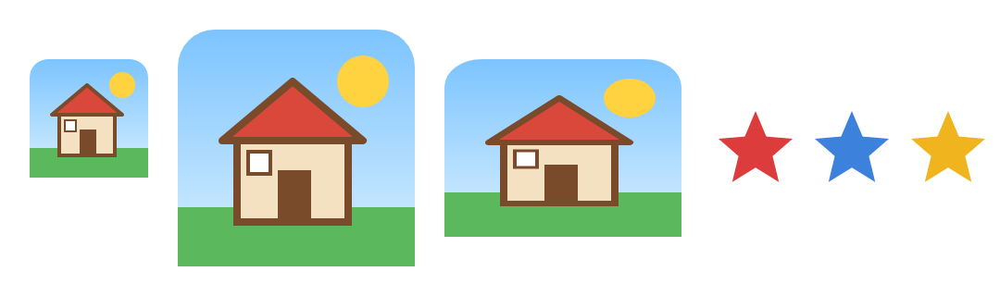

# SVG Drawing Widget

The SVG Drawing widget shows a whole SVG picture: every shape in it, each
with its own fill, stroke and gradient, scaled to the widget. Where the
SVG Icon widget draws one path in one color, the SVG Drawing widget draws
the SVG as it was made.

## Creating an SVG Drawing

Drag it out from the Tools palette, or create it in script:

	create widget "Logo" as "org.openxtalk.widget.svgdrawing"

## Showing an SVG

Set its **svgText** to the text of an SVG file:

	set the svgText of widget "Logo" to url ("file:" & tSvgFile)

You can also paste the SVG's text into the "SVG text" box of the Property
Inspector.

The widget compiles the SVG with the drawing library's `drawingSvgCompile`
function, with every compile option on, as the IDE's own import of an SVG
does. If the SVG does not compile, setting the svgText throws an error and
the widget keeps the picture it had.

If you compiled the SVG already, give the widget the result with its
**drawing** property. This is how to show one SVG in several widgets
without compiling it again:

	local tDrawing
	put drawingSvgCompile(tSvgText, "all") into tDrawing
	set the drawing of widget "Icon 1" to tDrawing
	set the drawing of widget "Icon 2" to tDrawing

## Standalones

The widget saves the compiled drawing with the stack. A saved stack, or a
standalone made from it, shows the picture without the drawing library.
Only setting the svgText needs the library: a standalone that does so must
include the drawing library and the XML external, which you choose in the
Standalone Application Settings.

## Size and proportions

The picture is drawn as large as fits in the widget, centered, with its
own proportions. Set **maintainAspectRatio** to false to stretch it to the
widget's rectangle instead.

The **formattedWidth** and **formattedHeight** are the size the SVG gives
its picture, so this shows it at its own size:

	set the width of widget "Logo" to the formattedWidth of widget "Logo"
	set the height of widget "Logo" to the formattedHeight of widget "Logo"

## One icon, any color

Icon sets often paint their shapes with `currentColor` instead of a color
of their own, so that one icon can be shown in any color. In the SVG
Drawing widget those shapes take its **foregroundColor**:

	set the foregroundColor of widget "Star" to "red"

Shapes with colors of their own keep them.
