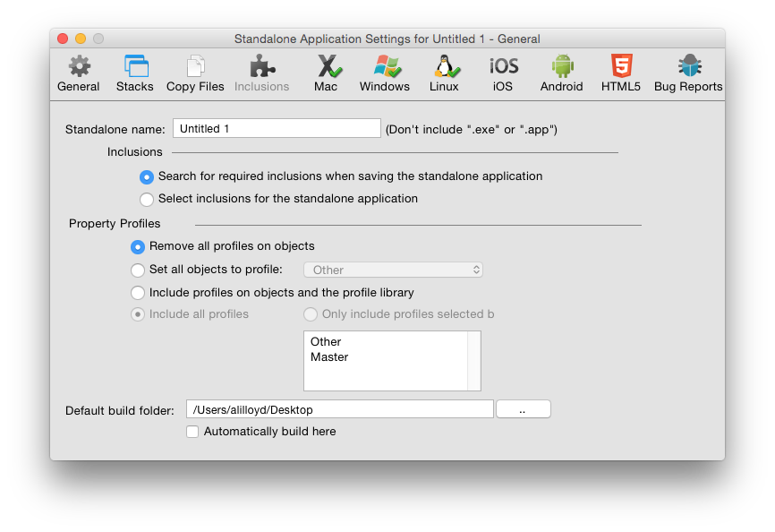
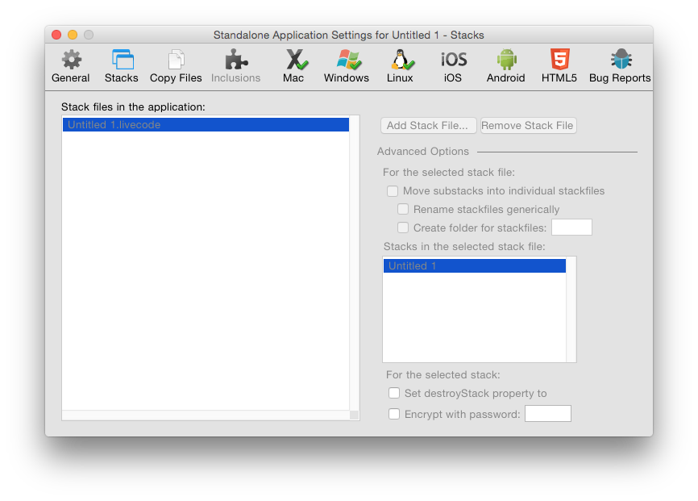
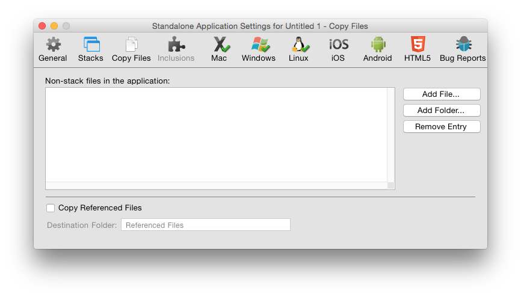
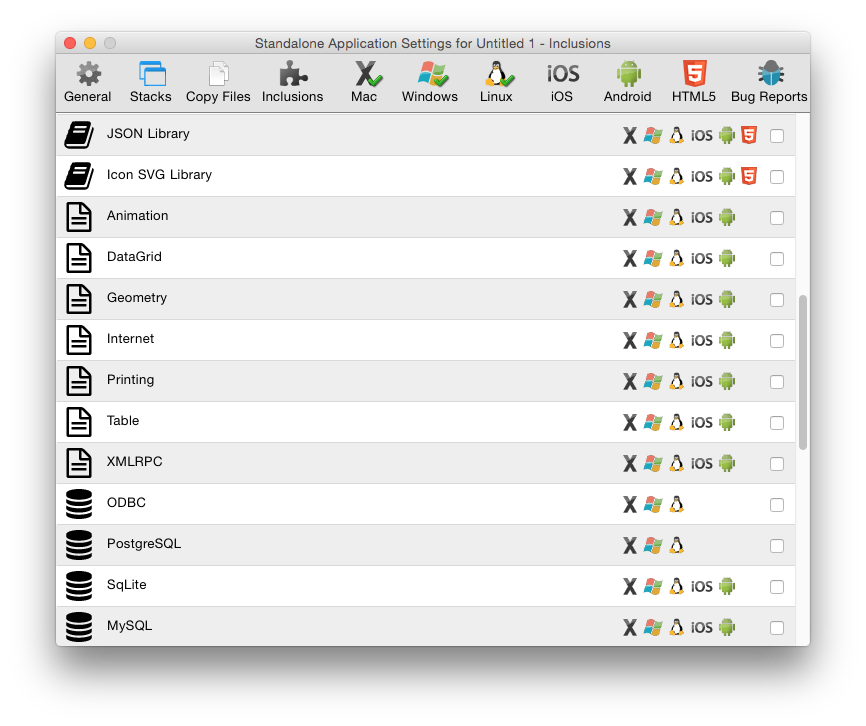
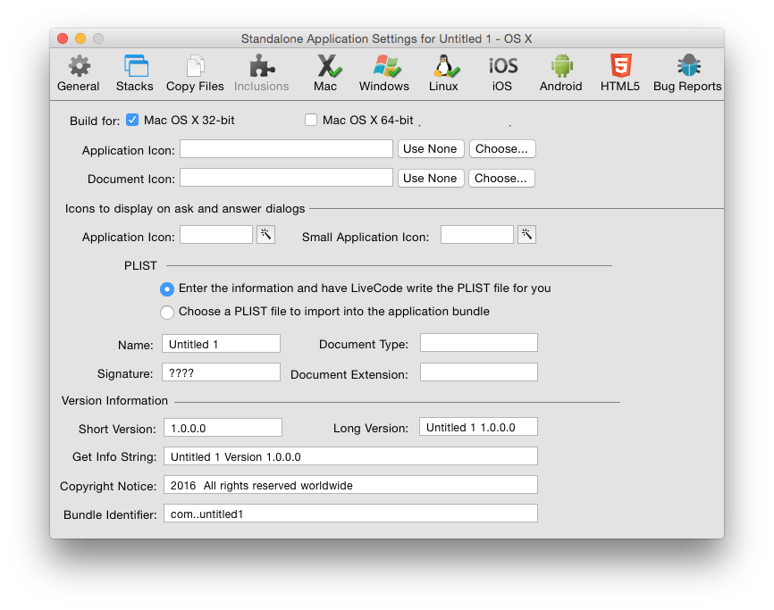
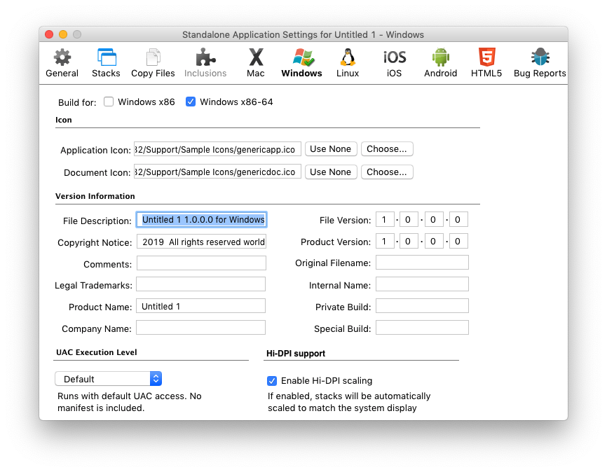
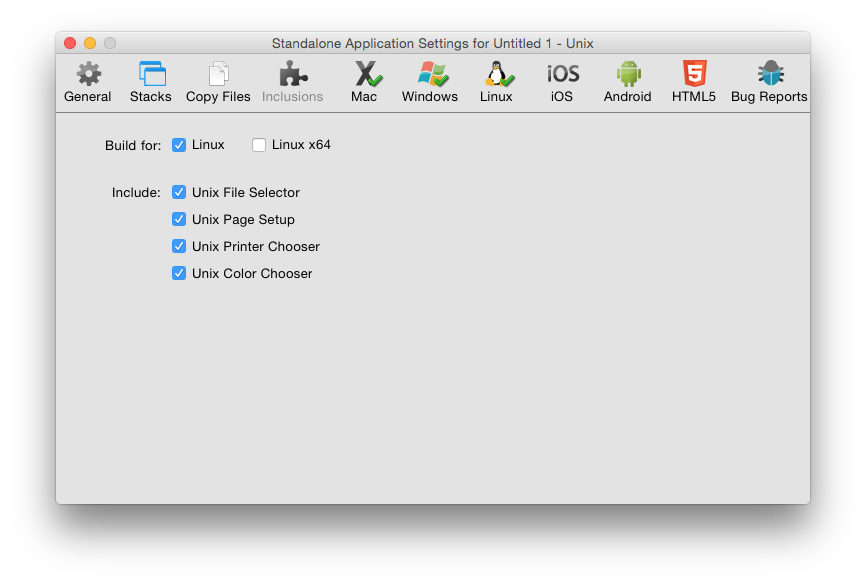
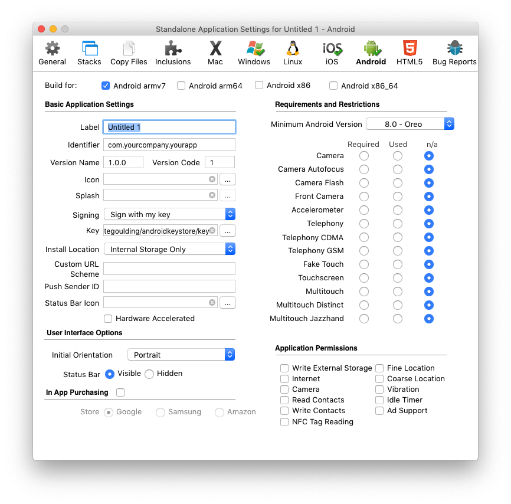
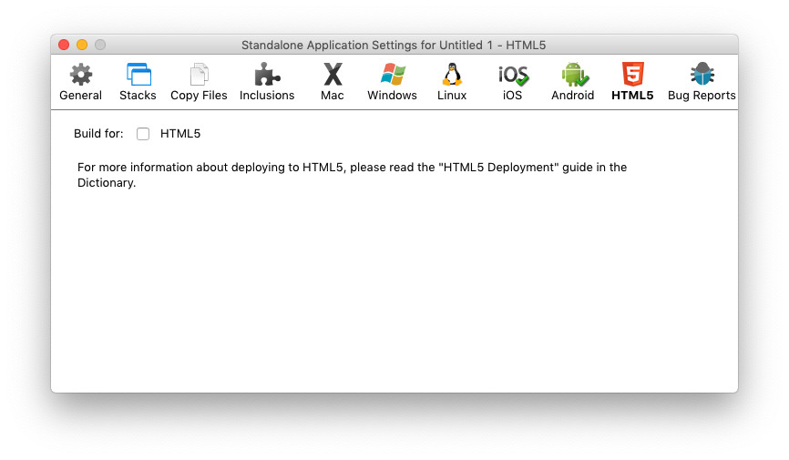
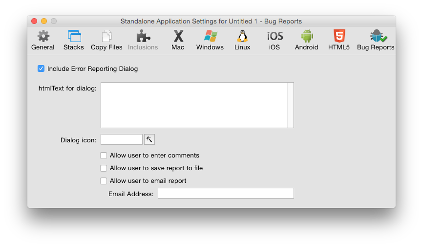

# Deploying Your Application

## Introduction

With XTalk, it is easy to deploy your application to anyone.

Using the standalone building capability you can create a native
application for each operating system you want to support. Users
can run these applications like any other application they download and install.
Standalone applications can have their own identity as true applications, include
icons, document associations and more.

## Building a Standalone Application

When you have finished your application and what to distribute it you can build
it into a standalone application. These applications do not require users to have the IDE.
All of the engine's feature set is available for use in a standalone application, with the
exception that you cannot set scripts on objects.

The builder itself will let you build standalone applications for any platform it supports,
from any platform it supports. For example you can build a Windows standalone
on a Mac OS X machine. However, you may wish to check that your application looks and behaves correctly
on each platform you intend to support. Please note it is inherently harder to debug an
application that has been built as a standalone, so you should test your application as
thoroughly as possible before building it.

Related lessons:

* [Building Standalone Applications](http://lessons.livecode.com/m/4603/l/44282-building-standalone-applications)
* [How do I Develop Cross-Platform?](http://lessons.livecode.com/m/4069/l/28092-how-do-i-develop-cross-platform-in-livecode)

### Step by step

Deploying an app to standalone is straightforward:

1) Open your stack in the IDE

2) Select **File → Standalone Application Settings...** from the menu bar

3) Select the settings for your app

4) Make sure that checkboxes for each platform you wish to build for are checked

5) Close the standalone settings window

6) Select **File → Save as Standalone Application...** from the menu bar

Your application will be packaged up and placed in the selected output folder.

## Standalone Applications Settings

The Standalone Applications Setting dialog allows you to create settings for your
standalone application. This dialog can be found in the File menu. The settings you enter
are applied to the current front most editable stack and are saved with the stack. This
means you only need to enter the settings once for each application you create. The same
settings will apply if you do another build in the future.

Related lessons:

* [The Standalone Application Settings](http://lessons.livecode.com/m/4603/l/685074-the-standalone-application-settings)

## General Settings

Figure 1 – Standalone Settings – General Tab

| &nbsp;| &nbsp;|
|-------------------------|---------------------------------------------------------------------------------------------------------------------------------------------------------------------------------------------------------------------------------------------------------------------------------------------------------------------|
| **Mode Selector**       | Choose between the different standalone application settings screens.                                                                                                                                                                                                                                               |
| **Standalone Name**     | Set the name of your standalone application. This should be the name you want your finished application to have. Don’t include a file extension (.exe on Windows or .app on Mac OS X) as the standalone builder can create standalones for multiple platforms and will add the appropriate extension automatically. |
| **Inclusions Selector** | Choose the components you want to include in a standalone. You may either choose to search for required inclusions automatically, or manually select the components you want to include.                                                                                                                            |

**Search for Inclusions**

This is the default option. When selected, the IDE will search your application stack file
(main stack and sub stacks) to attempt to determine what components your application uses.
It will then include those items.

**Select Inclusions for the Standalone Applications**

Select this option if you want to specify the components to include manually. You may wish
to use this option if your application dynamically loads components that cannot be searched
at this point automatically, or if you know exactly what components your application uses
and wish to speed up the standalone building process by skipping the automatic search step.

It is important that you choose to include all the components that your application uses
or it may fail. If you do not include your own custom error reporting or the IDE’s
standalone error reporting dialog (discussed below) such failure may be silent – i.e. an
operation in your standalone will simply cease working without displaying anything to the
user.                                                                                                                                                                                                                                                                                                                                                                                                                                                                                                                                                                                                                                                                                                                                                                                                                                                                                                                                                                                                                                     |

| &nbsp;| &nbsp;|
|----------------------------------------------|----------------------------------------------------------------------------------------------------------------------------------------------------------------------------------------------------------------------------------------------------|
| **Profiles Settings**                        | Choose between the Property Profile settings options. You only need to alter settings in this area if you have used Property Profiles (see the section on *Property Profiles* in Chapter 4, Builder a User Interface above)                        |
| **Remove all profiles**                      | Removes all profiles and builds the standalone using the currently active profile on each object. Select this option if you don't need to change profile in the standalone and want to save disk space by removing extraneous profile information. |
| **Set all objects to profile**               | Set all objects to a specific profile then remove the profile data from objects.                                                                                                                                                                   |
| **Include profiles and the profile library** | Include the profile library and allow switching between profiles in the standalone application. You can choose whether to include specific profiles or all profiles.                                                                               |

#### Including Additional Stacks

Figure 2 – Standalone Settings – Stacks Tab

| &nbsp;| &nbsp;|
|------------------------------------------|-----------------------------------------------------------------------------------------------------------------------------------------------------------------------------------------------------------------------------------------------------------------------------------------------------------------|
| **Stack Files**                          | Use this section to add additional stack files to your application. Any stacks you add to this section will be added to the `stackFiles`property of the main stack of your standalone. This means that any scripts within your standalone application will be able to locate and reference these stacks by name. |
| **Advanced Options**                     | Use this section to control exactly how multiple stack files are managed in your standalone.                                                                                                                                                                                                                    |
| **Move substacks into individual files** | If you select this option, each of the sub stacks in the stack files you select will be moved into their own individual file, located in the data folder or within the application bundle of your standalone.                                                                                                   |
| **Rename stackfiles generically**        | Renames each sub stack file using a number on disk (instead of using the name of the sub stack). Select this option if you do not want the names you have selected for stacks to be visible to the end user in the filing system.                                                                               |
| **Create folder for stackfiles**         | Creates a folder and places the stack files into that folder, instead of storing them at the same level as the standalone executable. All references in the `stackFiles`property will refer to this folder using a relative path so the stacks can still be located by the standalone application.               |
| **Individual stack options**             | Select a stack file on the left then an individual stack from within the file to set options on that stack.                                                                                                                                                                                                     |
| **Set destroyStack to true**             | Set this option if you want the selected stack file to be removed from memory when it is closed. This option is useful if you are loading large stacks into memory and want them to be removed when they are closed.                                                                                            |
| **Encrypt with password**                | Secures the scripts within the selected stack file with a password. This provides a basic level of encryption that prevents someone from casually reading the scripts in the stack by opening the file in a binary file viewer.                                                                                 |

> **Note:** A stack file directly attached to a standalone application cannot have changes
saved to it. This stack is bound directly to the executable file that runs. The OS locks
an executable file while it is running. If you want to save changes in your standalone
application, split your stack up until multiple files. A common technique is to create a
"splash screen" stack that contains a welcome screen and then loads the stacks that make
up the rest of your application. These stacks are referenced as `stackFiles`on this pane
in the standalone settings screen. It is thus possible to automatically update these
component stacks, or to save changes to them. You may also want to consider creating
preference files in the appropriate location on your end user's system (see the
`specialFolderPath`function and query/setRegistry functions for more information).

> **Note:** Adding additional stacks to the stacks tab is not supported for
Android or HTML5 standalones. Additional stacks may be included via the Copy
Files tab.

#### Including Additional Files

Figure 3 – Standalone Settings – Copy Files

| &nbsp;| &nbsp;|
|----------------------------------------|------------------------------------------------------------------------------------------------------------------------------------------------------------------------------------------------------------------------------------------------------------------------|
| **Non-stack files in the application** | List other files to be included in the standalone. Use this feature to include help documents, read me files and other resources that you want to include with your standalone each time you build.                                                                    |
| **Copy Referenced Files**              | Loops over all image and player objects in stacks and copies any files referenced in the `fileName`property of these objects into the standalone. Then automatically sets the `fileName`property to reference these files in the standalone using referenced file paths. |
| **Destination folder**                 | Create a subfolder within your standalone to copy the image and movie files to.                                                                                                                                                                                        |

#### Including Additional Resources

Figure 4 – Standalone Settings – Inclusions

The list of resources available to select for inclusion in a standalone
application are a combination of currently installed Builder
extensions, externals and database drivers (both built-in and those
found in user folders), and built-in resources and script libraries.

The following built-in resources are available by default:

| &nbsp;| &nbsp;|
|----------------------|-------------------------------------------------------------------------------------------------------------------------------------------------------------------------------------------------------------------------------------------------------------------------------------------------------------------------------------------------------------------------------------------------------------------------------------------------------------------------------------------------------------------------------------------------------------------------------------------------|
| **Ask Dialog**       | This option is required if any of your scripts use the "ask" or "ask password" commands. The standalone builder will copy the stack "ask dialog" from the IDE into your standalone as a sub stack. The standalone builder makes a copy of your stack before adding resources to it as part of the build process, so your original stack is unaltered.                                                                                                                                                                                                                                           |
| **Answer Dialog**    | This option is required if any of your scripts use the "answer" command. Note that this only applies to the dialog form of the command. The answer file / printer / color / effect / folder / page setup / printer and record forms of the command do *not* require this option. The standalone builder will copy the stack "answer dialog" into your standalone.                                                                                                                                                                                                                               |
| **Browser**   	   | This option is required if your application uses the embedded browser or any `revBrowser` command.                                                                                                                                                                                                                                                                                                                                                                                                                                                                                              |
| **Browser (CEF)**    | This option is required if your application uses the embedded CEF browser or any `revBrowser` command.                                                                                                                                                                                                                                                                                                                                                                                                                                                                                          |
| **Brushes**          | This option is required if your application uses any brush cursors. It is not required if your application does not make use of the painting commands. It copies the stack "brushes" into your standalone.                                                                                                                                                                                                                                                                                                                                                                        |
| **Cursors**          | This option is required if your application uses any cursors. It is not required if your application only uses OS cursors. It copies the stack "cursors" into your standalone.                                                                                                                                                                                                                                                                                                                                                                                                    |
| **Database**         | This option is required if your application uses database access or any `revDatabase` command.                                                                                                                                                                                                                                                                                                                                                                                                                                                                                                  |
| **Magnify**		   | This option is required if your application uses the magnify palette.                                                                                                                                                                                                                                                                                                                                                                                                                                                                                                                           |
| **PDF Printer**      | This option is required if your application uses the "open printing to pdf" command.                                                                                                                                                                                                                                                                                                                                                                                                                                                                                                            |
| **Print Dialog**     | This option is required if your application uses the built-in print or page setup dialogs (e.g. for use on Linux without GTK installed). It is not required if you only display the system printer and page setup dialogs. It copies the stack "print dialog" and "page setup" into your standalone.                                                                                                                                                                                                                                                                                     |
| **SSL & Encryption** | This option is required if your application uses any SSL or encryption related commands                                                                                                                                                                                                                                                                                                                                                                                                                                                                                                         |
| **XML**              | This option is required if your application uses any `revXML` commands                                                                                                                                                                                                                                                                                                                                                                                                                                                                                                                          |

The following script libraries are available by default:

| Library Name | Automatic inclusion condition |
|----------------------|----------------------------------------------------------------------|
| **Animation** 	   | This library is unsupported.                                         |
| **DataGrid**         | DataGrid object.                                                     |
| **Geometry**         | Geometry properties or commands.                                     |
| **Internet**         | Internet access, including URL, ftp & POST                           |
| **Printing**         | `revPrintField`, `revShowPrintDialog` and `revPrintText`             |
| **Zip**              | All `revZip` commands (but not required for `compress`/`decompress`) |
| **Speech**           | `revSpeak` and revSpeechVoices                                       |
| **Table**            | Use of the table object                                              |
| **XMLRPC**           | Any `revXMLRPC` commands                                             |

The following database drivers are available by default:

- ODBC
- MySQL
- SQLite
- PostgreSQL

## Mac Deployment Settings

Figure 5 – Standalone Settings – Mac

| &nbsp;| &nbsp;|
|-----------------------------------------------------------------|-------------------------------------------------------------------------------------------------------------------------------------------------------------------------------------------------------------------------------------------------------------------------------------------------------------------------------------------------------------------------------------------------------------------------------|
| **Build for Mac OS X 32-bit**                                   | Build a standalone that includes a 32 bit slice.                                                                                                                                                                                                                                                                                                                                                                              |
| **Build for Mac OS X 64-bit**                                   | Build a standalone that includes a 64 bit slice.                                                                                                                                                                                                                                                                                                                                                                              |
| **Application Icon**                                            | Choose an application icon to represent the application in the Finder. The icon should be in icns format.                                                                                                                                                                                                                                                                                                                     |
| **Document Icon**                                               | Choose a document icon to represent your application's documents in the Finder. The icon should be in icns format.                                                                                                                                                                                                                                                                                                            |
| **Icons for ask / answer dialogs**                              | Choose an icon to display whenever you use the ask or answer commands to display a dialog. On Mac OS X, the convention is that these dialogs should display your application icon. The icon should be stored in your stack as an image, or selected from built-in icons. If you have used a built-in icon, be sure to select the relevant inclusion on the General tab (if you are selecting inclusions manually). |
| **PLIST – enter information and have the IDE write the PLIST** | Have the IDE fill out the PLIST for your application automatically. The PLIST is a settings file stored in XML format stored as part of every Mac OS X application. It contains information about the application, including its name, version number, copyright notice and document associations. Having the IDE create this file for you is the recommended option. For more information about PLISTs consult [Apple's developer documentation](http://developer.apple.com/documentation/Darwin/Reference/ManPages/man5/plist.5.html)|
| **Choose a file to import into the application bundle**         | Choose to import a PLIST file instead of having the IDE create one. Select this option if you have created your own highly customized PLIST that you want to use for your application in each build you create.                                                                                                                                                                                                              |
| **Short version / long version**                                | The version information to be included with your standalone.                                                                                                                                                                                                                                                                                                                                                                  |
| **Get info string**                                             | The visible text displayed in your application's Get Info window by the Finder.                                                                                                                                                                                                                                                                                                                                               |
| **Copyright notice**                                            | The copyright notice for your application.                                                                                                                                                                                                                                                                                                                                                                                    |
| **Bundle identifier**                                           | A unique identifier for your application used by Mac OS X to identify your application.                                                                                                                                                                                                                                                                                                                                       |

Related lessons:

* [Signing and Uploading apps to the Mac App Store](http://lessons.livecode.com/m/4071/l/876834-signing-and-uploading-apps-to-the-mac-app-store)

## Windows Deployment Settings

Figure 6 – Standalone Settings – Windows

| &nbsp;| &nbsp;|
|--------------------------------|----------------------------------------------------------------------------------------------------------------------------------------------------------------------------------------------------------------------------------------------------------------------------------|
| **Build for Windows x86**      | Build a 32-bit standalone for the Microsoft Windows OS.                                                                                                                                                                                                                                 |
| **Build for Windows x86_64**   | Build a 64-bit standalone for the Microsoft Windows OS.                                                                                                                                                                                                                                 |
| **Application icon**           | Choose an application icon to represent the application in Windows. The icon should be in .ico format.                                                                                                                                                                           |
| **Document icon**              | Choose a document icon to represent your application's documents in Windows. The icon should be in .ico format.                                                                                                                                                                  |
| **Version information**        | The version information to be stored as part of your application and displayed in the Windows property inspector and dialogs.                                                                                                                                                    |
| **UAC Execution Level**        | Select the user account control level that applies to your application. For more information, consult [MSDN](https://msdn.microsoft.com/en-us/library/bb384608.aspx)                                                                                                             |

## Linux Deployment Settings

Figure 7 – Standalone Settings – Linux

| &nbsp;| &nbsp;|
|---------------------------------|--------------------------------------------------------------------------------------------------------------------------------------------------------------------------------------------------------------------------------------------------------------|
| **Build for Linux**             | Build a standalone for 32-bit Linux                                                                                                                                                                                                                          |
| **Build for Linux x64**         | Build a standalone for 64-bit Linux                                                                                                                                                                                                                          |
| **Include**                     | Select built-in dialogs to include. These dialogs are useful if your application may be run on a system that does not include these dialogs as part of the OS. You do not need to include these dialogs if you are running a recent version of GTK. |

## Android Deployment Settings

Figure 8 – Standalone Settings – Android

| &nbsp;| &nbsp;|
|---------------------------------|---------------------------------------------------------------------------------------------------------------------------------------------------------------------------------------------------------------------------------------|
| **Build for Android armv7**     | Include armv7 binaries in the Android standalone                                                                                                                                                                                      |
| **Build for Android arm64**     | Include arm64 binaries in the Android standalone                                                                                                                                                                                      |
| **Build for Android x86**       | Include x86 binaries in the Android standalone                                                                                                                                                                                        |
| **Build for Android x86_64**    | Include x86_64 binaries in the Android standalone                                                                                                                                                                                     |
| **Label**                       | The application name                                                                                                                                                                                                                  |
| **Identifier**                  | The application identifier for your application. This should begin with a reverse domain name of a domain you own.                                                                                                                    |
| **Version Name**                | The version number of your application                                                                                                                                                                                                |
| **Version Code**                | The build number of your application                                                                                                                                                                                                  |
| **Icon**                        | The application icon                                                                                                                                                                                                                  |
| **Splash**                      | The application splash screen (applicable to the Educational Personal license only)                                                                                                                                                   |
| **Signing**                     | Choose to sign for development, with your own key or not to sign.                                                                                                                                                                     |
| **Key**                         | Choose a Java keystore file to sign with.                                                                                                                                                                                             |
| **Install Location**            | Allow installation onto external storage.                                                                                                                                                                                             |
| **Custom URL Scheme**           | Add a custom url scheme to the application so that it will launch when a url is opened that uses the scheme.                                                                                                                          |
| **Push Sender ID**              | The project number from Google's Cloud Messaging API. See the [How do I use Push Notifications with Android?](http://lessons.livecode.com/m/4069/l/59312-how-do-i-use-push-notifications-with-android) lesson.                        |
| **Status Bar Icon**             | The icon shown in the status bar for a notification                                                                                                                                                                                   |
| **Hardware Accelerated**        | Enable hardware acceleration of the application                                                                                                                                                                                       |
| **Initial Orientation**         | The orientation on the device when the application initially launches                                                                                                                                                                 |
| **Status Bar**                  | Set the visibility of the status bar                                                                                                                                                                                                  |
| **In App Purchasing**           | Specify the store used for the in-app purchasing API                                                                                                                                                                                  |
| **Minimum Android Version**     | Choose the minimum version of Android the application should run on                                                                                                                                                                   |
| **Camera**                      | Choose whether a camera is required, prohibited or not applicable in order for the application to function                                                                                                                            |
| **Camera Autofocus**            | Choose whether camera autofocus is required, prohibited or not applicable in order for the application to function                                                                                                                    |
| **Camera Flash**                | Choose whether a camera flash is required, prohibited or not applicable in order for the application to function                                                                                                                      |
| **Front Camera**                | Choose whether a front camera is required, prohibited or not applicable in order for the application to function                                                                                                                      |
| **Accelerometer**               | Choose whether an accelerometer is required, prohibited or not applicable in order for the application to function                                                                                                                    |
| **Telephony**                   | Choose whether telephony is required, prohibited or not applicable in order for the application to function                                                                                                                           |
| **Telephony CDMA**              | Choose whether CDMA telephony is required, prohibited or not applicable in order for the application to function                                                                                                                      |
| **Telephony GSM**               | Choose whether GSM telephony is required, prohibited or not applicable in order for the application to function                                                                                                                       |
| **Fake Touch**                  | Choose whether fake touch is required, prohibited or not applicable in order for the application to function                                                                                                                          |
| **Touchscreen**                 | Choose whether a touchscreen is required, prohibited or not applicable in order for the application to function                                                                                                                       |
| **Multitouch**                  | Choose whether multitouch is required, prohibited or not applicable in order for the application to function                                                                                                                          |
| **Multitouch Distinct**         | Choose whether multitouch distinct is required, prohibited or not applicable in order for the application to function                                                                                                                 |
| **Multitouch Jazzhand**         | Choose whether multitouch jazzhand is required, prohibited or not applicable in order for the application to function                                                                                                                 |
| **Write External Storage**      | Request permission to write to external storage                                                                                                                                                                                       |
| **Internet**                    | Request permission to for internet access                                                                                                                                                                                             |
| **Camera**                      | Request permission to access the camera                                                                                                                                                                                               |
| **Read Contacts**               | Request permission to read the user's contact data                                                                                                                                                                                    |
| **Write Contacts**              | Request permission to write to the user's contact data                                                                                                                                                                                |
| **NFC Tag Reading**             | Request permission to read NFC tags                                                                                                                                                                                                   |
| **Fine Location**               | Request permission to access the device's fine location                                                                                                                                                                               |
| **Course Location**             | Request permission to access the device's course location                                                                                                                                                                             |
| **Vibration**                   | Request permission to vibrate the device                                                                                                                                                                                              |
| **Idle Timer**                  | Request permission for the idle timer                                                                                                                                                                                                 |
| **Ad Support**                  | Request permission for ad support                                                                                                                                                                                                     |

Related lessons:

* [OpenXTalk and Android Studio](http://lessons.livecode.com/m/4069/l/985962-livecode-and-android-studio)
* [The Basics: How do I Create Hello World on Android?](http://lessons.livecode.com/m/4069/l/27733-the-basics-how-do-i-create-hello-world-on-android)

## HTML5 Deployment Settings

Figure 9 – Standalone Settings – Web (HTML5)

| &nbsp;| &nbsp;|
|---------------------------------|-------------------------------------------------------------------------------------------------------------------------------------------------------------------------------------------------------------------------------------------------------|
| **Build for HTML5**             | Build a standalone for HTML5                                                                                                                                                                                                                          |
| **Title**                       | The page's title, which the browser shows in its tab, its history and its bookmarks. Empty: the stack's label or, without one, its name                                                                                                               |
| **Icon**                        | An image that the browser shows as the page's icon, in its tab and its bookmarks: a PNG, ICO, SVG, GIF, JPEG or WebP file, which the standalone gets a copy of. **Use None** removes it                                                               |
| **Background**                  | The colour of the page around the main stack: click the swatch or **Choose...** to change it. **Use White** puts back the page's own white                                                                                                            |
| **Position**                    | Where the main stack is in the page: **Centered at the top** (the page's own place), **Centered in the window** of the browser, or **At the top left**                                                                                                |
| **Appearance**                  | **Light**: the stacks keep the light colours whatever the browser's colour scheme, as before. **Follow the browser**: the `systemAppearance` is the browser's scheme, controls without colours of their own are drawn dark in a dark scheme, the card gets `systemAppearanceChanged` when the scheme changes, and so does a page without its own background |

Almost every Internet-connected device has a web browser.  If your application
can run in a browser, your app can be used anywhere and by anyone, without any
need to download or install it.

An HTML5 standalone runs your stacks in a page of a web site, with
OXT-Beyond's web engine: the engine built as WebAssembly, which browsers
run. The **Web** pane of the Standalone Application Settings builds one:
tick **Build for HTML5**, and set the page's title, icon, colour and the
place of the main stack in it if you like. To try the standalone, choose
**Development → Test Target → _a browser_** from the menu bar, then
**Development → Test** (or the **Test** button of the toolbar): the IDE
builds the standalone, serves it from a web server on your own computer,
and opens it in that browser. On Linux, the menu lists whichever of
Firefox, Google Chrome, Chromium and Microsoft Edge are installed.

##### Supported browsers

The engine needs one of these browsers, or a newer version:

* [Google Chrome](https://www.google.com/chrome/) or Microsoft Edge 85
* [Mozilla Firefox](https://www.mozilla.org/firefox/new/) 79
* Safari 15, on macOS, iOS and iPadOS

OXT-Beyond's own tests run the standalones in Chromium.

##### Contents of the HTML5 standalone

The HTML5 standalone is a folder of four files (five with an icon), which
a web site serves together:

* `<name>.html`, the page, named after the standalone (the **General**
pane), with the **Title** of the **Web** pane as its title (or, without
one, the stack's label or name) and the pane's other settings. It says
"Loading..." until the engine starts, then shows the main stack.
* `icon.<extension>`, the page's icon, a copy of the image that the
**Icon** setting names.
* `standalone-community-<version>.js` and
`standalone-community-<version>.wasm`, the engine. They are the same for
every standalone made with the same version of OXT-Beyond.
* `standalone.zip`, your application: the stacks, the extensions and
script libraries they use, the files of the **Copy Files** pane, and the
font that the engine draws text with.

A browser runs the page only from a web server (an `http://` or `https://`
address), not from a file on the disk. Any web server will do. If it sends
the `.wasm` file with the type `application/wasm`, as most do, the browser
starts compiling the engine while it downloads; otherwise it waits for the
whole file. To try a standalone on your own computer without the IDE, run
a web server in its folder (for example `python3 -m http.server`) and open
`http://localhost:8000/<name>.html`.

##### What a stack can do in a browser

The web engine is the desktop engine, so stacks look and behave as they do
on the desktop: cards, groups, controls and graphics, the message path,
behaviors, script libraries, Builder extensions and widgets. Stacks other
than the main stack open in their own windows in the page, each with a
title bar that shows the stack's title, as on the desktop: the user moves
a window by its title bar, resizes a resizable stack by its right and
bottom edges (within its `minWidth`, `maxWidth`, `minHeight` and
`maxHeight`), and closes it with the close box, which sends
`closeStackRequest` first. A click brings a window to the front, palettes
stay above the other stacks (unless `the raisePalettes` is false), dialogs
above those, and menus above all. As on Linux, a window has no title bar
when its `decorations` leave out the title or give it a shape, and `the
effective rect` of a stack includes its title bar. A stack's `blendLevel`
makes its window see-through, and a stack whose `ignoreMouseEvents` is true
lets the mouse through its window to what is under it. The main stack's
window is the page itself, with no title bar. A page can restyle the title bars:
their class names start with `oxt-window`. A modal dialog (`modal`, or a
stack opened as a dialog) keeps the mouse and the keys from the stacks
under it until it closes, and then the keyboard goes back where it was,
as on the desktop. Where a browser does things its own way:

* **The look.** A browser has no look of its own for a stack's controls,
so the engine draws them all itself, as the desktop engines draw a part
that the system does not: in the `Windows 95` look and feel, in the
colours of Windows' light theme (light grey stacks and buttons, white
fields, a blue selection), whatever system the browser runs on and
whichever colour scheme it is set to: `the systemAppearance` is `light`.
Data grids work as they do on the desktop.
* **Waiting.** `wait`, `wait until` and `wait with messages` work in any
handler, and the page goes on running while the engine waits. The
exception is a handler that the page's JavaScript calls (see
**JavaScript** below): the page is waiting for its answer, so it cannot
wait in turn, and a `wait` there throws an error, which `try` can catch.
* **Dialogs.** `answer`, `ask`, `ask password` and `answer color` show
dialogs in the page, which wait for the user, and give `it` and `the
result` as on the desktop. In a handler that the page calls, the browser's
own dialogs are used instead. A page can restyle the dialogs: their class
names start with `oxt-dialog`.
* **Files.** The file commands and functions (`open file`, `read`, `write`,
`file:` and `binfile:` URLs, `the files`, `create folder` and the rest)
work on the engine's own file system, which is in the page, not on the
user's disk:
  * `specialFolderPath("resources")` is `/boot/standalone`, where the files
of the **Copy Files** pane are, and is the `defaultFolder` when the
standalone starts.
  * `specialFolderPath("home")` is `/livecode`, with the `documents`,
`desktop`, `preferences` and `support` folders in it. The browser keeps
this folder for the web site, so what a stack writes there is still there
on the user's next visit, in the same browser. (A page can turn this off;
see **The Module object** below.)
  * `specialFolderPath("temporary")` is `/tmp`. It, and every folder but
the home folder, starts afresh on each visit.
  * `answer file`, `answer files` and `answer folder` show the browser's
file picker. The files that the user picks are copied into `/uploads`
(`specialFolderPath("uploads")`), and `it` has the copies' paths.
  * `ask file` gives a path in `/downloads` (`specialFolderPath("downloads")`).
A file written there goes to the user as a download when it is closed.
* **URLs.** `get url`, `put ... into url`, `post`, `load url` and the
Internet library's commands use the browser's own requests. A browser
lets a page read from its own web site, and from other sites only when
they allow it (with CORS headers); a request that the browser refuses
fails as one to a server that cannot be reached.
* **Links.** `launch url` opens an `http` or `https` address in a new tab,
and gives a `mailto:` or `tel:` link to the application that answers it;
it refuses `javascript:` and `data:` addresses. `launch document` opens a
file of the engine's file system in a tab. A browser opens a tab only just
after the user has clicked or typed, so at other times the page asks the
user first.
* **Keyboard, mouse and touch.** Keys, modifier keys (Cmd is the command
key on a Mac), the mouse, its wheel and the standard cursors work as on
the desktop, and the copy, cut and paste keys use the system clipboard.
`the mouse`, `the mouseLoc` and `the mouseClick` follow the page's
events, also in a loop that asks for them without waiting (`repeat while
the mouse is down`), as on the desktop. On a touch screen, a finger on a
stack is the mouse: touching presses the mouse button, moving moves the
mouse, and lifting lets the button go, so taps click and fingers drag.
The touch screen's keyboard comes up while an
unlocked field has the focus, as on a phone: when the touch that put the
focus there ends (a browser brings it up only for a touch), or the next
touch after a script did, and it goes away when the field loses the
focus. What it types reaches the field as keys, with their `keyDown`
messages, and so does text from dictation or an emoji picker. Text that
a keyboard composes before it sends it (an input method for Chinese,
Japanese or Korean, or a phone's keyboard that sends a word at a time)
reaches the field with no `keyDown` messages.
* **Drag and drop** between the controls and stacks of the page works as
on the desktop: `dragStart`, `the dragData`, `dragEnter`, `dragMove`,
`dragLeave`, `dragDrop` and `dragEnd`, `the dragImage` and the engine's
own dragging of text between fields. The cursor says what a drop would
do, and Escape cancels a drag. A drag that a stack starts stays in the
page. Files, folders, text and HTML dragged from another application or
page can be dropped on a stack. The browser shows what such a drag
carries only when it is dropped, so the stack under the pointer gets
`dragEnter`, `dragMove` and `dragDrop` then (or `dragLeave`, if it does
not take the drop), and until then the pointer says that a drop would
copy. The files and folders are copied into `/uploads`, as those that
`answer file` gives are, and `the dragData["files"]` has their copies'
paths.
* **The screen** is the browser's window: `the screenRect` is its size, a
stack gets `desktopChanged` when it changes, and stacks draw at the
screen's scale, so they stay sharp on high-resolution screens and when the
page is zoomed. `import snapshot` and `export snapshot` of the screen or of
a stack's window take what the stacks show there, and `the mouseColor` is
the colour under the mouse; the rest of the page, and the pages of the
browser widget and movies of the player, which a page cannot read, are the
page's background colour. With no rectangle, the user drags one out on the
page, or clicks a stack to take its window, as on the desktop; Escape
cancels, and the import fails.
* **Sound.** `play` plays audio clips and WAV, AU and AIFF files, and
`beep` beeps. A browser lets a page make sound only once the user has
clicked or typed in it: until then, a sound waits, and one that ends
before then is not heard, although the stack is told that it played.
* **The player** plays the movies and sounds that the browser can play
(MP4, WebM and MP3 in current browsers), from the engine's file system or
an address, with the browser's own controller. Its `timeScale` is 1000. A
browser starts a movie with sound only once the user has clicked or typed
in the page; a movie whose `playLoudness` is 0 starts at once. In edit mode,
the player shows a grey transport placeholder. Give it a direct media URL;
a Vimeo or YouTube watch-page URL is an HTML page, which a video element
cannot play. Show a provider's permitted embed URL in the browser widget
instead (subject to that provider's embedding and privacy settings).
* **The browser widget** shows a page of the stack's own web site, its
`htmlText`, or a file of the engine's file system, with its messages, `do
... in widget` and the page's calls to its `javascriptHandlers`, as on the
desktop. It shows a page of another web site only if that site lets other
sites show its pages; the engine then knows only the address it gave the
widget, `do ... in widget` does nothing, and the page calls a handler with
`window.parent.postMessage({liveCode: "handlerName", parameters: [1, 2]}, "*")`.
In Safari, a page of the stack's own site gets its `liveCode` object only
once it has loaded, so a script that calls a handler as the page loads
should wait until `window.liveCode` is there.
* **Builder extensions and widgets** work, including foreign handlers with
callbacks. A native library built for a desktop system cannot be loaded.
* **XML, zip archives and databases.** revXML (with XSLT), revZip and
revDB with its SQLite driver work as on the desktop, on the files of the
engine's file system. Include them as on the desktop, on the
**Inclusions** pane or by letting the builder search for them. A database
in the home folder is kept between visits, as any file there is: it is
written to the browser's storage moments after it changes, and when the
page is hidden or closed, so a change committed just before the browser
ends the page can be lost; SQLite's journal keeps the database whole.
(Until 0.2.7-rc.6, each commit waited for the browser's storage, which
made Safari reload a page that used SQLite.)
* **Encryption.** `encrypt` and `decrypt`, with a cipher or with RSA
keys, and `the cipherNames` work as on the desktop: the engine has OpenSSL
in it, so the **SSL & Encryption** inclusion is not needed. It has every
cipher of the desktop engines but the four `aes-...-cbc-hmac-sha...`
ones, which need an x86 processor's AES instructions. `md5Digest`,
`sha1Digest`, `messageDigest` and `randomBytes` work too.
* **Speech.** revSpeech speaks with the browser's speech synthesis, and
the voices of the system the browser runs on: `revSpeak`,
`revStopSpeech`, `revIsSpeaking()`, `revSpeechVoices()`,
`revSetSpeechVoice`, `revSetSpeechSpeed`, `revSetSpeechPitch` and
`revSetSpeechVolume`, on the scales they have on Windows, and `revSpeak`
stops what is being said first, as on a Mac. Include it as on the
desktop. A browser speaks only once the user has clicked or typed in the
page, as it plays sound, and it does not tell a voice's gender:
`revSpeechVoices("male")` and `revSpeechVoices("female")` list the
voices whose names say so.
* **Printing.** `open printing`, `print`, `print break`, `cancel
printing` and `close printing` work, with the page settings (`the
printPaperSize`, `the printPaperOrientation`, `the printMargins`, `the
printPaperScale` and the layout properties) as on the desktop. When
printing closes, the browser's print dialog opens with the pages, and the
user prints them or saves them as a PDF there: a browser does not let a
page print without it, so `answer printer` and `answer page setup` return
at once, as if OK was clicked, and the number of copies, collation and
two-sided printing are chosen in the dialog. The paper is US Letter or A4,
as the browser's language has it, and `the printerName` is empty. Each
page is a picture of it at 300 dots an inch, so the text of a PDF of it
cannot be searched or copied. `open printing to pdf`, and `the
printerOutput` set to `file:` and a path, write a PDF of the pages'
pictures, with the links, anchors and bookmarks of `print link`, `print
anchor` and `print bookmark` and the document information of `with
options`. A PDF written into `/downloads` reaches the user as a download.
* **JavaScript.** `do 

These are the other things that it can have:

* `print` and `printErr`: functions that get each line that the stack
writes to stdout and stderr (`write ... to stdout`). Without them, the
lines go to the browser's console.
* `setStatus`: a function that gets "Running..." as the engine starts, and
empty text once it has started.
* `livecodeStandalone`: the name of the standalone archive (by default
`standalone.zip`).
* `livecodeStandalonePrefixURL`: put before that name to make the
archive's address, for an archive in another folder or on another site.
* `locateFile`: a function that takes the name of a file that the engine
needs (its `.wasm` file, and the archive) and returns its address. When
it is there, `livecodeStandalonePrefixURL` is not used.
* `livecodeStandaloneRequest`: a request for the archive that the page has
already started, so that the archive downloads while the engine's script
does: an `XMLHttpRequest` whose `responseType` is `"arraybuffer"`. The
engine starts once it has arrived.
* `livecodePersistent`: `false` to start the home folder afresh on every
visit, instead of keeping it in the browser.

The engine sets `Module.livecodeStorageError` when the browser is not
keeping the home folder: the browser's reason, such as a full disk or
storage refused (a private window can refuse it), when a write to its
storage failed or the folder could not be loaded from it, and empty
again once a write works. Each time that changes, the window gets an
`oxtstoragestate` event whose `detail` is `{kept, error}`. The engine
does nothing else with it, and a page that does not look shows nothing
(the web IDE shows a "Not saved" bar). To tell the user:

    window.addEventListener('oxtstoragestate', function(e) {
      document.getElementById('not-saved').hidden = e.detail.kept;
    });

See also Emscripten's
[Module object documentation](https://emscripten.org/docs/api_reference/module.html).

##### Engine download

The engine's script loads the engine's `.wasm` file from its own folder,
and the archive from the page's folder. The browser downloads it while the
rest of the page loads:

    

Make sure to replace `<version>` with the version in the engine's file
names.

##### Bringing it all together

Here's a complete page for an HTML5 standalone:

    <!doctype html>
    <html>
      <body>
        

          <canvas id="canvas" style="border: 0 none; padding: 0; outline: none;" oncontextmenu="event.preventDefault()"></canvas>
        

        
        
      </body>
    </html>

##### Advanced: Speeding up engine download

The engine's `.wasm` file is about 23 MB, and the archive about 8 MB (the
two fonts are most of it). Web servers can send them compressed, which
browsers unpack as they arrive: compressed with gzip, the engine is about
8.3 MB and the archive about 3.9 MB. Most hosting compresses by itself; on a server of
your own, turn compression on for `.wasm`, `.js` and `.zip` files, or
compress them once with `gzip` and have the server send those files:

* For the Apache web server, configure `mod_deflate` to serve [pre-compressed content](https://httpd.apache.org/docs/2.4/mod/mod_deflate.html#precompressed)
* For the NGINX web server, add [`gzip_static on;`](https://nginx.org/en/docs/http/ngx_http_gzip_static_module.html)
to your configuration.

#### Bug Reports

Figure 10 – Standalone Settings – Bug Reports

| &nbsp;| &nbsp;|
|---------------------------------------|--------------------------------------------------------------------------------------------------------------------------------------------------------------------------------------------------------------------------------------------------------------------------------------------------------------------------------------------------------------------------------------------|
| **Include Error Reporting Dialog**    | Include an error reporting stack in your standalone. You should select this option if you are testing your application and want details of any errors in your standalone, or if you have not included your own error reporting routines in your stacks.                                                                                                                                    |
| **htmlText for dialog**               | The text to display to the user in the dialog that comes up when an error is encountered. This text should be in xTalk-compatible HTML format. Create and format the text in a field then copy the field's HTMLText property.                                                                                                                                                  |
| **Dialog icon**                       | The icon to display in the error dialog. This should be stored as an image in your stack.                                                                                                                                                                                                                                                                                                  |
| **Allow user to enter comments**      | Display a box for the user to give you more information. This information will be included in the report.                                                                                                                                                                                                                                                                                  |
| **Allow user to save report to file** | Allow the user to save the report to a file. Select this option if you want users to save an error report and send it to you.                                                                                                                                                                                                                                                              |
| **Allow user to email report**        | Allow the user to email the report. Select this option if you want the user to be able to send you or your technical support department details of the error. This option loads up the system default email client and populates the email with the contents of the error report and the user's comments. The To: field is sent to the email address specified in the email address field. |

## Testing Your Application

Testing an app is straightforward:

1) Open your stack in the IDE

2) Select **File → Standalone Application Settings...** from the menu bar

3) Select the settings for your app

4) Make sure that checkboxes for each platform you wish to build for are checked
as the chosen platforms will govern which test targets are available.

5) Close the standalone settings window

6) Choose **Development → Test Target → _Your Target_** from the menu bar to
select the target to test deployment to

7) Click the **Test** button or choose **Development → Test** from the menu bar

8) The standalone will be built and deployed to the target and launched.

