# IDE screenshots: Windows x86_64

[Every platform](../README.md) · commit [`d366f8d1`](https://github.com/SethMorrowSoftware/OpenXTalk-Beyond/commit/d366f8d13247b8e5f34a1cee3bbe946390e8bcff) · [the build, success](https://github.com/SethMorrowSoftware/OpenXTalk-Beyond/actions/runs/41238963372) · 2026-10-31 20:27 UTC

- light: 114 snapshot(s), 74 step(s), every step done
- dark: 114 snapshot(s), 74 step(s), every step done

Each window light, then dark; click one for the full size. A clone of this branch has the same
page as the build's download in `index.html`.

### 00-screen-start

<a href="light/shots/00-screen-start.png">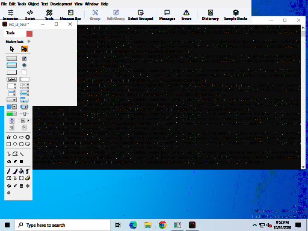</a> <a href="dark/shots/00-screen-start.png">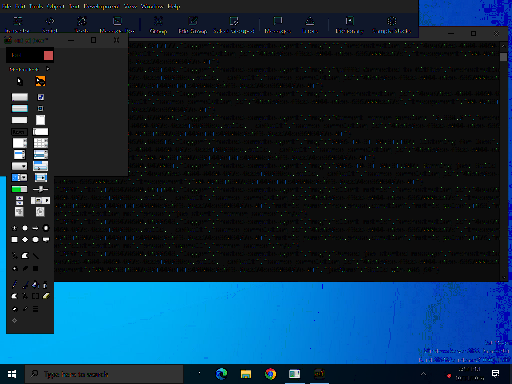</a>

### 01-tools-modern-drawn

<a href="light/shots/01-tools-modern-drawn.png">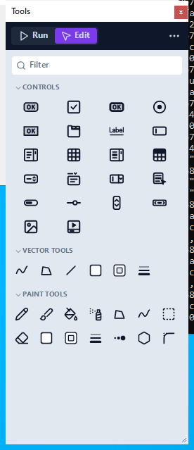</a> <a href="dark/shots/01-tools-modern-drawn.png">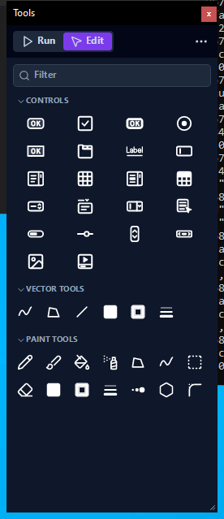</a>

### 01-tools-modern-large

<a href="light/shots/01-tools-modern-large.png">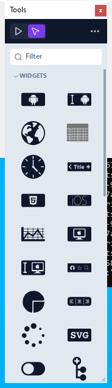</a> <a href="dark/shots/01-tools-modern-large.png">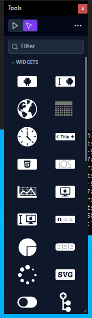</a>

### 01-tools-modern-names-tools

<a href="light/shots/01-tools-modern-names-tools.png">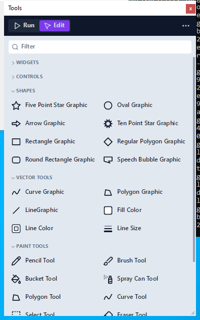</a> <a href="dark/shots/01-tools-modern-names-tools.png">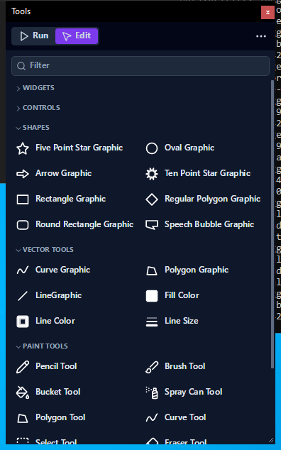</a>

### 01-tools-modern-names

<a href="light/shots/01-tools-modern-names.png">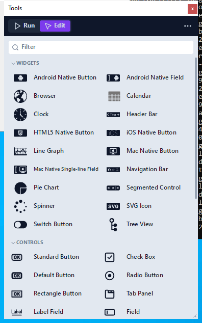</a> <a href="dark/shots/01-tools-modern-names.png">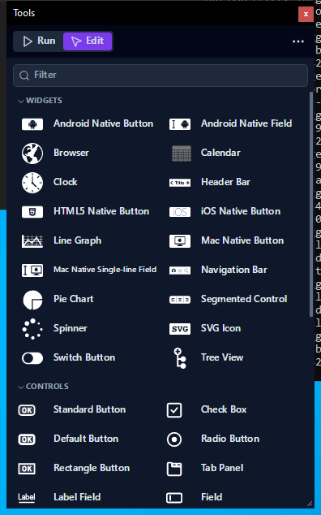</a>

### 01-tools-modern-pictures

<a href="light/shots/01-tools-modern-pictures.png">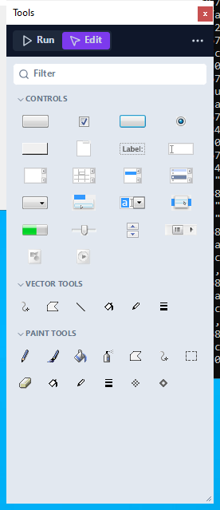</a> <a href="dark/shots/01-tools-modern-pictures.png">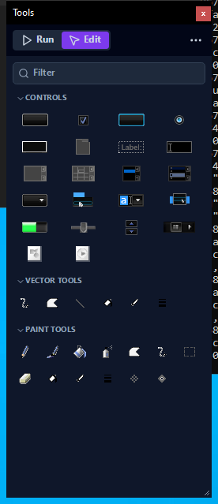</a>

### 01-tools-modern-wide

<a href="light/shots/01-tools-modern-wide.png">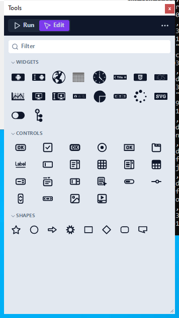</a> <a href="dark/shots/01-tools-modern-wide.png">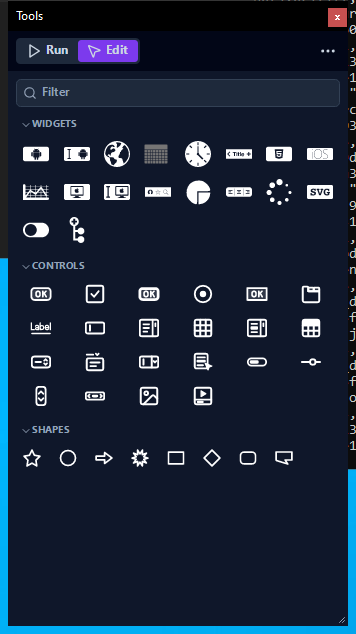</a>

### 01-tools-modern

<a href="light/shots/01-tools-modern.png">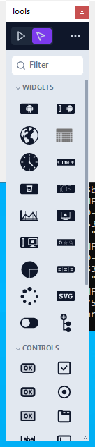</a> <a href="dark/shots/01-tools-modern.png">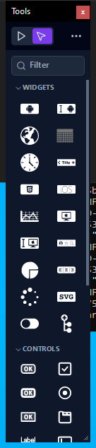</a>

### 01-tools

<a href="light/shots/01-tools.png">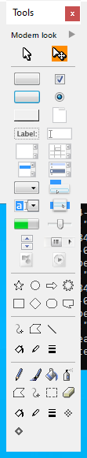</a> <a href="dark/shots/01-tools.png">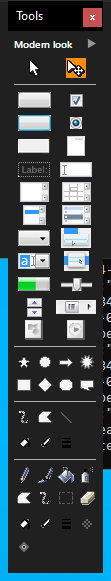</a>

### 02-hover-tools

<a href="light/shots/02-hover-tools.png">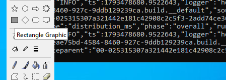</a> <a href="dark/shots/02-hover-tools.png">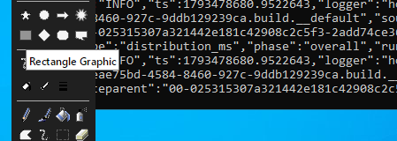</a>

### 02-tooltip-tools

<a href="light/shots/02-tooltip-tools.png">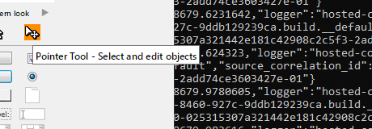</a> <a href="dark/shots/02-tooltip-tools.png">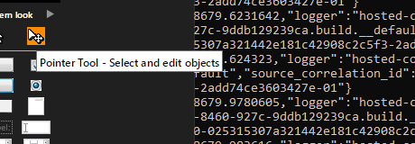</a>

### 03-menubar-classic

<a href="light/shots/03-menubar-classic.png">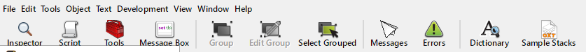</a> <a href="dark/shots/03-menubar-classic.png">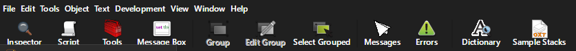</a>

### 03-menubar-modern-on

<a href="light/shots/03-menubar-modern-on.png">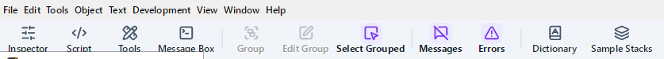</a> <a href="dark/shots/03-menubar-modern-on.png">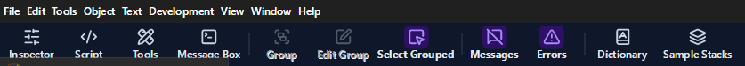</a>

### 03-menubar-modern

<a href="light/shots/03-menubar-modern.png">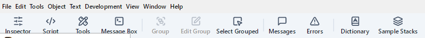</a> <a href="dark/shots/03-menubar-modern.png">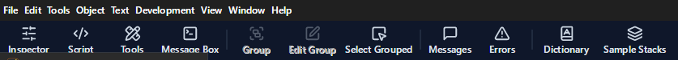</a>

### 03-menubar

 

### 04-sample-stack

<a href="light/shots/04-sample-stack.png">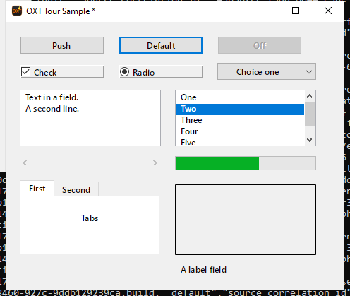</a> <a href="dark/shots/04-sample-stack.png">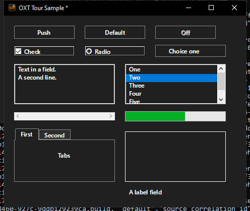</a>

### 04b-controls

<a href="light/shots/04b-controls.png">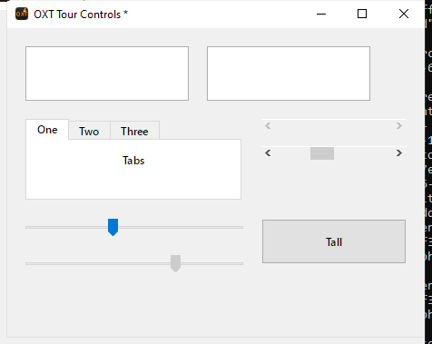</a> <a href="dark/shots/04b-controls.png">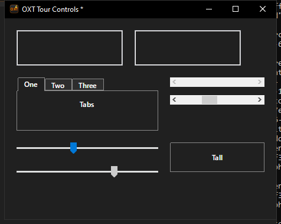</a>

### 04b-title-bar

<a href="light/shots/04b-title-bar.png">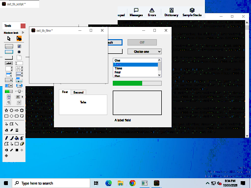</a> 

### 04c-card-border

<a href="light/shots/04c-card-border.png">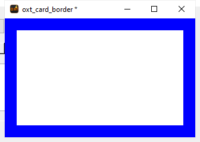</a> <a href="dark/shots/04c-card-border.png">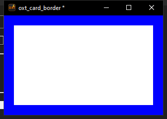</a>

### 04c-controls-window-color

 

### 04d-field-scroll

<a href="light/shots/04d-field-scroll.png">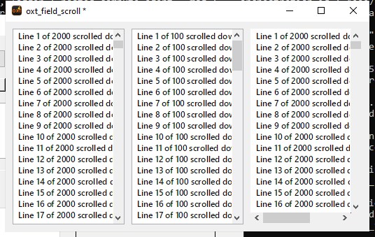</a> <a href="dark/shots/04d-field-scroll.png">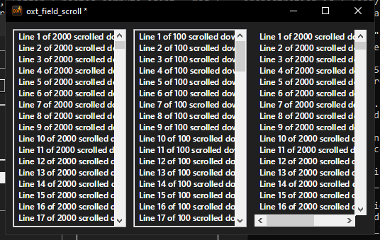</a>

### 04e-image-frames-question

<a href="light/shots/04e-image-frames-question.png">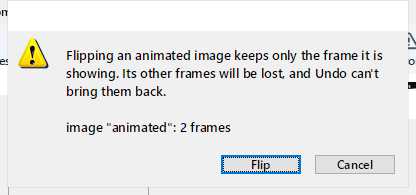</a> <a href="dark/shots/04e-image-frames-question.png">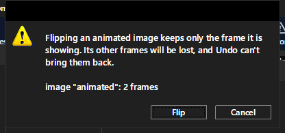</a>

### 04e-image-frames

<a href="light/shots/04e-image-frames.png">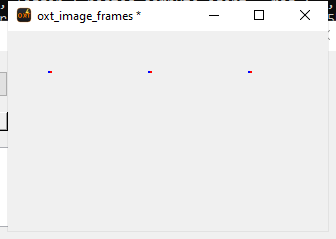</a> <a href="dark/shots/04e-image-frames.png">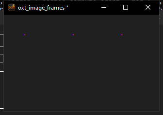</a>

### 04f-widget-appearance

<a href="light/shots/04f-widget-appearance.png">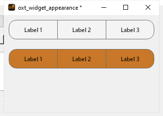</a> <a href="dark/shots/04f-widget-appearance.png">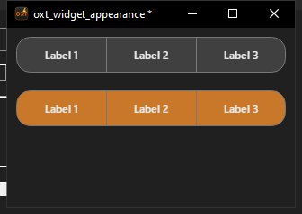</a>

### 04g-svg-paths

<a href="light/shots/04g-svg-paths.png">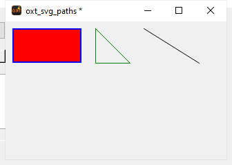</a> <a href="dark/shots/04g-svg-paths.png">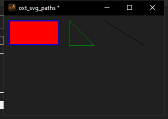</a>

### 05-inspector-button-1-basic

<a href="light/shots/05-inspector-button-1-basic.png">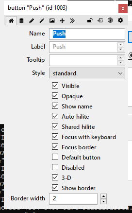</a> <a href="dark/shots/05-inspector-button-1-basic.png">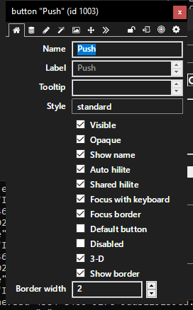</a>

### 05-inspector-button-2-icons

<a href="light/shots/05-inspector-button-2-icons.png">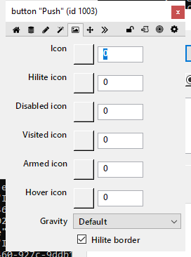</a> <a href="dark/shots/05-inspector-button-2-icons.png">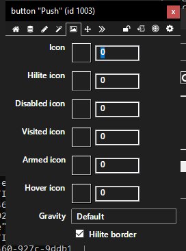</a>

### 05-inspector-button-3-colors

<a href="light/shots/05-inspector-button-3-colors.png">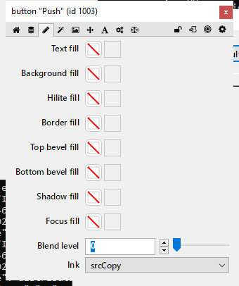</a> 

### 05-inspector-button-4-text

 

### 05-inspector-button-5-position

 

### 05-inspector-button-6-effects

 

### 05-inspector-button-7-custom

 

### 05-inspector-button-8-advanced

 

### 05-inspector-tabs

 

### 06-inspector-field-text

 

### 06b-inspector-field-scrollbar

 

### 06c-inspector-image-id

 

### 06d-inspector-button-gravity

 

### 06e-inspector-hypercard-button

 

### 07-inspector-gradient

 

### 07-inspector-graphic-colors

 

### 08-inspector-multiple-colors

 

### 09-tooltip-inspector

 

### 09b-player-inspector

 

### 10-script-editor-handlers

 

### 10-script-editor-search

 

### 10-script-editor

 

### 11-message-box

 

### 12-project-browser

 

### 13-dictionary-text

 

### 13-dictionary

 

### 13-guides

 

### 14-preferences-01-general

 

### 14-preferences-02-files-memory

 

### 14-preferences-03-appearance

 

### 14-preferences-04-ui-tweaks

 

### 14-preferences-05-extras

 

### 14-preferences-06-object-sizes

 

### 14-preferences-07-script-editor

 

### 14-preferences-08-property-profiles

 

### 14-preferences-09-app-browser

 

### 14-preferences-10-dictionary

 

### 14-preferences-11-mobile-support

 

### 14-preferences-12-project-browser

 

### 14-preferences-13-compatibility

 

### 14-preferences-14-automatic-updates

 

### 14-preferences-15-troubleshooting

 

### 14-preferences-16-debug-properties

 

### 15-standalone-01-general

 

### 15-standalone-02-stacks

 

### 15-standalone-03-os-x

 

### 15-standalone-04-unix

 

### 15-standalone-05-copy-files

 

### 15-standalone-06-windows

 

### 15-standalone-07-android

 

### 15-standalone-08-bug-reports

 

### 15-standalone-09-emscripten

 

### 15-standalone-10-inclusions

 

### 16-menu-builder

 

### 17-extension-manager-redrawn

 

### 17-extension-manager

 

### 18-extension-builder

 

### 19-message-watcher

 

### 19b-error-display

 

### 20-search

 

### 22-object-library

 

### 23-navigator

 

### 24-about-redrawn

 

### 24-about

 

### 24a-home-redrawn

 

### 24a-home-resized

 

### 24a-home

 

### 24b-release-notes-redrawn

 

### 24b-release-notes-search

 

### 24b-release-notes

 

### 24c-kit-dialog

 

### 24d-learn-redrawn

 

### 24d-learn

 

### 24e-academy-lesson

 

### 24e-academy-redrawn

 

### 24e-academy

 

### 24f-example-program

 

### 24f-example

 

### 24f-xtalk-assistant-memory

 

### 24f-xtalk-assistant-settings

 

### 24f-xtalk-assistant

 

### 24g-xtalk-chat-redrawn

 

### 24g-xtalk-chat

 

### 25-answer

 

### 26-ask

 

### 27-icon-chooser

 

### 99-screen-end

 

### zz-field-scroll-1

 

### zz-inspector-tabs-1

 
